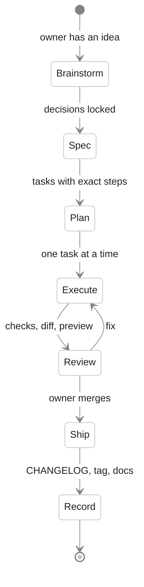

[Home](Home) › Security and development › AI-assisted development

# AI-assisted development

How this project is built. The owner works with an AI coding assistant, and the repository is organised so that every session, human or assistant, starts from the same written context and leaves a written trail: `CLAUDE.md` as the operating manual, specs and plans in `docs/superpowers/`, a curated `CHANGELOG.md`, a `ROADMAP.md`, and a journal in `docs/conversation-log.md`. The method is brainstorm, spec, plan, execute; the owner reviews and merges.

> [!NOTE]
> **At a glance:**
> - `CLAUDE.md` is loaded by the assistant at the start of every session; keep it current.
> - Specs record decisions before code; plans break them into small, checkable tasks.
> - Work is done on branches, reviewed in pull requests, and tagged on merge.
> - The essay "Built With AI, Here to Stay" (2026-07-10) tells the owner's own view of building software this way.

*Read from the top: ideas become written decisions, then small tasks, then reviewed changes, and every shipped change is recorded.*

## The four stages

| Stage | Output | Where |
|---|---|---|
| **Brainstorm** | answers to one question at a time, with options shown | session only; outcome goes in the spec |
| **Spec** | the "what and why", decisions frozen | `docs/superpowers/specs/YYYY-MM-DD-<topic>-design.md` |
| **Plan** | numbered tasks with exact files, code and verification commands | `docs/superpowers/plans/YYYY-MM-DD-<topic>.md` |
| **Execute** | commits on a branch, a pull request, review, merge | git |

Specs and plans in the repo today:

| Date | Spec | Plan |
|---|---|---|
| **2026-05-27** | website redesign | website redesign (12 tasks) |
| **2026-06-11** | Quiet Magazine redesign; image manifest | Quiet Magazine redesign (13 tasks) |
| **2026-06-13** | API spine foundation | API spine foundation |
| **2026-06-15** | blog SEO foundation; Liquid Glass | · |

## What keeps sessions honest

- **`CLAUDE.md`** describes the architecture, conventions and gotchas; when a change makes a fact stale, the same change updates it.
- **Verification before claims:** the v3.0.0 parity gate (27 of 27 pages byte-faithful), live checks after deploys (`curl` of headers, routes and redirects), and the API test suite.
- **Owner in the loop:** merges, secrets, DNS, Access and App Store settings are the owner's; the assistant prepares, the owner decides.
- **Independent checks for risky changes:** the email DNS plan (v2.2.1) and the SEO foundation (v2.2.0) were each cross-checked by separate validation passes before anything changed.

## When to just do it by hand

A typo, a one-line CSS nudge or a copy edit does not need a spec. Anything that changes structure, URLs, data, security or the release process does.

## Related pages
- [Contributing and house style](Contributing-and-House-Style): the rules each stage follows.
- [Decisions log](Decisions-Log): the outcomes of past brainstorms.
- [The May 2026 redesign](The-May-2026-Redesign): the first full run of the method.
- [Release history](Release-History): the trail it leaves.

Last checked: 2026-11-09

Sources in the repo

- `CLAUDE.md`, `docs/superpowers/README.md`, `docs/superpowers/specs/`, `docs/superpowers/plans/`
- `docs/conversation-log.md`, `CHANGELOG.md` (v2.2.0, v2.2.1, v3.0.0)

