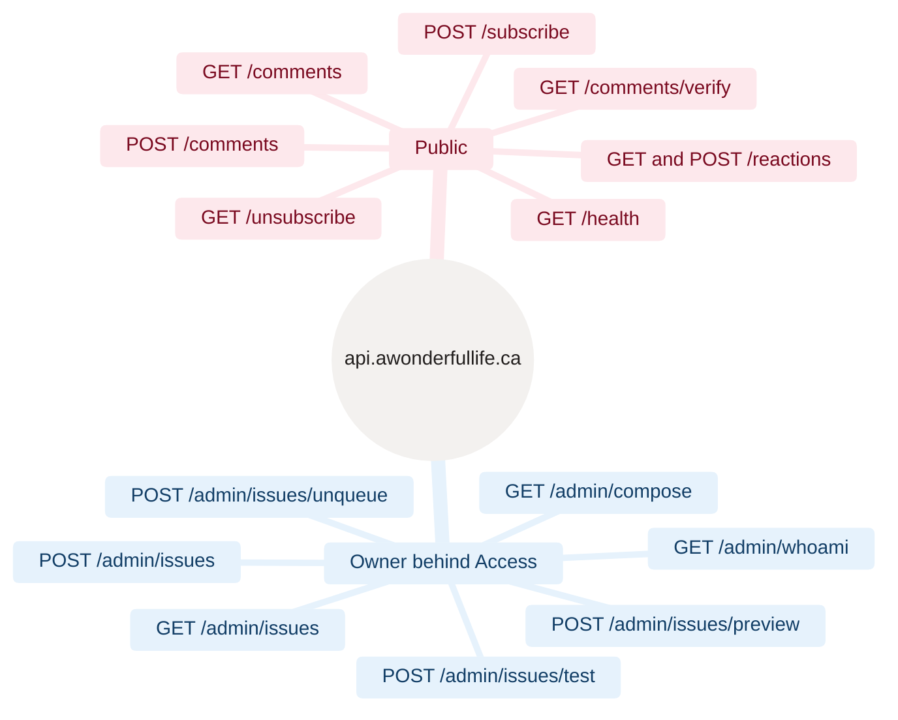

<sub>[Home](Home) › Security and development › API reference</sub>

# API reference

Every route on `https://api.awonderfullife.ca`, served by the `awonderfullife-api` Worker (`api/src/index.ts`). Public routes are called cross-origin by the blog's own scripts; `/admin` routes are for the owner and sit behind Cloudflare Access. Responses are JSON (`application/json; charset=utf-8`) unless noted. Anything not listed returns 404 `{"error":"not_found"}`.

> [!NOTE]
> **At a glance:**
> - 15 route and method pairs: 8 public, 7 owner-only, plus `OPTIONS` preflights for the CORS routes.
> - CORS allows only `https://awonderfullife.ca` and `https://www.awonderfullife.ca`.
> - `/admin/*` needs a valid `Cf-Access-Jwt-Assertion` header, checked in code even behind Access.
> - The Worker is not reachable on `workers.dev` (`workers_dev: false`).


*Read outward: two families of routes; everything under Owner needs a Cloudflare Access sign-in.*

## Public routes

| Method and path | Body or query | Success | Errors |
|---|---|---|---|
| **`GET /health`** | · | `{"status":"ok","time":"<ISO>"}` | · |
| **`POST /subscribe`** | JSON `{email, token, source?}` or form `email`, `cf-turnstile-response` | `{"status":"ok"}` | 400 `invalid_email`, 403 `turnstile_failed` |
| **`OPTIONS /subscribe`** | · | 204 with CORS headers | · |
| **`GET /unsubscribe`** | `?token=<unsub_token>` | 200 HTML "You've been unsubscribed." (always, whether or not the token existed) | · |
| **`GET /comments`** | `?slug=` | `{"comments":[{id, name, body, removed, created_at}]}` | invalid slug gives an empty list |
| **`POST /comments`** | JSON `{slug, name, body, email?, token}` | `{"status":"posted"}` with a session, else `{"status":"verification_sent"}` | 400 `bad_request`, `invalid`, `invalid_email`; 403 `turnstile_failed`; 503 `email_unavailable` |
| **`GET /comments/verify`** | `?token=` | 302 to `/posts/<slug>#comments`, sets `awl_c` if `COMMENT_SECRET` is set | 400 plain text "invalid or has expired" |
| **`GET /reactions`** | `?slug=` | `{"count":N}` | invalid slug gives `{"count":0}` |
| **`POST /reactions`** | JSON `{slug}` | `{"count":N}` or `{"count":N,"throttled":true}` | 400 `bad_request`, `invalid`; 503 `reactions_unavailable` |

`/comments` and `/reactions` also answer `OPTIONS` with 204. Removed comments come back with `name: null`, the tombstone text as `body` and `removed: true`.

## Owner routes

All require Cloudflare Access at the edge and pass `getAccessEmail`, which verifies the JWT against `https://<team>/cdn-cgi/access/certs` with the configured audience. Failure returns 403 `{"error":"forbidden"}`.

| Method and path | Body | Success | Errors |
|---|---|---|---|
| **`GET /admin/whoami`** | · | `{"email":"<signed-in>","db":"ok"}` (`db: error` if D1 fails) | 403 |
| **`GET /admin/compose`** | · | the compose page HTML | 403 |
| **`GET /admin/issues`** | · | `{"issues":[{id, status, subject, scheduled_at, sent_at, sent_count}]}`, latest 50 | 403 |
| **`POST /admin/issues`** | `{subject, preheader?, markdown, scheduleMode: "default" or "custom", at?}` | `{"status":"queued","id":N,"scheduled_at":"<ISO>"}` | 400 missing fields, bad or past time |
| **`POST /admin/issues/preview`** | same as above | HTML of the rendered email | 400 |
| **`POST /admin/issues/test`** | same as above | `{"status":"sent" or "failed","to":"<signed-in>"}` | 400; 503 if no Resend key |
| **`POST /admin/issues/unqueue`** | `{id}` | `{"removed":0 or 1}` | 400 invalid id |

`at` is a `datetime-local` string (`YYYY-MM-DDTHH:MM`) read as Eastern time.

## Scheduled handler

Not an HTTP route. On every cron tick (`*/15 * * * *`) the Worker runs, in order, `runScheduledSend`, `runCommentModeration` and `purgeReactionEvents`, then logs one line: `[scheduled] cron=... send=... moderation=... reactions_purge=...`.

## Calling it by hand

```bash
curl -s https://api.awonderfullife.ca/health
curl -s "https://api.awonderfullife.ca/reactions?slug=built-with-ai-here-to-stay"
curl -s "https://api.awonderfullife.ca/comments?slug=built-with-ai-here-to-stay"
```

> [!CAUTION]
> Do not script `POST` calls against production for testing: subscriptions and comments are real rows, and Turnstile will reject them anyway. Use `npm run dev` and the test suite instead (see [Local development](Local-Development)).

## Related pages
- [Comments and reactions](Comments-and-Reactions): the flows behind these routes.
- [Newsletter pipeline](Newsletter-Pipeline): the subscribe and admin routes in use.
- [Security and privacy](Security-and-Privacy): Access, CORS and Turnstile.
- [Data model](Data-Model): what each route reads and writes.
- [Testing and quality](Testing-and-Quality): the tests for every route.

Last checked: 2026-11-09

<details><summary>Sources in the repo</summary>

- `api/src/index.ts`, `api/src/admin.ts`, `api/src/comments.ts`, `api/src/reactions.ts`, `api/src/access.ts`, `api/src/turnstile.ts`
- `api/wrangler.jsonc`, `api/test/*.test.ts`
</details>
