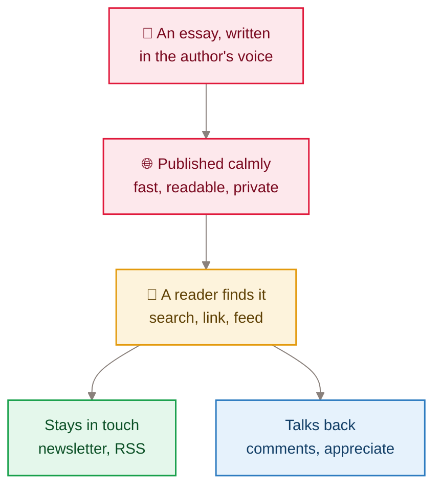

[Home](Home) › Business and product › About the blog

# About the blog: product and mission

A Wonderful Life is a personal essay blog. Vijay Panangipally writes, in his own voice, about technology and AI, the politics shaping Canada and the United States, travel, and the quiet questions of integrity and endurance. The tagline, *Data, life, and the space between*, describes the vantage point: someone who works with data by day applying the same habit of looking closely to the rest of life. The product is the writing. Everything in this repository exists to present that writing calmly, keep it fast and private, and let readers who want more stay in touch.

> [!NOTE]
> **At a glance:**
> - One author, one voice, eighteen essays (2024-03-14 to 2026-07-16) across five categories.
> - The site is owned end to end: no CMS, no third-party newsletter, no comment platform, no analytics script.
> - The same domain also hosts the public support and privacy pages for the owner's iOS app, Namaz.
> - The repository is public, so secrets live only in Cloudflare and never in git.

## What the blog is for

*Read top to bottom: the essay is the product; the site's only jobs are to present it well and give readers a quiet way to stay and respond.*

## The voice

The About page sets the register: warm, first person, plain. It describes business intelligence by day, the urge to turn messy data into stories people can use, technology and travel and the world, politics "not by design but by necessity", and a black iced coffee within reach. The July 2026 rewrite (v3.5.5) removed heavy bold and em dashes so the page follows the same editorial rules as the essays. See [Content and editorial](Content-and-Editorial) for the full style.

## What kinds of essays

| Category | Posts | What it covers |
|---|---|---|
| **Reflection** | 3 | endurance, integrity, lives well lived |
| **Society** | 3 | data and truth, education, partition and unity |
| **Politics** | 5 | elections, leadership, the Canada and U.S. relationship |
| **Technology** | 4 | Apple Intelligence, Siri, building software with AI |
| **Travel** | 3 | winter in Toronto, an electric road trip, borders crossed |

The full list is in the [Post catalogue](Post-Catalog); the taxonomy is explained in [The five categories](The-Five-Categories).

## What the blog is not

- **Not a content-marketing surface.** Titles and descriptions are tuned so a real reader can find an essay (v3.5.1, v3.5.3), but the essays themselves are never rewritten for clicks.
- **Not a multi-author publication.** One author, one editor.
- **Not a CMS site.** Each post is one Markdown file in git; see [Adding a post](Adding-a-Post).
- **Not a tracking site.** There is no analytics script on any page. Traffic numbers come only from Cloudflare's own zone analytics, read by `docs/superpowers/tools/cf-analytics.sh`.

## Ownership as a principle

Between June and July 2026 the blog moved every reader-facing service in house, onto a second Worker the owner controls:

| Concern | Before | Now |
|---|---|---|
| **Newsletter list** | Buttondown embed | D1 `subscribers` table, Turnstile-gated (v2.8.0) |
| **Sending issues** | Buttondown | Resend, from a compose page behind Cloudflare Access (v2.9.0 to v2.12.0) |
| **Comments** | none | D1, email-verified, auto-moderated (v2.16.0) |
| **Reactions** | none | zero-PII appreciate counter (v3.4.0) |
| **Search** | none | Pagefind index built with the site, no server (v3.2.0) |

The reasoning is in the [Decisions log](Decisions-Log).

## The other face: app support

The domain is becoming the owner's personal platform. In July 2026 it gained `/namaz/` and `/namaz/privacy/`, the App Store support URL and privacy policy for **Namaz**, an iOS prayer-times and Qibla app that collects nothing. See [Namaz app support pages](Namaz-App-Support). The About page also links to Track Your App, the owner's Canadian immigration tracker, which has its own repository.

## Related pages
- [Features catalogue](Features-Catalogue): everything the site does, feature by feature.
- [Readers and journeys](Readers-and-Journeys): how people actually use it.
- [Content and editorial](Content-and-Editorial): the house style.
- [Decisions log](Decisions-Log): why the blog owns its own services.
- [Roadmap](Roadmap): where it is heading.

Last checked: 2026-11-09

Sources in the repo

- `src/content/about.njk`, `src/_data/site.json`
- `CHANGELOG.md` (v2.8.0, v2.16.0, v3.2.0, v3.4.0, v3.5.5)
- `src/content/posts/*.md` (front matter `category`, `date`)

