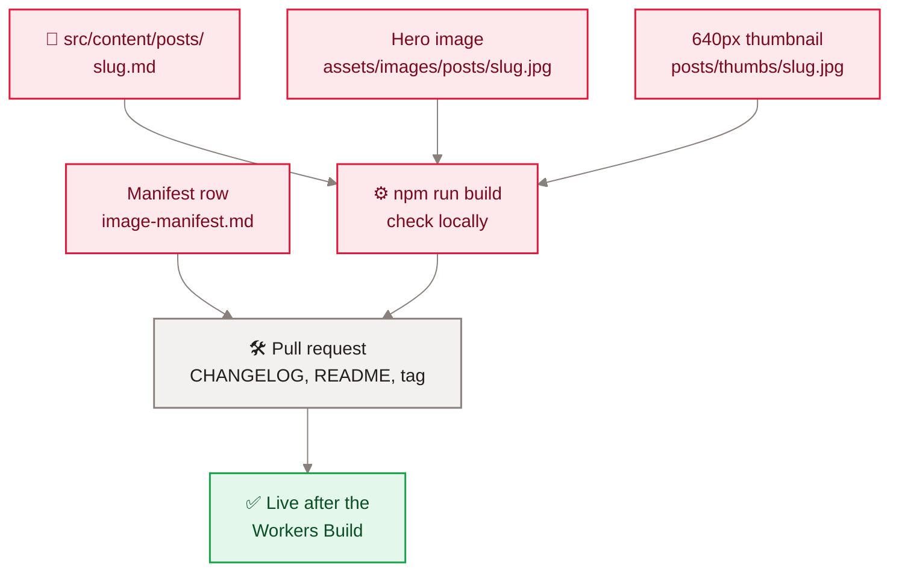

<sub>[Home](Home) › Business and product › Adding a post</sub>

# Adding a post

Since the Eleventy move in v3.0.0, a new essay is one Markdown file. The home page card or featured opener, the archive row, the category page, prev and next links on both neighbours, related posts, the RSS feed, the sitemap, the search index and every SEO tag are generated from that file. This page is the step-by-step, plus the two small extras (hero image and thumbnail) that still need hands.

> [!NOTE]
> **At a glance:**
> - Create `src/content/posts/<slug>.md`, add a hero at `assets/images/posts/<slug>.jpg` and a 640px thumbnail in `thumbs/`, then build.
> - Never set `guid` on a new post; never rename an existing slug.
> - Merging to `main` deploys it; the newest post becomes the featured opener automatically.
> - Add a CHANGELOG entry, a README row and a tag, as for any release.


*Read top to bottom: three files go in, one build checks them, one merge publishes them.*

## Step by step

### 1. Pick a slug

Lowercase words joined by hyphens, a-z, 0-9 and `-` only (the API rejects anything else: `^[a-z0-9-]{1,120}$`, so comments and appreciations would silently not work). The slug becomes `/posts/<slug>` forever.

### 2. Write the file

```markdown
---
title: "Hook: The Phrase a Reader Would Search"
date: 2026-11-09
category: technology
description: "One complete first-person sentence, about 140 characters."
excerpt: "The card teaser, first person."
heroAlt: "What the hero image shows, described plainly."
dek: "Optional italic sub-headline."
---

The essay, in Markdown or HTML.
```

| Field | Required | Notes |
|---|---|---|
| **`title`** | ✅ | `<h1>`, `<title>`, cards, feed, JSON-LD |
| **`date`** | ✅ | `YYYY-MM-DD`; sort order, byline, archive year, feed, sitemap |
| **`category`** | ✅ | one of `reflection`, `society`, `politics`, `technology`, `travel` |
| **`description`** | ✅ | meta, Open Graph, Twitter, JSON-LD |
| **`excerpt`** | ✅ | cards and featured opener |
| **`heroAlt`** | ✅ | hero and social image alt text |
| **`dek`** | No | italic sub-headline |
| **`minRead`** | No | pins the reading time; otherwise words divided by 200 |
| **`updated`** | No | `YYYY-MM-DD` after a meaningful edit; feeds `dateModified` |
| **`heroTitled`** | No | `true` only when the cover image carries the title |
| **`listTitle`** | No | a shorter title for cards and prev/next |
| **`guid`** | No | never for new posts; only legacy posts freeze one |

`excerptHome` appears in old notes but no template reads it.

### 3. Add the hero and thumbnail

- Hero: `assets/images/posts/<slug>.jpg`, 3:2, 1536 x 1024 like the rest of the series, progressive JPEG, roughly 150 to 400 KB.
- Thumbnail: `assets/images/posts/thumbs/<slug>.jpg`, 640px wide. The home card grid offers it in `srcset` (`640w`), so a missing thumbnail becomes a broken card image once the post is no longer the featured one.
- Add a row to `docs/superpowers/specs/2026-06-11-image-manifest.md`.

> [!WARNING]
> On 2026-11-09 the newest post, `the-wait-was-worth-it-ios-27-siri-ai`, has no thumbnail. It is the featured opener today, which uses the full image, so nothing is broken yet. Add `thumbs/the-wait-was-worth-it-ios-27-siri-ai.jpg` before or with the next post. See [Runbooks](Runbooks).

See [Hero photography](Hero-Photography) for how covers are made.

### 4. Build and look

```bash
npm ci
npm run build      # Eleventy into _site/, then Pagefind indexes it
npm run serve      # live-reload dev server (search needs a full build first)
```

Check the home page (the new post should be the featured opener), the post page, its category page and `/archive` search.

### 5. Ship it

Open a pull request to `main`. In the same change, following the release rules in `CLAUDE.md`:

- add a `CHANGELOG.md` entry headed with the version, a title and the UTC merge time, copying the format of the entries already there (a new post is a patch release);
- add a row to the README release table;
- after merge, tag the merge commit: `git tag -a vX.Y.Z -m "..." && git push origin vX.Y.Z`.

Merging triggers the site's Workers Build. See [Deployment and release](Deployment).

## Editing an existing post

Edit its one file and build. Neighbours, cards and feed update themselves. Set `updated:` if the change is meaningful, so search engines see a real freshness date. Do not change the slug or the `guid`.

## Related pages
- [Content and editorial](Content-and-Editorial): the writing rules.
- [Hero photography](Hero-Photography): the cover image.
- [Build pipeline](Build-Pipeline): what the build does with the file.
- [Data model](Data-Model): every front matter field in detail.
- [Deployment and release](Deployment): merge, build, tag.

Last checked: 2026-11-09

<details><summary>Sources in the repo</summary>

- `CLAUDE.md` (Adding or modifying a post)
- `src/content/posts/posts.11tydata.js`, `src/_layouts/post.njk`, `src/_includes/card-grid.njk`
- `api/src/comments.ts`, `api/src/reactions.ts` (`SLUG_RE`)
- `assets/images/posts/`, `assets/images/posts/thumbs/`
</details>
