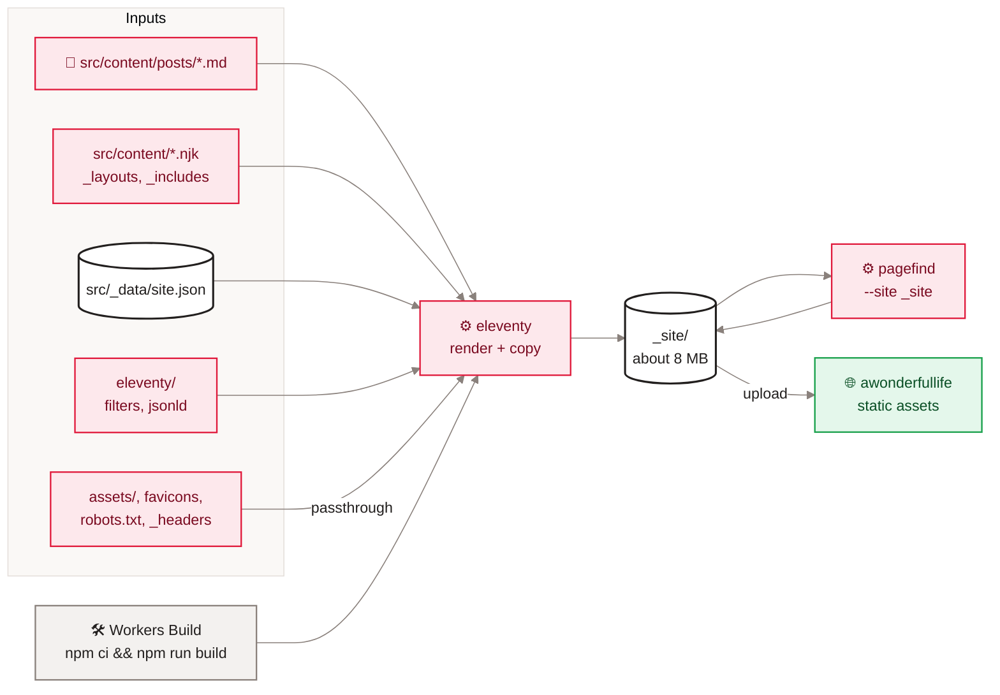

<sub>[Home](Home) › Architecture › Build pipeline</sub>

# Build pipeline

How Markdown and templates become the files a reader downloads. `npm run build` runs two steps: **Eleventy** renders `src/` into `_site/` and copies static files across, then **Pagefind** indexes the post pages in `_site/` and writes its search bundle into `_site/pagefind/`. Cloudflare's Workers Build runs exactly this command on every push to `main`, then uploads `_site/` as the site Worker's static assets. A full build takes well under a second of Eleventy time (about 0.2 s for 30 files locally).

> [!NOTE]
> **At a glance:**
> - Inputs: `src/` (templates, Markdown, data), `eleventy/` (filters, JSON-LD), `assets/` and five root files.
> - Output: `_site/` with 26 HTML pages, `feed.xml`, `sitemap.xml`, assets and the Pagefind bundle (about 8 MB).
> - Only `_site/` is deployed, so repo internals can never be served.
> - The site has no runtime code: everything dynamic about a page is decided here, at build time.

## From inputs to the live site


*Read left to right: five kinds of input feed Eleventy, Pagefind adds the search index to the same folder, and the Workers Build uploads that folder as the site.*

## Step 1: Eleventy

`eleventy.config.js` sets:

| Setting | Value | Effect |
|---|---|---|
| **Directories** | input `src`, output `_site`, includes `_includes`, layouts `_layouts`, data `_data` | where Eleventy looks |
| **Template formats** | `njk`, `md`; Markdown and HTML pre-processed with Nunjucks | Nunjucks works inside Markdown |
| **Markdown** | markdown-it, `html: true`, `typographer: false` | raw HTML allowed, quotes untouched |
| **Passthrough** | `favicon.ico`, `favicon.svg`, `apple-touch-icon.png`, `robots.txt`, `_headers`; `assets/**` except `staging-images/` | copied byte for byte |
| **Filters** | 15 filters from `eleventy/filters.mjs` | dates, URLs, reading time, grouping, neighbours, related posts, image sizes |
| **Global** | `jsonLdGraph(site, ctx)` from `eleventy/jsonld.mjs` | the JSON-LD block in every head |
| **Collection** | `posts`: every `src/content/posts/*.md`, newest first, one documented same-day tie-break | drives home, archive, categories, feed, sitemap, nav |

What each template writes:

| Template | Output files | Built from |
|---|---|---|
| **`posts/*.md`** (18) | `posts/<slug>.html` | `post.njk` inside `base.njk` |
| **`index.njk`** | `index.html` | `collections.posts[0]` featured, the rest as cards |
| **`archive.njk`** | `archive.html` | posts grouped `byYear`, facets, search mount |
| **`categories.njk`** | `categories/<slug>.html` (5) | pagination over `site.categories` |
| **`about.njk`** | `about.html` | static content |
| **`namaz.md`, `namaz-privacy.md`** | `namaz/index.html`, `namaz/privacy/index.html` | `base.njk` |
| **`feed.njk`** | `feed.xml` | RSS 2.0, `en-ca`, every post |
| **`sitemap.njk`** | `sitemap.xml` | home, about, archive, 5 categories, 18 posts |

## Step 2: Pagefind

`pagefind --site _site` (version 1.5.2) scans the built HTML. Only elements marked `data-pagefind-body` are indexed, and only `post.njk` has that mark, so the index holds the 18 essays and nothing else (no navigation, category lists or Namaz pages). Each post also gives Pagefind its title, date and category as metadata. The bundle lands in `_site/pagefind/`, and only the archive page (`search: true`) loads `pagefind-ui.js` and its CSS.

## Step 3: upload and serve

The site Worker's `wrangler.jsonc` has no `main` script, only:

```jsonc
"assets": {
  "directory": "./_site",
  "html_handling": "auto-trailing-slash"
}
```

`html_handling` gives clean URLs: `/posts/<slug>` serves `posts/<slug>.html`, a request for the `.html` form is redirected to the clean one, and `/namaz` redirects to `/namaz/`. `_headers` inside `_site/` sets cache and security headers (see [Security and privacy](Security-and-Privacy)).

> [!IMPORTANT]
> The Workers Build command for the site must stay `npm ci && npm run build` with the asset directory `./_site`. The v3.0.0 cut-over required this to be set in the Cloudflare dashboard **before** merging; if the build command is ever cleared, a deploy would publish an empty or stale folder. See [Runbooks](Runbooks).

## What the build guarantees

- **One source of truth per fact.** A post's title appears in about ten places (head, cards, nav, feed, JSON-LD); all come from one front-matter field.
- **Nothing private is served.** Before v3.0.0 the asset folder was the repo root and needed `.assetsignore` (after `.git/` was briefly public on 2026-05-27); now the asset folder only ever contains build output.
- **Parity with the old site.** The v3.0.0 move was gated by a one-time parity script that compared 27 generated pages with the hand-built ones and passed 27 of 27, fixing five latent bugs on the way (see [Release history](Release-History)).

## Related pages
- [Page lifecycle](Page-Lifecycle): what happens to these files when someone visits.
- [Deployment and release](Deployment): the Workers Build in context.
- [Data model](Data-Model): the front matter and `site.json` the build reads.
- [SEO and discoverability](SEO-and-Discoverability): the head tags the build writes.
- [Local development](Local-Development): running the build yourself.

Last checked: 2026-11-09

<details><summary>Sources in the repo</summary>

- `eleventy.config.js`, `package.json`, `wrangler.jsonc`, `_headers`
- `src/content/*`, `src/_layouts/*`, `eleventy/filters.mjs`, `eleventy/jsonld.mjs`
- `CHANGELOG.md` (v3.0.0, v3.2.0), `CLAUDE.md`
</details>
