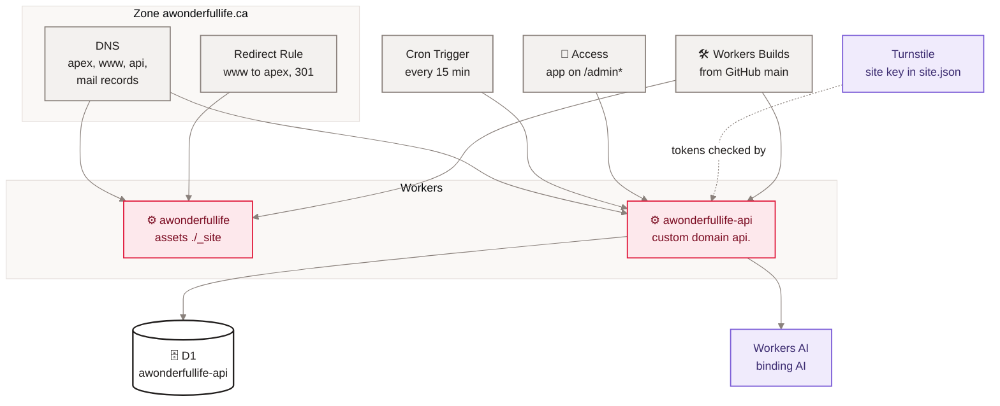

[Home](Home) › Operations › Cloudflare

# Cloudflare

Everything that runs in production runs on Cloudflare. This page lists every Cloudflare product the project uses, how each is configured (from the repo where possible, from the dashboard where not), and what would break without it. The zone `awonderfullife.ca` is on Cloudflare DNS; there is no other host.

> [!NOTE]
> **At a glance:**
> - Two Workers: `awonderfullife` (static assets from `_site/`) and `awonderfullife-api` (code, D1, Workers AI, cron).
> - Two Workers Builds connected to GitHub `main`, one per Worker.
> - One cron trigger: `*/15 * * * *` on the API Worker. No KV, no Durable Objects, no Queues, no R2.
> - Dashboard-only settings: the build commands, the `www` Redirect Rule, Access, Turnstile widget, secrets, DNS.

*Read top to bottom: the zone routes traffic to two Workers; the API Worker uses D1, AI, the cron, Access and Turnstile; Workers Builds deploys both.*

## Products in use

| Product | Configured in | Settings | Without it |
|---|---|---|---|
| **Workers Static Assets** | `wrangler.jsonc` | `assets.directory ./_site`, `html_handling auto-trailing-slash`, `nodejs_compat`, observability on | no website |
| **Workers (code)** | `api/wrangler.jsonc` | `main src/index.ts`, `workers_dev false`, custom domain `api.awonderfullife.ca`, observability on | no newsletter, comments, appreciations |
| **Workers Builds** | dashboard | site: `npm ci && npm run build` at the root; API: root `api`, `npm ci`, deploy `npx wrangler deploy`, watch path `api/*`, production branch only | no automatic deploys |
| **D1** | `api/wrangler.jsonc` | binding `DB`, database `awonderfullife-api` | API routes fail |
| **Cron Triggers** | `api/wrangler.jsonc` | `*/15 * * * *` | no scheduled sends, moderation or purge |
| **Workers AI** | `api/wrangler.jsonc` | binding `AI`; also called by `gen-hero.sh` from the owner's laptop | moderation falls back to heuristics |
| **Access** | dashboard (Zero Trust) | application on `api.awonderfullife.ca/admin*`, policy for the owner | admin routes return 403 (the in-code check still holds) |
| **Turnstile** | dashboard; public site key in `site.json` and `comments.js` | secret as `TURNSTILE_SECRET` | sign-ups and comments rejected |
| **Redirect Rules** | dashboard | "Redirect from WWW to root": `www.awonderfullife.ca/*` to `https://awonderfullife.ca/${1}`, 301, keeps query | `www` serves a duplicate site |
| **DNS** | dashboard | Worker routes; iCloud MX, SPF, DKIM, DMARC; Resend records on `send.` | mail and routing break |
| **Analytics** | dashboard; `cf-analytics.sh` reads it | zone analytics (free plan keeps about 30 days) | no traffic numbers |

## Cron details

The API Worker has one trigger, every 15 minutes. Each tick runs three jobs in sequence and logs one summary line:

| Job | Does | Limit |
|---|---|---|
| **`runScheduledSend`** | sends issues whose `scheduled_at` has passed | all due issues; 100 recipients per Resend call |
| **`runCommentModeration`** | checks new visible comments | 50 per tick |
| **`purgeReactionEvents`** | deletes throttle rows not from today (UTC) | all |

> [!WARNING]
> Cloudflare's cron day-of-week runs 1 (Sunday) to 7 (Saturday), not 0 to 6. A trigger like `0 23 * * 6` means Friday, and `0` is rejected. Use `SAT` and `SUN` names (see v2.10.1).

## Compatibility dates

The site Worker uses `2026-05-27` with `nodejs_compat`; the API Worker uses `2026-06-13`. Change them deliberately, and run the API tests after a change.

## Related pages
- [Deployment and release](Deployment): the Workers Builds in the release process.
- [Secrets and configuration](Secrets-and-Configuration): what is set in the dashboard.
- [Monitoring and incidents](Monitoring-and-Incidents): observability and logs.
- [Site architecture](Site-Architecture): how these products fit together.
- [Runbooks](Runbooks): dashboard tasks step by step.

Last checked: 2026-11-09

Sources in the repo

- `wrangler.jsonc`, `api/wrangler.jsonc`, `api/src/index.ts`, `api/src/scheduled.ts`
- `src/_data/site.json`, `assets/js/comments.js`
- `ROADMAP.md` (www redirect, Workers Build for `/api`), `CLAUDE.md`, `docs/superpowers/tools/cf-analytics.sh`

