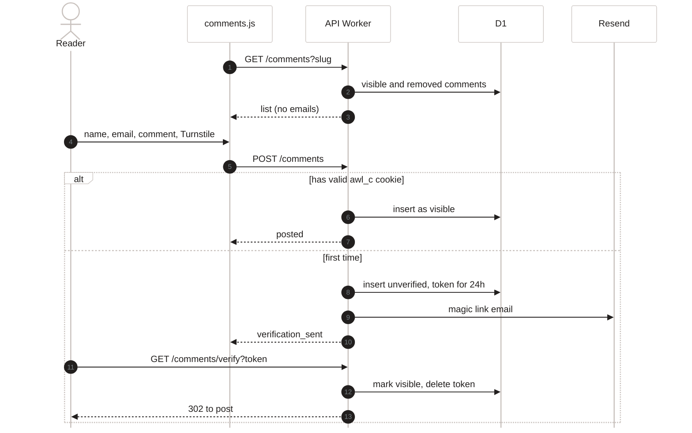
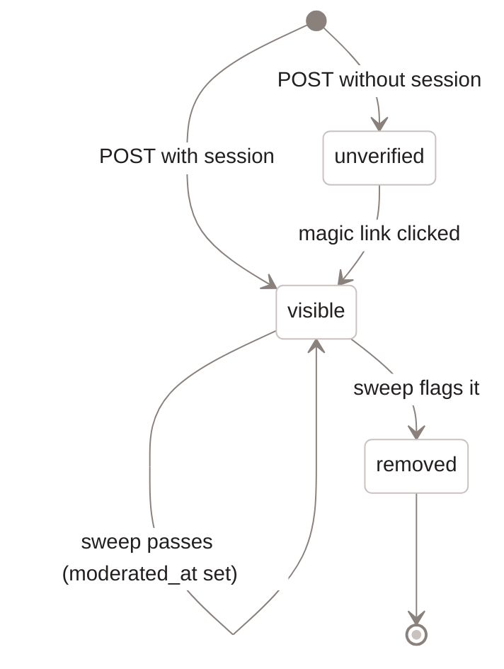
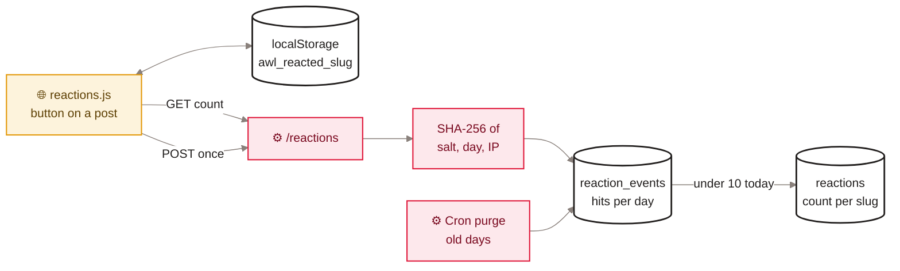

[Home](Home) › Data › Comments and reactions

# Comments and reactions

The two ways a reader can respond on a post, both served by the API Worker and both designed to keep as little about the reader as possible. **Comments** (v2.16.0) publish as soon as the author confirms their email once; a cron sweep then checks them and replaces anything abusive with a visible tombstone. **Appreciations** (v3.4.0) are a single button with a public count, no account and no stored IP address.

> [!NOTE]
> **At a glance:**
> - Comments: name and comment shown; email used only to verify, never shown or returned.
> - A confirmed browser gets a 30-day signed cookie (`awl_c`), so later comments skip the email.
> - Moderation every 15 minutes: heuristics, then Workers AI; failures become tombstones.
> - Appreciations: one per browser by `localStorage`, enforced server-side by a 10 per day cap on a salted IP hash.

## Comments: the full flow

*Read top to bottom: the list loads first; a new commenter confirms once by email, a returning one posts straight away.*

## Comment states

*Read from the top: unverified comments are never shown; removed ones stay as tombstones with no name or body.*

| Detail | Value |
|---|---|
| **Session cookie** | `awl_c`, HS256 JWT with the email, signed with `COMMENT_SECRET`, `Domain=awonderfullife.ca; Secure; HttpOnly; SameSite=None`, 30 days |
| **Without `COMMENT_SECRET`** | no cookie is set; every comment needs its own email confirmation |
| **Without `RESEND_API_KEY`** | first-time comments fail with 503 `email_unavailable` |
| **Tombstone text** | "This comment was removed because it failed our moderation checks." |
| **List limit** | 500 comments per post, oldest first |
| **Widget safety** | `assets/js/comments.js` builds every element with `textContent`, never `innerHTML` |
| **CORS** | only the apex and `www` origins, with credentials |

## Reactions: the appreciate button

*Read left to right: the browser remembers that it appreciated; the server keeps only an opaque daily hash to cap abuse and a public count per post.*

- `GET /reactions?slug=` returns `{count}` (0 for unknown or invalid slugs). Reads never need the salt.
- `POST /reactions` with `{slug}` returns the new count, or the current count plus `throttled: true` at the daily cap, with no error shown.
- Without `REACTION_SALT`, `POST` returns 503 `reactions_unavailable` and logs a warning; nothing is stored.
- The widget only shows a count that came from the server; `localStorage` just remembers the filled state.

> [!CAUTION]
> Never log or store `CF-Connecting-IP` in these tables. The throttle works only because the hash is salted and the day is part of it; storing raw IPs would break the zero-PII promise the feature was built on.

## Related pages
- [Data quality and processing](Data-Quality-and-Processing): the moderation and throttle rules.
- [API reference](API-Reference): request and response shapes.
- [Data model](Data-Model): the four tables involved.
- [Security and privacy](Security-and-Privacy): cookies, CORS and personal data.
- [Readers and journeys](Readers-and-Journeys): the commenter's experience.

Last checked: 2026-11-09

Sources in the repo

- `api/src/comments.ts`, `api/src/reactions.ts`, `api/src/scheduled.ts` (`purgeReactionEvents`)
- `assets/js/comments.js`, `assets/js/reactions.js`, `src/_layouts/post.njk`
- `api/migrations/0004_create_comments.sql`, `api/migrations/0005_reactions.sql`
- `CHANGELOG.md` (v2.16.0 to v2.16.2, v3.4.0)

