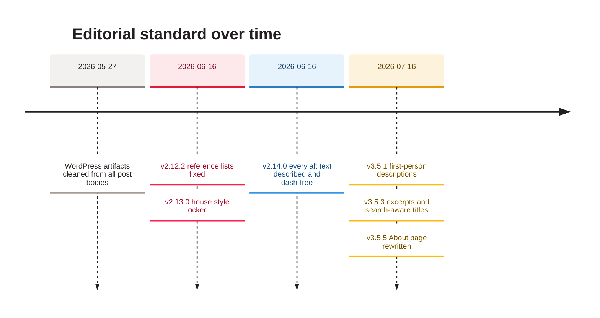

[Home](Home) › Business and product › Content and editorial

# Content and editorial

The house style every essay on awonderfullife.ca follows, locked in v2.13.0 (2026-06-16) and applied to every post since. It is modelled on a quiet, newspaper-like reading experience: plain prose, little emphasis, Canadian spelling, references set apart, and endings that close in the author's own voice. This page also covers the metadata each post needs, because titles, excerpts and descriptions are editorial work too.

> [!NOTE]
> **At a glance:**
> - Body text is 17px, line height 1.7, left aligned, in Manrope.
> - No em dashes in prose; bold and italic only for reference labels, list lead-ins and titles of works.
> - Canadian English (`honour`, `travelled`, `centre`) with `-ize` kept; proper nouns and URLs never changed.
> - No calls to action at the end of an essay; references go in a `post-references` section.

## The rules

| Rule | Do | Do not |
|---|---|---|
| **Typography** | 17px, line height 1.7, left aligned | justify (tried in v2.6.2, reverted in v2.13.0) |
| **Emphasis** | `<strong>`/`<em>` for source labels, definition lead-ins, titles of works, foreign terms | bold whole phrases or sentences ("emphasis spam") |
| **Dashes** | commas, colons, full stops, parentheses, a conjunction | em dashes in prose (an em dash inside a quoted real headline may stay) |
| **Spelling** | `honour`, `neighbour`, `defence`, `travelled`, `labour`, `centre`, `kilometre`; keep `-ize` | Canadianize proper nouns (Bureau of Labor Statistics), URLs or code |
| **Endings** | close reflectively in the author's plain voice | "join the conversation", "share in the comments" |
| **References** | `<section class="post-references">` with an `<h3>` and a list of `<strong>Source</strong>` and a link | a loose "Sources" paragraph |
| **Quotes** | literal curly quotes and ellipses as written | rely on a typographer to smarten text (it is off) |

> [!IMPORTANT]
> Markdown is rendered by markdown-it with HTML passthrough on and the typographer off (`eleventy.config.js`). What you type is what appears: straight quotes stay straight, curly quotes stay curly. Raw HTML in a post body is allowed and common in the legacy posts.

## The metadata that is editorial too

| Field | Purpose | Style |
|---|---|---|
| **`title`** | the `<h1>`, the browser title, cards, feed, structured data | an evocative hook, then a subtitle carrying the phrase a reader would search (v3.5.3) |
| **`description`** | meta description, Open Graph, Twitter, JSON-LD | one complete first-person sentence, about 134 to 148 characters (v3.5.1) |
| **`excerpt`** | the teaser on home and category cards and the featured opener | first person, sounds like the author talking (v3.5.3) |
| **`heroAlt`** | alt text for the hero and the social image | describe what the image shows, never restate the title, no em dashes |
| **`dek`** | optional italic sub-headline under the title | one sentence |

> [!CAUTION]
> Never change a post's slug (its file name). The slug is the public URL and the feed GUID; changing it breaks every inbound link and makes RSS readers see a "new" post. Titles can change freely.

## Voice

The voice is warm, considered and first person: someone who trusts evidence and is still moved by a sunset in an unfamiliar city. Maintainers should not rewrite the author's prose unless asked. Editorial passes (v2.13.0, v3.5.1, v3.5.3, v3.5.5) changed form, metadata and punctuation, never the substance of an essay.

## How the rules came about

*Read top to bottom: each step tightened the style without changing what any essay says.*

## Related pages
- [Adding a post](Adding-a-Post): where these rules are applied.
- [Hero photography](Hero-Photography): the image half of a post.
- [SEO and discoverability](SEO-and-Discoverability): where titles and descriptions end up.
- [Contributing and house style](Contributing-and-House-Style): rules for code and docs.

Last checked: 2026-11-09

Sources in the repo

- `CLAUDE.md` (Post body content, Editorial style)
- `eleventy.config.js` (markdown-it options)
- `CHANGELOG.md` (v2.6.2, v2.12.2, v2.13.0, v2.14.0, v3.5.1, v3.5.3, v3.5.5)

