[Home](Home) › Security and development › Contributing and house style

# Contributing and house style

The rules every change to this repository follows, whether it is an essay, a stylesheet tweak, an API route or a page of this wiki. Most come from `CLAUDE.md`, which is the operating manual for anyone (person or assistant) working in the repo; this page gathers them in one place.

> [!NOTE]
> **At a glance:**
> - Read `CLAUDE.md`, `ROADMAP.md` and the top of `CHANGELOG.md` before proposing work.
> - Anything bigger than a copy edit: brainstorm, spec, plan, execute (`docs/superpowers/`).
> - Every release: CHANGELOG entry, README row, semver tag on the merge commit.
> - No em dashes in prose; Canadian English; no secrets in a public repo.

## Workflow

```mermaid
%%{init: {"theme":"base","themeVariables":{"fontFamily":"Nunito, Segoe UI, Helvetica, Arial, sans-serif","fontSize":"15px","primaryColor":"#FFFFFF","primaryTextColor":"#221F1E","primaryBorderColor":"#C9C2BE","lineColor":"#8A817C","clusterBkg":"#FAF8F6","clusterBorder":"#E4DEDA","edgeLabelBackground":"#FFFFFF","tertiaryColor":"#FAF8F6"},"flowchart":{"curve":"basis","nodeSpacing":40,"rankSpacing":55}}}%%
flowchart LR
  I["👤 Idea"]:::user --> R{"In ROADMAP or<br/>CHANGELOG already?"}:::ours
  R -- "no" --> BS["Brainstorm"]:::ours --> SP["📄 Spec<br/>specs/date-topic-design.md"]:::ours --> PL["📄 Plan<br/>plans/date-topic.md"]:::ours --> EX["⚙️ Execute<br/>branch, commits"]:::ours
  R -- "yes" --> EX
  EX --> PR["🛠️ Pull request<br/>CHANGELOG, README row"]:::infra --> M["✅ Merge, tag"]:::good
classDef ours fill:#FDE8EC,stroke:#E0193B,stroke-width:1.5px,color:#7A0A20
classDef community fill:#E6F2FC,stroke:#2E7CC0,stroke-width:1.5px,color:#123E66
classDef official fill:#F0EBFC,stroke:#7A5BD6,stroke-width:1.5px,color:#3B2B70
classDef user fill:#FDF3DC,stroke:#E39A0D,stroke-width:1.5px,color:#5E4004
classDef good fill:#E4F7EB,stroke:#18A04B,stroke-width:1.5px,color:#0A4F25
classDef infra fill:#F3F1EF,stroke:#8A817C,stroke-width:1.5px,color:#221F1E
classDef store fill:#FFFFFF,stroke:#221F1E,stroke-width:2px,color:#221F1E
```

*Read left to right: check the roadmap first, design big changes on paper, then build, record and tag.*

## Rules for content

See [Content and editorial](Content-and-Editorial). In short: 17px left-aligned body, minimal emphasis, no em dashes, Canadian spelling, references in `post-references`, calm endings, never change a slug or a `guid`.

## Rules for code

| Area | Rule |
|---|---|
| **New page** | a template in `src/content/`, an explicit `permalink`, a `seoType`; add it to `sitemap.njk` if it should be indexed |
| **New post feature** | build-time first (filters, includes); a script only if it must run in the browser |
| **CSS** | add colours as tokens in the light and both dark blocks; find the right banner section in `style.css` |
| **Links** | absolute and extension-less: `/archive`, `/posts/<slug>`, `/categories/<slug>` |
| **Images** | unique file names; replace by renaming, never by overwriting |
| **Browser JS** | no dependencies; render reader content with `textContent` only |
| **API routes** | validate shape and size; bind every SQL parameter; CORS only for the two site origins; add tests with injected fakes |
| **Secrets** | Wrangler secrets only; names in `.dev.vars.example` with placeholder values |
| **Cron** | use `SAT`/`SUN` names for any day-of-week field |
| **Migrations** | a new numbered file in `api/migrations/`; never edit an applied one |

## Rules for releases

| Step | Detail |
|---|---|
| **Version** | major for a redesign or structural shift, minor for a feature, patch for a fix, content or docs |
| **CHANGELOG** | newest first, headed with the version, a title and the UTC merge time, prose that explains why |
| **README** | one row in the Release history table: version, time, PR, summary |
| **Tag** | `git tag -a vX.Y.Z -m "..."` on the merge commit, then push the tag |
| **CLAUDE.md** | update the "Latest" marker and any facts the change made stale |

## Rules for this wiki

- Pages live in `docs/wiki/` and are published by `wiki-sync.yml` on merge to `main`. Do not edit them in the GitHub UI.
- Every page follows the same skeleton: breadcrumb, title, summary, an "At a glance" note, a visual, the body, Related pages, a "Last checked" date and the sources list.
- Diagrams are Mermaid with the shared colour classes (see the legend on [Home](Home)), and one italic "how to read it" line under each.
- Screenshots go in `docs/wiki/images/` as 1600px WebP, public pages only, no personal data.
- No em dashes or en dashes; no secret values, emails or personal data.
- Link pages as `[Text](Page-Name)` without `.md`.

## Related pages
- [Content and editorial](Content-and-Editorial): the writing rules in full.
- [AI-assisted development](AI-Assisted-Development): the brainstorm, spec, plan, execute method.
- [Deployment and release](Deployment): the release steps in context.
- [Testing and quality](Testing-and-Quality): what to run before a pull request.

Last checked: 2026-11-09

Sources in the repo

- `CLAUDE.md`, `docs/superpowers/README.md`, `ROADMAP.md`, `CHANGELOG.md`
- `.github/workflows/wiki-sync.yml`, `assets/css/style.css`

