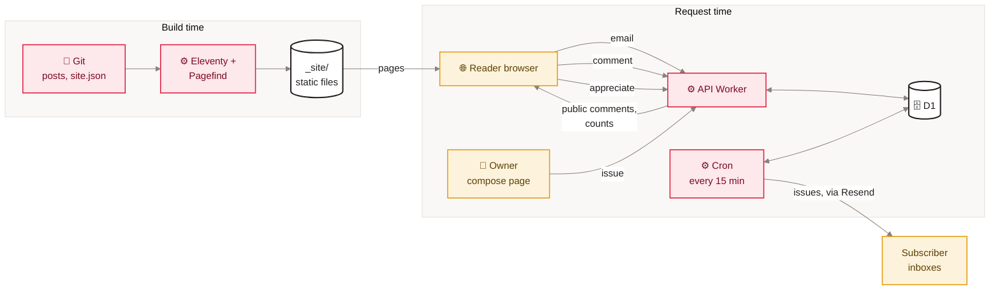
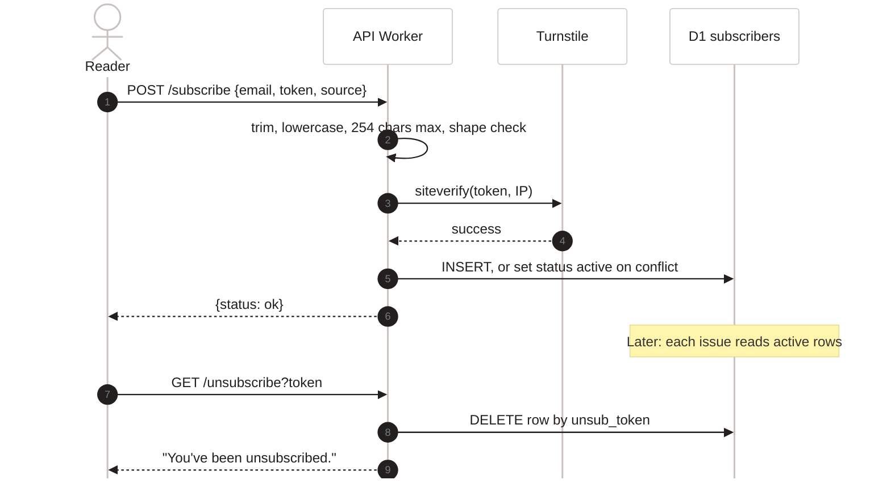

[Home](Home) › Data › Data flow end to end

# Data flow end to end

Each kind of data in the system, followed from where it starts to where it ends up and when it is deleted. There are two very different flows: **content** moves at build time from git to static files and never touches a database; **reader data** moves at request time from a browser into D1 through the API Worker, and some of it leaves again as email.

> [!NOTE]
> **At a glance:**
> - Content: Markdown in git, built by Eleventy, served as files. No runtime data path.
> - Subscribers: browser to `/subscribe` to D1; out again only as newsletter recipients; deleted on unsubscribe.
> - Comments: browser to D1 as `unverified`, made `visible` by a magic link, checked by the cron, shown publicly without the email.
> - Appreciations: a count per post, plus a salted daily hash that the cron purges after the day ends.
> - Issues: owner's compose page or CLI to D1, sent by the cron at their scheduled time.

## The five flows on one page

*Read left to right: content is fixed at build time; everything readers and the owner send passes through the API Worker into D1, and the cron turns queued issues into email.*

## Content

| Stage | Where | What happens |
|---|---|---|
| **Authored** | `src/content/posts/<slug>.md`, `src/_data/site.json` | owner writes front matter and body |
| **Built** | Workers Build, `npm run build` | Eleventy renders pages, feed, sitemap, JSON-LD; Pagefind indexes post bodies |
| **Served** | site Worker, `_site/` | static files with `_headers` |
| **Cached** | Cloudflare edge and browsers | HTML and CSS/JS revalidate; images immutable for a year |

## Subscriber email

*Read top to bottom: an email is checked, verified as human, stored with a random unsubscribe token, and deleted outright on unsubscribe.*

## Comments

`POST /comments` stores the comment as `unverified` with the email, creates a one-time token valid 24 hours in `comment_verifications`, and emails a link. Clicking it sets `status = 'visible'`, deletes the token and redirects to the post with a 30-day signed cookie. The next cron tick checks up to 50 unmoderated visible comments; any that fail become `removed` and are shown as a tombstone. The public list never includes the email; a removed comment shows neither name nor body. See [Comments and reactions](Comments-and-Reactions).

## Appreciations

`POST /reactions` hashes `REACTION_SALT`, the UTC day and the client IP with SHA-256, bumps a per-day per-post hit counter (capped at 10) in `reaction_events`, and if allowed increments `reactions.count`. The raw IP is never stored. Every cron tick deletes `reaction_events` rows from any day other than today.

## Newsletter issues

The owner writes an issue in the compose page or a Markdown file. It is rendered once (HTML and text, with a `{{UNSUB_URL}}` placeholder) and inserted into `issues` with a UTC `scheduled_at`. Every 15 minutes the cron selects due issues, claims each atomically (`queued` to `sending`), reads active subscribers, swaps in each subscriber's unsubscribe link, sends through Resend in batches of 100 and records `sent` or `failed` with counts. See [Newsletter pipeline](Newsletter-Pipeline).

## Retention

| Data | Kept until |
|---|---|
| **Subscriber row** (email, consent time, source, token) | the subscriber unsubscribes (row deleted) |
| **Issue** (rendered HTML and text, counts) | indefinitely; only `queued` issues can be unqueued (deleted) |
| **Comment** (name, email, body, status) | indefinitely; removed comments stay as tombstones |
| **Verification token** | used (deleted) or expired (left in place) |
| **Reaction count** | indefinitely |
| **Reaction event** (hash, slug, hits, day) | the end of its UTC day (purged by the cron) |
| **Theme and "appreciated" flags** | in the reader's own `localStorage` |

## Related pages
- [Data model](Data-Model): the tables and fields named here.
- [Data quality and processing](Data-Quality-and-Processing): every check along these paths.
- [Security and privacy](Security-and-Privacy): what is and is not personal data.
- [Build pipeline](Build-Pipeline): the content flow in depth.
- [API reference](API-Reference): each request in these diagrams.

Last checked: 2026-11-09

Sources in the repo

- `api/src/index.ts`, `api/src/comments.ts`, `api/src/reactions.ts`, `api/src/scheduled.ts`, `api/src/admin.ts`
- `api/migrations/0001` to `0005`
- `eleventy.config.js`, `package.json`, `_headers`

