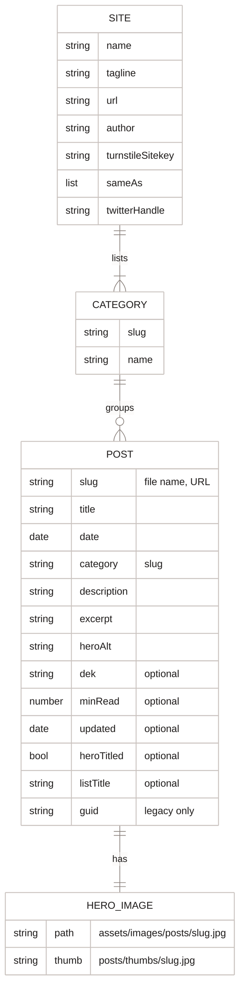
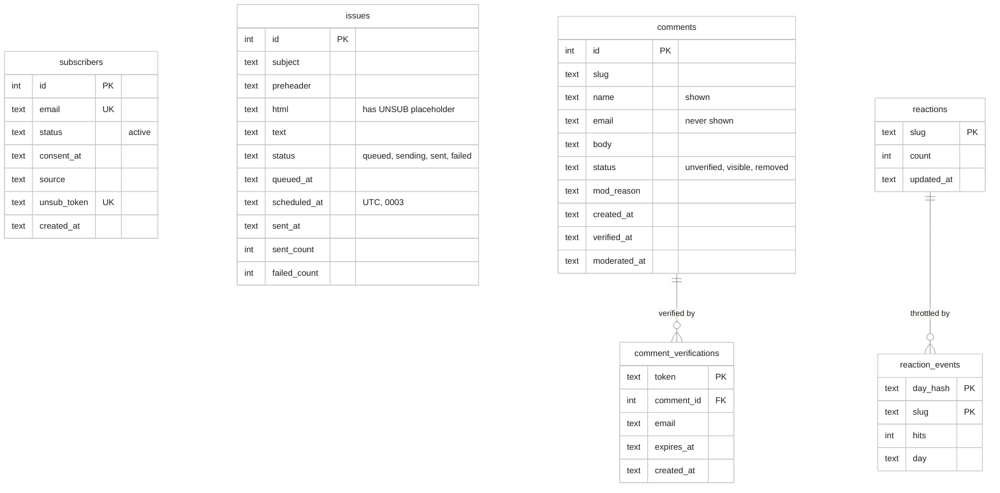

[Home](Home) › Data › Data model

# Data model

The project has two data models. The **content model** is files in git: post front matter, page front matter and `src/_data/site.json`, read by Eleventy at build time. The **runtime model** is one Cloudflare D1 (SQLite) database, `awonderfullife-api`, bound to the API Worker as `DB`, with five tables created by five migrations. The two never meet: posts are not in the database, and comments and counts refer to posts only by slug.

> [!NOTE]
> **At a glance:**
> - Content: 18 Markdown posts with up to 13 front matter fields; `site.json` holds site-wide values and the category list.
> - D1: `subscribers`, `issues`, `comments`, `comment_verifications`, `reactions`, `reaction_events`.
> - The slug (`^[a-z0-9-]{1,120}$`) is the only link between content and D1.
> - Migrations live in `api/migrations/` and were applied by hand with Wrangler; there is no migration step in any build.

## Content model

*Read each line as a relationship: the site lists five categories, each category groups posts, each post has one hero image named after its slug.*

Every post also inherits from `src/content/posts/posts.11tydata.js`: `layout: post.njk`, `permalink: posts/{{ page.fileSlug }}.html`, `tags: ["posts"]`. Non-post pages set their own `permalink`, `layout`, `seoType` (`home`, `about`, `archive`, `category`, `post`), `mainClass`, and feature flags (`newsletter`, `ambient`, `search`; posts get `hasComments` and `hasReactions` from `post.njk`). Field-by-field guidance is in [Adding a post](Adding-a-Post).

## Runtime model (D1)

*Read each box as a table and each line as a link: verifications point at a comment; reaction events throttle a post's counter by slug. `subscribers` and `issues` meet only when the cron sends.*

## Migrations

| File | Adds | Release |
|---|---|---|
| **`0001_create_subscribers.sql`** | `subscribers`, index on `status` | v2.5.0 |
| **`0002_create_issues.sql`** | `issues`, index on `status` | v2.10.0 |
| **`0003_add_issue_schedule.sql`** | `issues.scheduled_at`, index on `(status, scheduled_at)` | v2.12.0 |
| **`0004_create_comments.sql`** | `comments` (indexes on `(slug, status)` and `(status, moderated_at)`), `comment_verifications` | v2.16.0 |
| **`0005_reactions.sql`** | `reactions`, `reaction_events` | #54 (2026-07-10), live with v3.4.0 |

Timestamps are ISO 8601 strings in UTC. Statuses are plain text, not enforced by `CHECK` constraints; the code is the only writer.

> [!WARNING]
> Migrations against the live database change production data. Apply them with Wrangler from `api/` (`npx wrangler d1 migrations apply awonderfullife-api --remote`, or `d1 execute --file` as the issue README shows), only after the code that needs them is reviewed, and never edit a migration that has already run. See [Runbooks](Runbooks).

## Related pages
- [Data flow end to end](Data-Flow-End-to-End): how rows are created, changed and deleted.
- [Data quality and processing](Data-Quality-and-Processing): validation before anything is written.
- [API reference](API-Reference): the routes that read and write these tables.
- [Post catalogue](Post-Catalog): the current content.
- [SEO and discoverability](SEO-and-Discoverability): where front matter ends up.

Last checked: 2026-11-09

Sources in the repo

- `api/migrations/0001_create_subscribers.sql` to `0005_reactions.sql`
- `src/_data/site.json`, `src/content/posts/posts.11tydata.js`, `src/_layouts/*.njk`
- `api/src/comments.ts`, `api/src/reactions.ts` (`SLUG_RE`)

