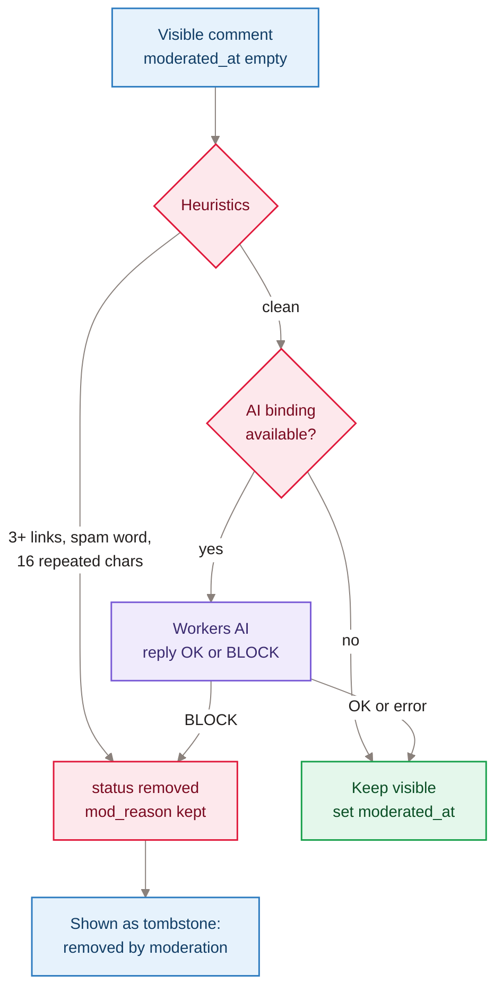
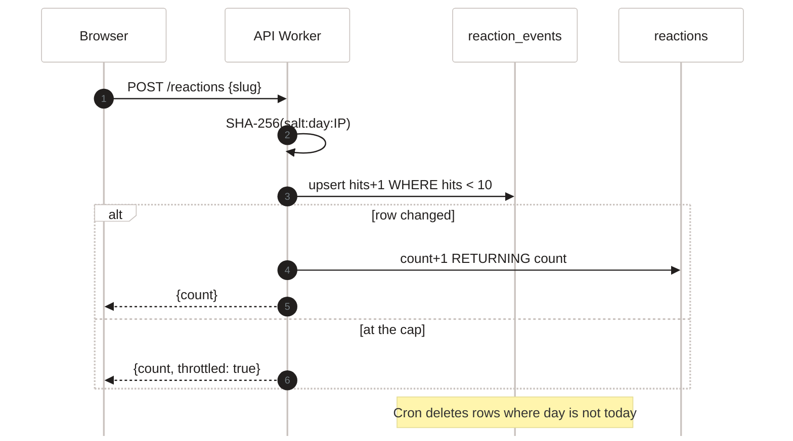

[Home](Home) › Data › Data quality and processing

# Data quality and processing

Every check, transformation and clean-up applied to data on its way into, through and out of the system. The API Worker treats all reader input as untrusted: it validates shape and size, proves a human is present with Turnstile, uses parameterised SQL everywhere, and the browser widgets render everything as text. At build time, filters make dates, URLs and text consistent so the generated pages agree with each other.

> [!NOTE]
> **At a glance:**
> - Input checks: email shape and 254-character cap, slug pattern, name 80 and comment 4,000 character caps.
> - Bot checks: Turnstile on subscribe and on every comment, fail closed.
> - Moderation: heuristics then Workers AI on each new visible comment; failures become tombstones, never silent deletes.
> - Abuse throttle: 10 appreciations per post per salted IP per UTC day, purged daily.
> - Build-time consistency: UTC date getters, reading time, extension-less URLs, decoded and escaped text.

## Validation at the API

| Input | Rule | On failure |
|---|---|---|
| **Subscriber email** | trimmed, lowercased, at most 254 characters, `^[^\s@]+@[^\s@]+\.[^\s@]+$` | 400 `invalid_email` |
| **Turnstile token** | sent to siteverify with the client IP; only `success: true` passes; empty token or network error fails | 403 `turnstile_failed` |
| **Comment slug** | `^[a-z0-9-]{1,120}$` | 400 `invalid` (or an empty list on `GET`) |
| **Comment name** | trimmed, cut to 80 characters, must be non-empty | 400 `invalid` |
| **Comment body** | trimmed, cut to 4,000 characters, at least 2 | 400 `invalid` |
| **Comment email** | same rule as subscribers (skipped when a valid session cookie is present) | 400 `invalid_email` |
| **Reaction slug** | same slug pattern | 400 `invalid` |
| **Issue** | subject and body required; custom time must parse as Eastern time and be in the future | 400 with a plain message |
| **Unqueue id** | positive integer; only `queued` rows are deleted | 400 or `removed: 0` |

All SQL uses `prepare(...).bind(...)`; no string concatenation of reader input.

## Comment moderation

*Read top to bottom: cheap rules first, then the AI check; anything flagged stays in place as a visible tombstone, and an AI error never blocks a comment.*

The sweep runs on every cron tick, takes up to 50 comments in id order, and sets `moderated_at` on each so it is checked once. The AI prompt treats disagreement and criticism as acceptable and blocks only spam, hate, harassment or abuse.

## Appreciation throttle

*Read top to bottom: one atomic statement both checks and bumps the daily cap; at the cap the reader simply sees the current count.*

## Newsletter processing

- Issues are rendered once at queue time, so the stored HTML is exactly what is sent; editing the source afterwards changes nothing until it is unqueued and queued again.
- Each issue is claimed with `UPDATE ... WHERE status = 'queued'`, so overlapping ticks never double-send.
- Sends go in chunks of 100; any chunk error counts its recipients as failed. An issue with failures and no successes is marked `failed`.
- Scheduling converts Eastern wall-clock time to UTC by measuring the offset at the target instant, so it stays right across daylight saving changes.

## Build-time consistency

| Concern | How it is handled |
|---|---|
| **Dates** | front matter dates are UTC midnight; every filter (`cardDate`, `bylineDate`, `rfc822Date`, `isoDate`) reads UTC getters |
| **Reading time** | `readingTime` strips tags, counts words, divides by 200, minimum 1; `minRead` overrides |
| **URLs** | `cleanUrl` drops `.html` and `index.html`; `absoluteUrl` prefixes `site.url` |
| **Text in XML and JSON** | `xmlEscape` for the feed; `htmlDecode` before JSON-LD so entities are not doubled |
| **Image sizes** | `imageDims` reads JPEG dimensions for `og:image:width/height` |
| **Ordering** | newest first, stable for ties, one documented same-day tie-break |

The v3.0.0 parity gate found five real data bugs in the hand-built site (a stale reading time, double-escaped feed titles, a missing year chip, a straight-apostrophe typo, inconsistent same-day order); the generated site fixed all five.

## Related pages
- [Data model](Data-Model): the fields being validated.
- [Comments and reactions](Comments-and-Reactions): the moderation and throttle from the reader's side.
- [Newsletter pipeline](Newsletter-Pipeline): send processing in depth.
- [Security and privacy](Security-and-Privacy): the security reasons behind these rules.
- [Testing and quality](Testing-and-Quality): the tests that pin these behaviours.

Last checked: 2026-11-09

Sources in the repo

- `api/src/index.ts`, `api/src/turnstile.ts`, `api/src/comments.ts`, `api/src/reactions.ts`, `api/src/scheduled.ts`, `api/src/schedule.mjs`, `api/src/admin.ts`
- `eleventy/filters.mjs`, `eleventy.config.js`
- `CHANGELOG.md` (v3.0.0 parity findings)

