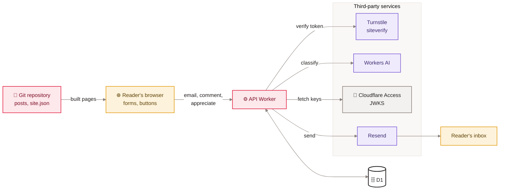

[Home](Home) › Data › Data sources and integrations

# Data sources and integrations

Every place data comes from and every outside service the project talks to, with the direction of the data, the credential involved (by name only) and what happens when the service is unavailable. The content itself has one source, the git repository; everything else is either readers' own input or a service the API Worker calls.

> [!NOTE]
> **At a glance:**
> - Content source of truth: Markdown and JSON in git. There is no external CMS or data feed.
> - Reader input: emails, comments, appreciations, through the API Worker into D1.
> - Outbound services: Resend (email), Turnstile (bot check), Workers AI (moderation), Cloudflare Access (owner sign-in).
> - Browser-side third parties: Google Fonts on every page, Turnstile on pages with forms, Toast UI CDN on the owner's compose page.

*Read left to right: built pages reach the reader; what the reader sends goes to the API, which stores it in D1 and calls outside services to check, moderate, authenticate and email.*

## Integration table

| Integration | Direction | Used by | Credential (name) | If it fails |
|---|---|---|---|---|
| **Git repository** | in (build) | Eleventy | none | no build, site stays on the last deploy |
| **Resend batch API** `api.resend.com/emails/batch` | out | scheduled send, compose test send, comment magic links | `RESEND_API_KEY` | issue marked `failed` if nothing sent; comment returns 503 `email_unavailable` if no key |
| **Turnstile siteverify** `challenges.cloudflare.com` | out | `/subscribe`, `POST /comments` | `TURNSTILE_SECRET`; public site key in `site.json` | fail closed: 403 `turnstile_failed` |
| **Workers AI** | out | comment moderation sweep | `AI` binding | heuristics only; comment kept |
| **Cloudflare Access** | in (JWT), out (JWKS) | `/admin/*` | `ACCESS_TEAM_DOMAIN`, `ACCESS_AUD` | 403 `forbidden` |
| **D1** `awonderfullife-api` | both | every API route and the cron | `DB` binding | route errors; `/admin/whoami` reports `db: error` |
| **Google Fonts** | browser | every page (Manrope) | none | system font fallback |
| **Turnstile widget script** | browser | pages with the newsletter card, posts (comments) | public site key | form cannot get a token |
| **Toast UI Editor CDN** | browser | `/admin/compose` | none | compose editor does not load |
| **Workers AI image API** | out (owner laptop) | `gen-hero.sh` | token and account in files under `$HOME` | no new hero |
| **Cloudflare GraphQL analytics** | out (owner laptop) | `cf-analytics.sh` | read-only analytics token | no report |

## Email on the domain

Two separate mail systems share the domain, by design:

| Purpose | System | Records |
|---|---|---|
| **Owner's inbox** | iCloud+ Custom Email Domain (v2.3.0) | apex MX to iCloud, SPF `include:icloud.com ~all`, DKIM `sig1._domainkey`, DMARC `p=none` with aggregate reports |
| **Newsletter and magic links** | Resend, sending subdomain `send.awonderfullife.ca` (v2.9.1) | its own SPF, DKIM and MX, set up through Cloudflare |

Replies to newsletter and comment emails go to the owner's iCloud inbox through `NEWSLETTER_REPLY_TO`. `docs/superpowers/tools/check-email-dns.sh` checks the iCloud records over DNS-over-HTTPS.

## Not integrated

No analytics vendor, no ad network, no social embeds, no third-party comment or newsletter service (Buttondown was retired in v2.8.0). Namaz's use of Apple WeatherKit happens inside the app, not on this site.

## Related pages
- [Data flow end to end](Data-Flow-End-to-End): these integrations in motion.
- [Secrets and configuration](Secrets-and-Configuration): where each credential lives.
- [Security and privacy](Security-and-Privacy): what each service can see.
- [Newsletter pipeline](Newsletter-Pipeline): Resend in depth.
- [Comments and reactions](Comments-and-Reactions): Turnstile and Workers AI in depth.

Last checked: 2026-11-09

Sources in the repo

- `api/src/*.ts`, `api/wrangler.jsonc`, `api/.dev.vars.example`
- `src/_layouts/base.njk`, `src/_data/site.json`, `api/src/admin.ts`
- `docs/superpowers/tools/*.sh`, `CHANGELOG.md` (v2.3.0, v2.8.0, v2.9.1)

