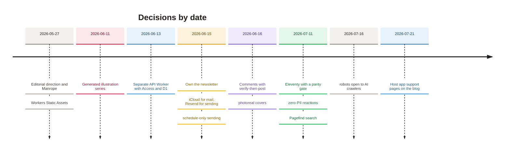

[Home](Home) › Business and product › Decisions log

# Decisions log

The significant choices that shaped awonderfullife.ca, newest first, each with the date, what was decided, why, and what it cost or ruled out. Each entry points to the release or document where the decision is recorded in full.

> [!NOTE]
> **At a glance:**
> - Platform: Cloudflare Workers Static Assets over Pages; a second Worker for the API rather than adding code to the site.
> - Ownership: newsletter, comments, reactions and search all brought in house.
> - Build: Eleventy, adopted only once the hand-built site was proven equal by a parity gate.
> - Privacy: no analytics script, no stored IPs, comment emails never shown.

*Read top to bottom in time: most structural choices were made in the six weeks from late May to early July.*

## The decisions

| Date | Decision | Why | Trade-off | Record |
|---|---|---|---|---|
| **2026-07-21** | Host the Namaz app's support and privacy pages on the blog | one domain the owner controls, no new hosting | the pages inherit blog SEO defaults (About image, `AboutPage`) | [Namaz app support pages](Namaz-App-Support) |
| **2026-07-16** | Open `robots.txt` fully, including AI crawlers | let essays surface in AI answer engines as well as search | essays may be used by AI systems | v3.5.0 notes |
| **2026-07-16** | Retune titles for search but never change slugs | findability without breaking links or feeds | titles and URLs no longer match word for word | v3.5.3 |
| **2026-07-11** | Search with Pagefind, built with the site | no server, no vendor, no cost | index only updates on deploy | v3.2.0 |
| **2026-07-11** | Reactions with zero personal data: salted daily IP hash, purged daily | a friendly signal without tracking anyone | a determined person can still add up to 10 a day per IP | #54, v3.4.0 |
| **2026-07-11** | Move to Eleventy, gated by a byte-level parity check | adding a post touched four or more files by hand; errors crept in | a build step and Node in the deploy | v3.0.0 |
| **2026-06-16** | Comments publish after one email confirmation, then auto-moderation | real names, low friction, little spam, no third-party platform | first comment needs an inbox; AI moderation can err | v2.16.0 |
| **2026-06-16** | Photoreal covers instead of flat illustrations | the owner preferred them; composed covers double as social cards | larger files (137 to 405 KB) | v2.12.1, v2.14.0 |
| **2026-06-16** | Lock a newspaper-like house style | consistency and readability across all posts | every post was edited | v2.13.0 |
| **2026-06-15** | Schedule-only newsletter sending, no "send now" button | prevent accidental broadcasts | a one-off urgent send needs the CLI | v2.11.0 |
| **2026-06-15** | Own the newsletter (D1, Turnstile, Resend), retire Buttondown | own the list, match the site's privacy stance | more code to maintain | v2.5.0, v2.8.0 |
| **2026-06-15** | iCloud+ for the mailbox, Resend on a `send.` subdomain | keep personal mail and bulk sending separate | two sets of DNS records | v2.3.0, v2.9.1 |
| **2026-06-15** | Liquid Glass accents, used selectively | a modern material without losing editorial crispness | Chromium-only lensing; rim shimmer when scrolling | v2.4.0, v2.7.0 |
| **2026-06-13** | A second Worker at `api.` with Access plus in-code JWT checks | keep the static site untouched and cacheable; defence in depth | two deploys to manage | v2.1.0, API spine spec |
| **2026-06-11** | Generate a cohesive illustration series | stand-ins were not topical; a series looks designed | later replaced by photoreal covers | v2.0.0 |
| **2026-05-27** | Workers Static Assets, not Pages | config in the repo, room to grow into code | the early `.git` exposure until assets were filtered | old Deployment notes, CHANGELOG |
| **2026-05-27** | Editorial direction: Manrope, white, ink and blue, five categories | modernise without losing the writing's voice | the original template's look was dropped | May redesign spec |

## Decisions not to do something

- **No analytics script.** Cloudflare zone analytics are enough.
- **No CMS.** Git is the editor and the history.
- **No broadcast-now in the web UI.**
- **No staging environment.** The site is static and the API is tested; rollback is one click.
- **No CI for deploys.** Workers Builds deploy directly; GitHub Actions only syncs this wiki.

## Related pages
- [About the blog](About-the-Blog): the principles behind these choices.
- [Site architecture](Site-Architecture): the result of the platform decisions.
- [Release history](Release-History): when each landed.
- [Roadmap](Roadmap): decisions still open.

Last checked: 2026-11-09

Sources in the repo

- `CHANGELOG.md`, `ROADMAP.md`, `CLAUDE.md`
- `docs/superpowers/specs/*.md`

