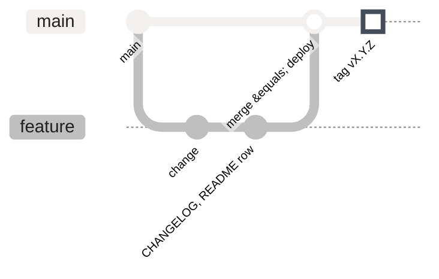
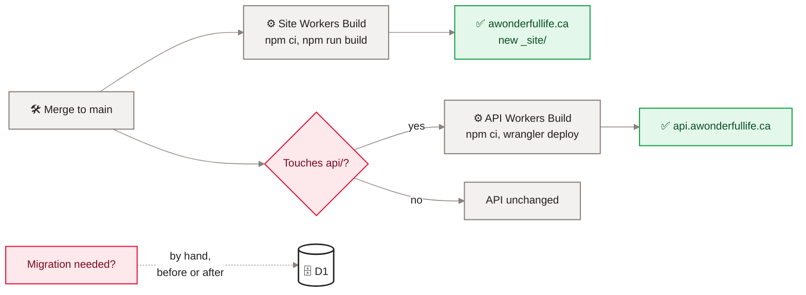

[Home](Home) › Operations › Deployment and release

# Deployment and release

How a change reaches production, and how it is recorded. Both Workers deploy from GitHub `main` through Cloudflare Workers Builds: the site on every push, the API on pushes that touch `api/`. There is no staging environment and no deploy workflow in GitHub. Every release then gets a semver tag on its merge commit, a `CHANGELOG.md` entry and a row in the README release table.

> [!NOTE]
> **At a glance:**
> - Site: push to `main`, Workers Build runs `npm ci && npm run build`, uploads `_site/`; live in about 30 seconds.
> - API: push to `main` touching `api/*`, Workers Build runs `npm ci` then `npx wrangler deploy` from `api/`; `cd api && npm run deploy` still works by hand.
> - D1 migrations are never applied by a build; run them deliberately with Wrangler.
> - Versioning: major for a redesign or structural shift, minor for a feature, patch for a fix, content or docs.

## The path of a change

*Read left to right: work happens on a branch, the merge to `main` triggers the Workers Builds, and the merge commit is tagged with the release number.*

*Read left to right: every merge rebuilds the site; only API changes redeploy the API; database migrations are a separate, manual step.*

## Releasing, step by step

1. Branch from `main`, make the change, run `npm run build` (and `cd api && npm test` for API changes).
2. Add a `CHANGELOG.md` entry at the top, headed with the version, a title and the UTC merge time, in the same format as the entries already there.
3. Add a row to the README "Release history" table: version, time, PR link, summary.
4. Open a pull request and merge it.
5. Tag the merge commit: `git tag -a vX.Y.Z -m "vX.Y.Z: summary" && git push origin vX.Y.Z`.
6. Watch the build in the Cloudflare dashboard and check the live site.

## Versioning rules

| Bump | When | Examples |
|---|---|---|
| **Major** | redesign, identity or structural shift | v2.0.0 Quiet Magazine; v3.0.0 Eleventy |
| **Minor** | new feature or notable enhancement | v3.1.0 dark mode; v3.4.0 appreciate |
| **Patch** | fix, content, docs | v3.5.2 portrait cache fix; v3.5.4 new post |

Tags were back-filled to v1.0.0 on 2026-06-15 (v2.4.1). Latest tag: `v3.5.7` (2026-07-16).

## Deploy history in short

| Period | Site deploy | API deploy |
|---|---|---|
| **2026-05-27 to 2026-07-10** | Workers Build, no build step, repo root as assets (with `.assetsignore`) | from 2026-06-13: `cd api && npm run deploy` by hand |
| **2026-06-20 onward** | same | Workers Build on `api/*` changes |
| **2026-07-10 onward (v3.0.0)** | Workers Build `npm ci && npm run build`, assets `./_site` | same |

> [!WARNING]
> The v3.0.0 cut-over needed the site build command set in the dashboard **before** the merge, because the merge also moved the asset directory to `./_site`. Any future change to the build command or output folder must be made in the dashboard and in `wrangler.jsonc` together.

## Rolling back

- **Fastest:** Cloudflare dashboard, the Worker, **Deployments**, pick the last good one, **Rollback**. No rebuild.
- **Cleanest:** `git revert` the bad merge and push; the Workers Build redeploys. Git and production stay in step.
- **Database:** D1 has point-in-time recovery (Time Travel) in the dashboard and Wrangler; there are no down migrations in the repo.

## Related pages
- [Release history](Release-History): every release made this way.
- [GitHub Actions](GitHub-Actions): why deploys are not in Actions.
- [Cloudflare](Cloudflare): the Workers Build settings.
- [Runbooks](Runbooks): migrations, rollbacks, secrets.
- [Build pipeline](Build-Pipeline): what the site build does.

Last checked: 2026-11-09

Sources in the repo

- `wrangler.jsonc`, `api/wrangler.jsonc`, `package.json`, `api/package.json`
- `CLAUDE.md` (Build, run, deploy; Releases and versioning), `README.md`, `CHANGELOG.md` (v2.4.1, v3.0.0), `ROADMAP.md`
- `git tag`

