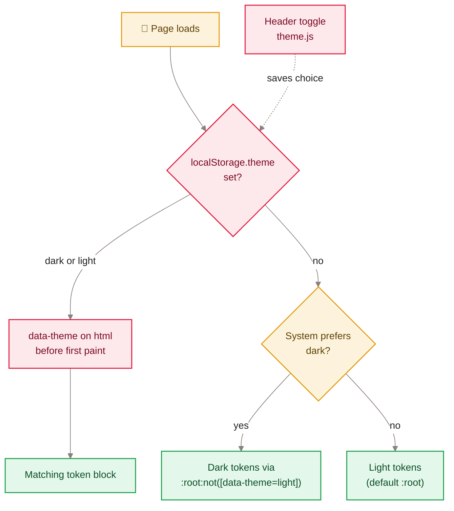

[Home](Home) › Architecture › Design system

# Design system

The look of awonderfullife.ca lives in one stylesheet, `assets/css/style.css` (about 1,100 lines), driven by CSS custom properties on `:root`. The direction is a crisp editorial magazine: Manrope throughout, white and ink with one editorial blue, generous photography, and a restrained layer of Apple-style "Liquid Glass" on the header, newsletter card, comments pane and facet chips. A dark theme redefines the same tokens, so components never hard-code colours.

> [!NOTE]
> **At a glance:**
> - One font (Manrope 400 to 700), one accent (`#0a4a9a` light, `#5b9bd5` dark).
> - Widths: base `860px`, wide grids `1200px`, post reading column `44rem` (about 73 characters).
> - Dark mode: `prefers-color-scheme` unless the reader picked a theme (`data-theme` on `<html>`).
> - Glass is progressive: frosted blur everywhere it is supported, edge lensing on Chromium only, calm fallback for reduced motion.

## Theme logic

*Read top to bottom: a saved choice wins; otherwise the operating system decides. The toggle only writes the saved choice.*

## Tokens

| Token | Light | Dark | Used for |
|---|---|---|---|
| **`--color-bg`** | `#ffffff` | `#12151b` | page background |
| **`--color-text`** | `#111111` | `#e8eaed` | body text |
| **`--color-text-light`** | `#666666` | `#9aa0a6` | bylines, captions, dates |
| **`--color-border`** | `#e5e5e5` | `#262b35` | rules, card edges |
| **`--color-accent`** | `#0a4a9a` | `#5b9bd5` | kickers, links |
| **`--color-bg-soft`** | `#f9f9f9` | `#1a1e26` | code blocks |
| **`--cta-bg`** | `#0a4a9a` | `#1c64c8` | buttons |
| **`--glass-bg`** | white at 60% | slate at 55% | frosted surfaces |
| **`--glass-blur`** | `blur(18px) saturate(1.8) brightness(1.06)` | `blur(18px) saturate(1.4) brightness(0.9)` | backdrop filter |
| **`--max-width`** | `860px` | same | header, about, archive |
| **`--max-width-wide`** | `1200px` | same | home and category grids |
| **`--font`** | `'Manrope'`, system fallbacks | same | everything |

v3.1.0 first moved the last ~20 hard-coded colours into semantic tokens (no visual change), then added the dark block. The dark accent was tuned for WCAG AA contrast.

## Typography and layout

- **Body:** 17px, line height 1.7, left aligned (v2.13.0).
- **Post titles:** display scale, `clamp()`-based, set in the post header; an optional italic `.post-dek` below.
- **Kicker:** uppercase, tracked, accent blue, always a link to its category.
- **Post layout:** article plus a sticky author rail on wide screens; stacks below on narrow ones.
- **Cards:** 3:2 images with 14px rounded corners; home grid 3 columns, 2 at 1000px or less, 1 at 700px or less; category grids 2 columns.

## Liquid Glass

| Surface | Treatment | Since |
|---|---|---|
| **Header** | floating capsule, frosted, specular rim, edge lensing | v2.4.0, capsule v2.6.0, lensing v2.7.0 |
| **Newsletter card** | frosted pane, edge lensing | v2.4.0, v2.7.0 |
| **Comments section** | one frosted pane; comments and form are translucent cards on it (no nested blur) | v2.16.1, v2.16.2 |
| **Facet chips** | translucent pills with a bevel | v2.4.0 |

Edge lensing is an inline SVG filter (`#edge-lensing`: turbulence, blur and displacement) in `base.njk`, used through `backdrop-filter: url(#edge-lensing)` on `.lensing` elements. It is gated three ways: the opt-in class, an `@supports` block that only Chromium passes, and `prefers-reduced-motion`, which swaps in a calm heavy blur. Where `backdrop-filter` is unsupported, an `@supports not` block makes glass surfaces near opaque. A known trade-off: on Chromium the header rim can shimmer while content scrolls beneath it.

## Ambient backdrop

The home page alone sets `ambient: true`, which adds three drifting colour clouds (accent blue, terracotta, slate) and three comets on staggered loops behind the content (v2.17.0, brighter in v2.17.1). It is decorative (`aria-hidden`), uses GPU transforms only, and freezes under `prefers-reduced-motion`.

## Finding your way in `style.css`

The file is divided by banner comments: Header, Theme toggle, Shared kicker, Featured post, Illustrated card grid, Single post page, Comments, Sources and References, Post footer prev/next, Appreciate button, Related posts, About, Site search, Faceted browsing strip, Archive, Newsletter, Footer, Focus styles, Responsive, Edge-lensing. Search for the banner of the area you are changing.

> [!TIP]
> Add new colours as tokens in both the light `:root` block and the dark blocks (`@media (prefers-color-scheme: dark) :root:not([data-theme="light"])` and `:root[data-theme="dark"]`), never as literals inside a component.

## Related pages
- [Features catalogue](Features-Catalogue): screenshots of these components.
- [Page lifecycle](Page-Lifecycle): when the theme script runs.
- [The June 2026 redesign](The-June-2026-Redesign): where the card grid and post layout came from.
- [The May 2026 redesign](The-May-2026-Redesign): where Manrope and the palette came from.
- [Hero photography](Hero-Photography): the images the design frames.

Last checked: 2026-11-09

Sources in the repo

- `assets/css/style.css`, `src/_layouts/base.njk`, `assets/js/theme.js`
- `docs/superpowers/specs/2026-06-15-liquid-glass-design.md`, `docs/superpowers/specs/2026-06-11-quiet-magazine-redesign-design.md`
- `CHANGELOG.md` (v2.4.0 to v2.17.1, v3.1.0)

