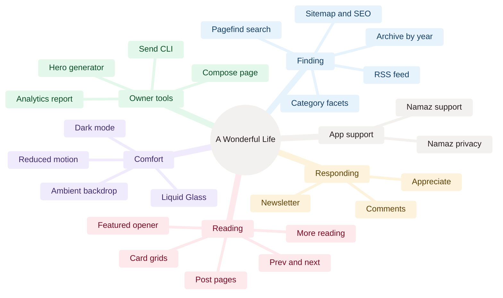
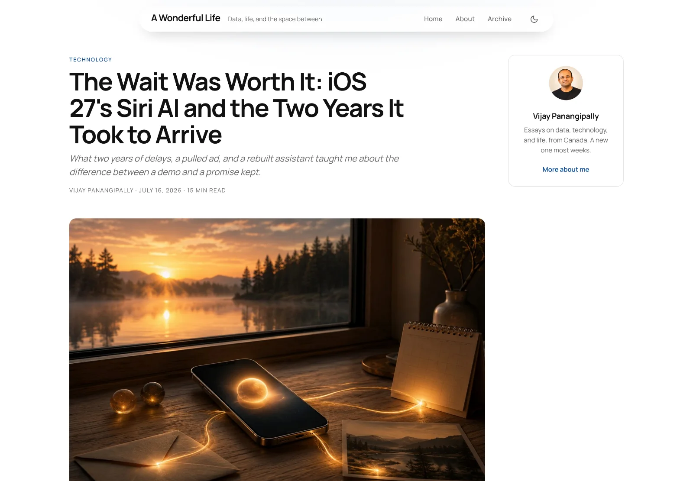
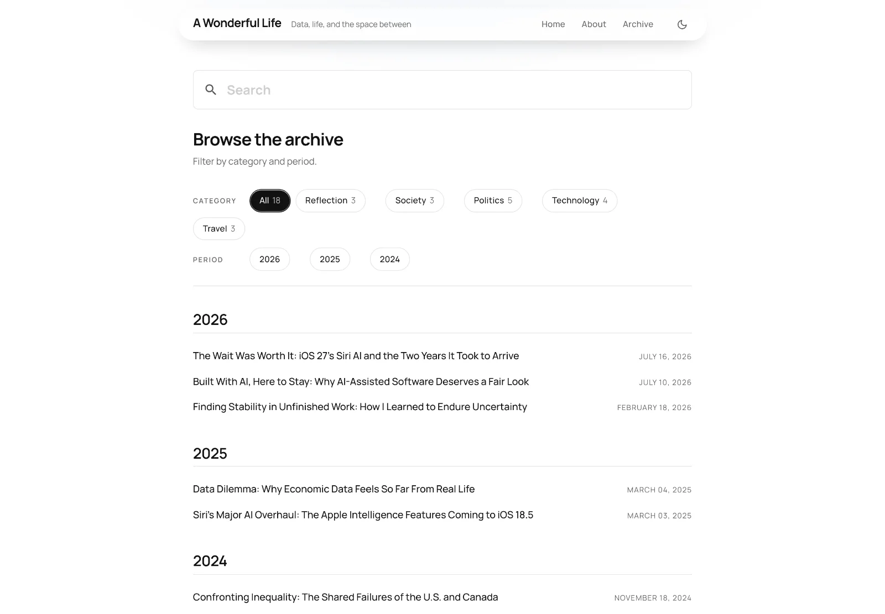
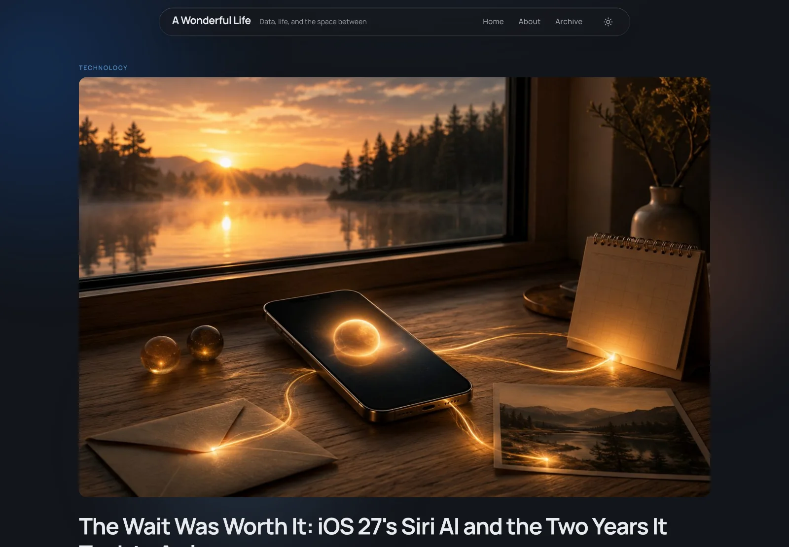

[Home](Home) › Business and product › Features catalogue

# Features catalogue

Every feature of awonderfullife.ca and its API, what it does for a reader or for the owner, where it lives in the code, and the release that brought it. Reader features are all static or run in the reader's browser, except the four that talk to `api.awonderfullife.ca`: newsletter sign-up, comments, the appreciate button and unsubscribe.

> [!NOTE]
> **At a glance:**
> - 26 HTML pages are generated: home, about, archive, 5 categories, 18 posts and 2 Namaz pages, plus `feed.xml` and `sitemap.xml`.
> - Four reader features call the API: subscribe, unsubscribe, comments, appreciate.
> - Two owner features sit behind Cloudflare Access: the newsletter compose page and `whoami`.
> - Dark mode, search and related posts all work without a server.

*Read outward from the centre: six families of features, each branch one feature listed in the tables below.*

## Reading

<em>A post page: kicker, display title, dek and byline, the breakout hero, and the author card in the right rail.</em>

| Feature | What it does | Where | Since |
|---|---|---|---|
| **Featured opener** | The newest post opens the home page at full width with its hero and excerpt | `src/content/index.njk` | v2.0.0 |
| **Card grid** | Every other post as an illustrated card, 3-up on home, 2-up on categories | `src/_includes/card-grid.njk` | v2.0.0, 3-up v2.16.5 |
| **Post page** | Kicker, display title, optional dek, byline with reading time, hero, body | `src/_layouts/post.njk` | v1.0.0, generated v3.0.0 |
| **Reading time** | Words divided by 200, rounded, minimum 1, unless `minRead` pins it | `readingTime` in `eleventy/filters.mjs` | v2.0.0 |
| **Author card** | Sticky right-rail card with portrait, one-line bio, link to About | `src/_includes/author-card.njk` | v2.15.0 |
| **Prev and next** | Chronological neighbours within the posts collection | `src/_includes/post-nav.njk`, `postNeighbors` | v2.0.0 |
| **More reading** | Three related posts: same category first, newest first, backfilled | `relatedPosts` filter | v3.3.0 |
| **Hero-titled covers** | For covers with the title baked in, the HTML header is hidden visually but kept for SEO and screen readers | `heroTitled` front matter, `.is-hero-titled` | v2.12.1 |

## Finding

<em>The archive: Pagefind search above the facet strip, then posts grouped by year.</em>

| Feature | What it does | Where | Since |
|---|---|---|---|
| **Archive** | Every post grouped by year, with `id="yearYYYY"` anchors | `src/content/archive.njk` | v1.0.0 |
| **Faceted strip** | Category chips with counts, period chips that jump to a year | `src/_includes/facets.njk` | v1.0.0 |
| **Category pages** | One page per category, paginated over `site.categories` | `src/content/categories.njk` | v1.0.0 |
| **Search** | Pagefind full-text index of post bodies, loaded only on the archive | `package.json` build, `search: true` | v3.2.0 |
| **RSS** | `feed.xml`, newest first, with frozen legacy GUIDs | `src/content/feed.njk` | v2.15.0 |
| **Sitemap and SEO** | `sitemap.xml`, canonicals, Open Graph, Twitter cards, JSON-LD | see [SEO and discoverability](SEO-and-Discoverability) | v2.2.0, v3.5.0 |

## Responding

| Feature | What it does | Where | Since |
|---|---|---|---|
| **Newsletter sign-up** | Email plus Turnstile, posted to `POST /subscribe`, inline thanks | `src/_includes/newsletter.njk`, `newsletter-script.njk` | v2.8.0 |
| **Unsubscribe** | One click from any issue deletes the subscriber row | `GET /unsubscribe` | v2.5.0 |
| **Comments** | Name, email, comment and Turnstile; publish after a magic link; 30-day session | `assets/js/comments.js`, `api/src/comments.ts` | v2.16.0 |
| **Appreciate** | One button per post, count from the API, remembered in `localStorage` | `assets/js/reactions.js`, `api/src/reactions.ts` | v3.4.0 |

Details: [Newsletter pipeline](Newsletter-Pipeline) and [Comments and reactions](Comments-and-Reactions).

## Comfort

<em>Dark mode follows the system setting and can be flipped with the header toggle.</em>

| Feature | What it does | Where | Since |
|---|---|---|---|
| **Dark mode** | Follows `prefers-color-scheme`; header toggle saves a choice; applied before first paint | `base.njk` inline script, `assets/js/theme.js` | v3.1.0 |
| **Liquid Glass** | Frosted capsule header, newsletter and chips; edge lensing on Chromium | `assets/css/style.css`, `#edge-lensing` SVG filter | v2.4.0, v2.7.0 |
| **Ambient backdrop** | Drifting colour clouds and comets behind the home page; frozen for reduced motion | `ambient: true` on `index.njk` | v2.17.0 |
| **Clean URLs** | `/posts/<slug>`, `/archive`, `/categories/<slug>`, no `.html` | Worker `html_handling` | v2.15.0 |

## Owner tools

| Tool | What it does | Where | Since |
|---|---|---|---|
| **Compose page** | Rich editor, live preview, test send to self, schedule picker, queue list | `GET /admin/compose`, `api/src/admin.ts` | v2.11.0, v2.12.0 |
| **Send CLI** | Same render and queue from a terminal; `--dry-run`, `--test`, `--queue`, `--at` | `api/scripts/send-issue.mjs` | v2.9.0 |
| **Whoami** | Confirms Access sign-in and D1 connectivity | `GET /admin/whoami` | v2.1.0 |
| **Hero generator** | Generates a flat editorial hero through Workers AI | `docs/superpowers/tools/gen-hero.sh` | v2.0.0 |
| **Analytics report** | Cloudflare zone traffic for one or more domains | `docs/superpowers/tools/cf-analytics.sh` | 2026-06-20 |
| **Email DNS check** | Checks MX, SPF, DKIM, DMARC for iCloud mail | `docs/superpowers/tools/check-email-dns.sh` | v2.2.1 |

## App support

| Page | URL | Purpose | Since |
|---|---|---|---|
| **Namaz** | `/namaz/` | Support and contact page, the App Store Support URL | 2026-07-21 |
| **Namaz privacy** | `/namaz/privacy/` | Privacy policy: the app collects nothing | 2026-07-21 |

See [Namaz app support pages](Namaz-App-Support).

## Related pages
- [Readers and journeys](Readers-and-Journeys): these features in the order a reader meets them.
- [Site architecture](Site-Architecture): which Worker serves which feature.
- [API reference](API-Reference): the routes behind the responding features.
- [Design system](Design-System): the look of each component.
- [Release history](Release-History): when each feature shipped.

Last checked: 2026-11-09

Sources in the repo

- `src/content/*.njk`, `src/_layouts/*.njk`, `src/_includes/*.njk`
- `eleventy/filters.mjs`, `assets/js/*.js`, `assets/css/style.css`
- `api/src/*.ts`, `api/scripts/send-issue.mjs`, `docs/superpowers/tools/*.sh`
- `CHANGELOG.md`

