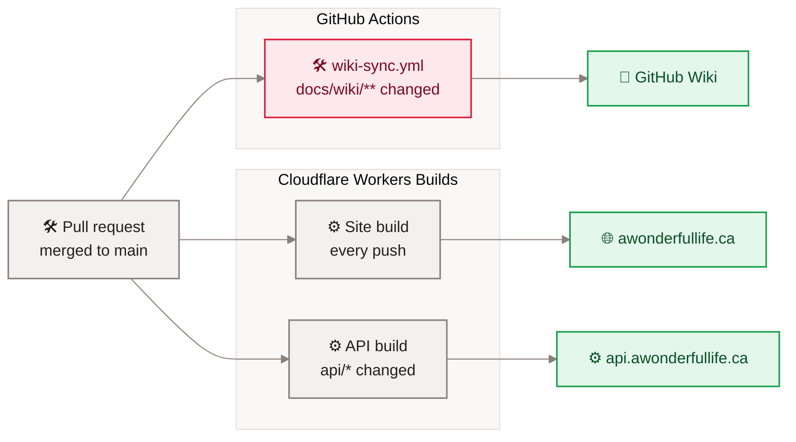

[Home](Home) › Operations › GitHub Actions

# GitHub Actions

This repository has exactly one GitHub Actions workflow, `.github/workflows/wiki-sync.yml`, and it only publishes this wiki. Building, testing and deploying the site and the API all happen in **Cloudflare Workers Builds**, which watch the GitHub repository directly. That is a deliberate choice for a small personal site: no deploy tokens stored in GitHub, and one place (the Cloudflare dashboard) to look at every build.

> [!NOTE]
> **At a glance:**
> - `wiki-sync.yml`: on a push to `main` that touches `docs/wiki/**` (or the workflow), or by hand, it copies `docs/wiki/` into the GitHub Wiki.
> - No workflow builds, tests or deploys code. The API tests run locally (`cd api && npm test`).
> - The workflow uses only the built-in `github.token` with `contents: write`; no repository secrets are needed.
> - Never edit wiki pages in the browser: the next sync overwrites them.

## What runs where

*Read left to right: one merge can start up to three jobs; only the wiki job is a GitHub Action.*

## `wiki-sync.yml`

| Item | Value |
|---|---|
| **Triggers** | `push` to `main` with paths `docs/wiki/**` or `.github/workflows/wiki-sync.yml`; `workflow_dispatch` |
| **Concurrency** | group `wiki-sync`, never cancels a run in progress |
| **Permissions** | `contents: write` |
| **Runner** | `ubuntu-latest`, 5-minute timeout |
| **Steps** | check out the repo; clone `<repo>.wiki.git` with `github.token`; `rsync -a --delete --exclude .git docs/wiki/ wiki/`; commit as `github-actions[bot]` and push if anything changed |
| **Failure message** | if the wiki repository does not exist yet, it asks you to create a first page in the Wiki tab and re-run |

> [!IMPORTANT]
> The sync uses `rsync --delete`: any page in the GitHub Wiki that is not in `docs/wiki/` is removed. The earlier hand-written wiki pages (Home, About the Blog, Site Architecture, Deployment and the rest) were rewritten here under the same names so their links keep working.

## Running it by hand

GitHub, **Actions** tab, **wiki-sync**, **Run workflow** on `main`. Use it after the first merge, or if a sync failed.

## If you ever add CI

Good first candidates, in order of value:

1. Run `cd api && npm ci && npm test && npm run typecheck` on pull requests that touch `api/`.
2. Run `npm ci && npm run build` on pull requests, so a broken template fails before merge rather than in the Workers Build.
3. A Markdown check on `docs/wiki/` (links and the no-dash rule).

Deploys should stay in Workers Builds unless there is a reason to move them; moving them would need a Cloudflare API token stored as a GitHub secret.

## Related pages
- [Deployment and release](Deployment): the Workers Builds that do deploy.
- [Cloudflare](Cloudflare): build settings in the dashboard.
- [Testing and quality](Testing-and-Quality): running the tests locally.
- [Contributing and house style](Contributing-and-House-Style): editing this wiki.

Last checked: 2026-11-09

Sources in the repo

- `.github/workflows/wiki-sync.yml`
- `wrangler.jsonc`, `api/wrangler.jsonc` (deploy comments), `CLAUDE.md`, `ROADMAP.md`

