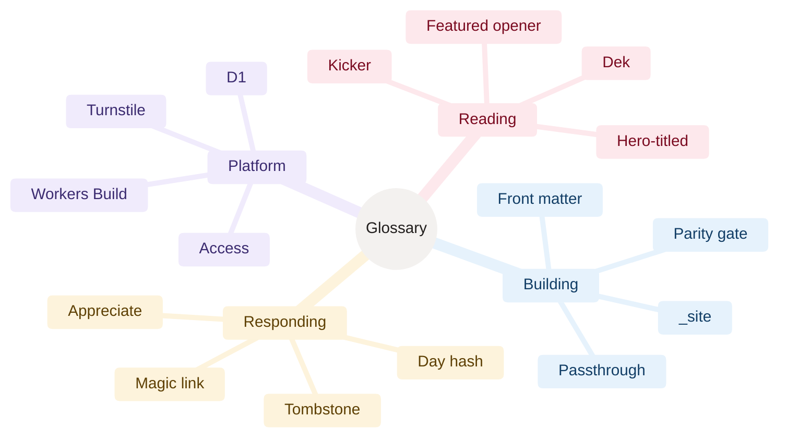

[Home](Home) › Business and product › Glossary

# Glossary

The words this project uses, in alphabetical order, with what each means here and where to read more.

> [!NOTE]
> **At a glance:**
> - Site terms (kicker, dek, featured opener), build terms (front matter, passthrough, `_site/`), API terms (tombstone, magic link, salt) and platform terms (Workers Build, Access, D1).
> - When a term names a file, field or setting, it is in `code`.
> - If you meet a word that is not here, add it.

*Read outward: four groups of terms; every leaf is defined in the table.*

| Term | Meaning | More |
|---|---|---|
| **Access (Cloudflare Access)** | Cloudflare's sign-in gate in front of `api.awonderfullife.ca/admin*` | [Security and privacy](Security-and-Privacy) |
| **Ambient backdrop** | drifting colour clouds and comets behind the home page | [Design system](Design-System) |
| **Appreciate** | the one-button reaction at the end of a post | [Comments and reactions](Comments-and-Reactions) |
| **`awl_c`** | the 30-day signed cookie that lets a confirmed commenter skip email | [Comments and reactions](Comments-and-Reactions) |
| **Breakout hero** | a hero image wider than the text column | [The June 2026 redesign](The-June-2026-Redesign) |
| **Composed cover** | a hero image with the kicker, title and byline in the art (`heroTitled: true`) | [Hero photography](Hero-Photography) |
| **D1** | Cloudflare's SQLite database; here `awonderfullife-api`, binding `DB` | [Data model](Data-Model) |
| **Day hash** | SHA-256 of the salt, the UTC day and the IP, used to throttle appreciations | [Data quality and processing](Data-Quality-and-Processing) |
| **Dek** | the optional italic sub-headline under a post title | [Content and editorial](Content-and-Editorial) |
| **Edge lensing** | the SVG filter that bends content seen through glass, Chromium only | [Design system](Design-System) |
| **Facets** | the category and period chips on the archive and category pages | [The five categories](The-Five-Categories) |
| **Featured opener** | the newest post at full width at the top of the home page | [Features catalogue](Features-Catalogue) |
| **Front matter** | the YAML block at the top of a post file | [Adding a post](Adding-a-Post) |
| **`guid`** | a post's frozen RSS identifier; legacy posts only | [SEO and discoverability](SEO-and-Discoverability) |
| **Issue** | one newsletter email, queued in D1 with a send time | [Newsletter pipeline](Newsletter-Pipeline) |
| **Kicker** | the small uppercase category link above a title | [The five categories](The-Five-Categories) |
| **Liquid Glass** | the frosted, bevelled material on the header, newsletter, comments and chips | [Design system](Design-System) |
| **Magic link** | the one-time email link that confirms a comment | [Comments and reactions](Comments-and-Reactions) |
| **Namaz** | the owner's iOS prayer-times app, whose support pages live at `/namaz/` | [Namaz app support pages](Namaz-App-Support) |
| **Pagefind** | the static search index built from `_site/` | [Build pipeline](Build-Pipeline) |
| **Parity gate** | the one-time check that the Eleventy output matched the hand-built site | [Release history](Release-History) |
| **Passthrough** | files Eleventy copies unchanged into `_site/` | [Build pipeline](Build-Pipeline) |
| **Quiet Magazine** | the name of the June 2026 redesign | [The June 2026 redesign](The-June-2026-Redesign) |
| **`seoType`** | the front matter value that picks a page's social image and JSON-LD type | [SEO and discoverability](SEO-and-Discoverability) |
| **`_site/`** | Eleventy's output folder and the site Worker's asset directory | [Build pipeline](Build-Pipeline) |
| **Slug** | a post's file name and URL path; never changes | [Adding a post](Adding-a-Post) |
| **Tombstone** | the placeholder text that replaces a comment removed by moderation | [Comments and reactions](Comments-and-Reactions) |
| **Turnstile** | Cloudflare's privacy-friendly bot check on forms | [Data quality and processing](Data-Quality-and-Processing) |
| **`{{UNSUB_URL}}`** | the placeholder in a stored issue, replaced per subscriber at send time | [Newsletter pipeline](Newsletter-Pipeline) |
| **Workers Build** | Cloudflare's build and deploy from GitHub, one per Worker | [Deployment and release](Deployment) |
| **Workers Static Assets** | serving a folder of files from a Worker with no code | [Cloudflare](Cloudflare) |

## Related pages
- [Home](Home): every page in the wiki.
- [Features catalogue](Features-Catalogue): the features many of these terms name.
- [Site architecture](Site-Architecture): the platform terms in context.

Last checked: 2026-11-09

Sources in the repo

- `CLAUDE.md`, `assets/css/style.css`, `api/src/*.ts`, `src/_layouts/*.njk`

