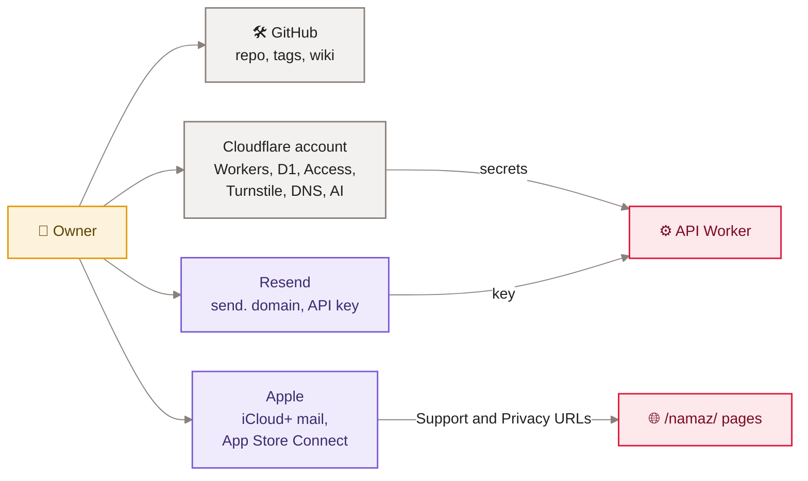

[Home](Home) › Operations › Hand-offs

# Hand-offs

What someone taking over awonderfullife.ca (a new maintainer, a helper, or the owner after a long break) needs to know, which accounts hold what, the steps only the owner can do, and the open threads at the time of writing. The project is small enough that one person can hold it all; this page makes sure nothing lives only in one person's head.

> [!NOTE]
> **At a glance:**
> - Accounts: GitHub (repo and wiki), Cloudflare (both Workers, D1, Access, Turnstile, DNS, AI), Resend, Apple (iCloud+ mail, and the Namaz App Store listing).
> - Owner-only: Access policy, secrets, DNS, Resend domain, App Store URLs, Search Console.
> - Read first: `CLAUDE.md`, then [Site architecture](Site-Architecture), then [Runbooks](Runbooks).
> - Open threads on 2026-11-09 are listed at the end.

## Who holds what

*Read left to right: four accounts, all held by the owner; the Worker only ever sees secrets, never account logins.*

## The first hour

1. Read `CLAUDE.md` at the repo root; it is the operating manual and is kept current.
2. Clone, `npm ci && npm run build`, open `_site/index.html` or run `npm run serve`.
3. `cd api && npm ci && npm test` (61 tests should pass).
4. Skim `CHANGELOG.md` (newest first) and `ROADMAP.md`.
5. Get a Cloudflare dashboard login with access to both Workers, and an Access policy entry if you will use the compose page.

## Owner-only steps

| Task | Where | Why it cannot be in git |
|---|---|---|
| **Add a person to the admin pages** | Cloudflare Zero Trust, Access application for `api.awonderfullife.ca/admin*` | identity policy |
| **Set or rotate secrets** | `wrangler secret put` | secret values |
| **Change build commands** | Workers Builds settings for each Worker | dashboard setting |
| **DNS, Redirect Rules** | Cloudflare zone | dashboard setting |
| **Newsletter sending domain** | Resend account | third-party account |
| **Mailbox and DMARC reports** | iCloud+ and DNS | personal account |
| **Namaz Support and Privacy URLs** | App Store Connect | Apple account |
| **Search Console, Bing Webmaster** | Google and Microsoft | verification belongs to the owner |

## Conventions to keep

- One Markdown file per post; never rename a slug or edit a `guid`.
- Every release: CHANGELOG entry, README row, semver tag on the merge commit.
- Specs in `docs/superpowers/specs/`, plans in `docs/superpowers/plans/` for anything bigger than a copy edit.
- Rename images instead of overwriting them.
- Edit this wiki in `docs/wiki/`, never in the browser.

## Open threads (2026-11-09)

| Thread | Status | Next step |
|---|---|---|
| **Namaz pages release record** | live since 2026-07-21, no CHANGELOG entry or tag | add an entry, README row and tag (for example `v3.5.8`) |
| **Namaz pages in the sitemap and a proper social image** | not done | add to `sitemap.njk`; consider a dedicated `seoType` |
| **Em dashes on the Namaz pages** | against house style | small copy edit |
| **Thumbnail for the newest post** | missing | add `thumbs/the-wait-was-worth-it-ios-27-siri-ai.jpg` before the next post |
| **DMARC tightening** | still `p=none` | move to `quarantine`, then `reject`, after clean reports |
| **Search Console and Bing** | not verified | owner verifies and submits the sitemap |
| **Newsletter polish** | open | import any old Buttondown subscribers; rate-limit `/subscribe`; Queues if the list grows to thousands |
| **CI** | none | consider running API tests and the site build on pull requests ([GitHub Actions](GitHub-Actions)) |

## Related pages
- [Runbooks](Runbooks): the procedures.
- [Secrets and configuration](Secrets-and-Configuration): every setting by name.
- [Roadmap](Roadmap): the longer list of planned work.
- [Contributing and house style](Contributing-and-House-Style): the rules for changes.
- [Local development](Local-Development): setting up a machine.

Last checked: 2026-11-09

Sources in the repo

- `CLAUDE.md`, `README.md`, `ROADMAP.md`, `CHANGELOG.md`
- `api/wrangler.jsonc`, `api/.dev.vars.example`, `src/content/sitemap.njk`, `src/content/namaz*.md`

