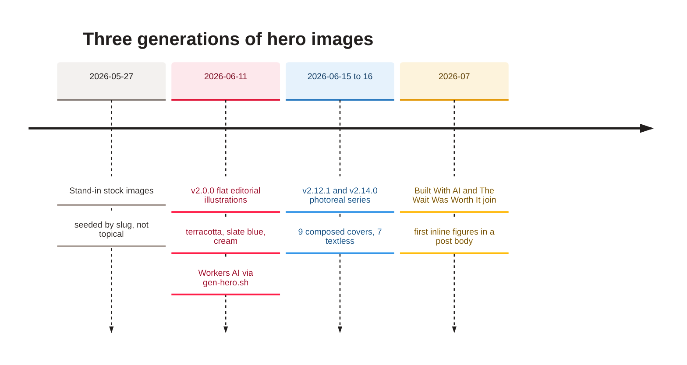
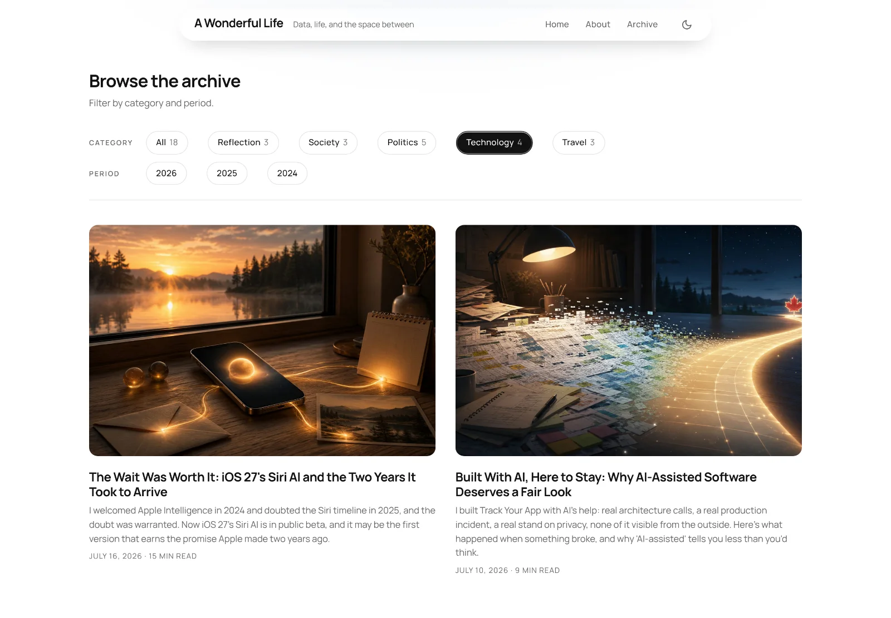

[Home](Home) › Business and product › Hero photography

# Hero photography

Every post opens with a hero image, and the same image is its card, its social preview and its `BlogPosting` image. The series has had three lives: deterministic stock stand-ins at launch (May 2026), a flat editorial illustration series generated with Cloudflare Workers AI (June 11), and the current photoreal series made with an image generator and optimised by hand (June 15 to 16, then each new post). This page describes the current standard and the tools.

> [!NOTE]
> **At a glance:**
> - 18 heroes in `assets/images/posts/`, all 1536 x 1024 (3:2) progressive JPEGs, plus 640px thumbnails in `thumbs/`.
> - 9 are "composed" covers with the title baked in (`heroTitled: true`); 9 are textless.
> - Every alt text describes the scene, avoids restating the title and contains no em dash.
> - Hero images are cached for a year as immutable, so a replaced image needs a new file name.

*Read top to bottom: each generation replaced the whole series so the site always looks like one set.*

<em>Two current heroes on the Technology page: both photoreal, 3:2, with rounded corners.</em>

## The standard

| Item | Standard |
|---|---|
| **Size** | 1536 x 1024 (3:2); the card and hero CSS also use 3:2 since v2.15.0 |
| **Format** | progressive JPEG, quality around 80, typically 137 to 405 KB |
| **Name** | `assets/images/posts/<slug>.jpg`; inline figures `<slug>-1.jpg`, `-2.jpg` |
| **Thumbnail** | `assets/images/posts/thumbs/<slug>.jpg`, 640px wide, used by the home card `srcset` |
| **Composed or textless** | composed covers carry kicker, title and byline in the art and set `heroTitled: true` |
| **Alt** | `heroAlt` describes the scene; no title, no em dash |
| **People** | symbolic scenes rather than real likenesses where possible |
| **Record** | one row per hero in `docs/superpowers/specs/2026-06-11-image-manifest.md` |

## Tools

- **`docs/superpowers/tools/gen-hero.sh <slug> "<subject>" <seed>`** calls the Cloudflare Workers AI image endpoint with a fixed flat-editorial style prompt and saves `assets/images/posts/<slug>.jpg` (1600 x 896, Pillow re-encode). It reads the API token and account id from `$HOME/.cloudflare_ai_token` and `$HOME/.cloudflare_ai_account`, never from the repo. It made the June 11 series; the current photoreal series was produced outside the repo and dropped into `assets/staging-images/` (gitignored, never copied to `_site/`) before optimising.
- **Thumbnails** are a resize of the hero to 640px wide (no script in the repo; any image tool works).

> [!IMPORTANT]
> `_headers` serves `/assets/images/*` with `Cache-Control: public, max-age=31536000, immutable`. Overwriting an image under the same name leaves visitors and the Cloudflare edge on the old one for up to a year. Give a replaced image a new file name and update its references; that is why the portrait is `vijay-v2.jpg` (v3.5.2).

## Social images

| Page | `og:image` |
|---|---|
| **Posts** | the post's hero |
| **About, Namaz pages** | the author portrait `assets/images/vijay-v2.jpg` (all `seoType: about`) |
| **Home, archive, categories** | `assets/images/og-default.jpg` |

Width and height are measured from the JPEG at build time by the `imageDims` filter, so every page reports real dimensions.

## Related pages
- [Adding a post](Adding-a-Post): where a hero fits in the workflow.
- [Design system](Design-System): how heroes and cards are styled.
- [The June 2026 redesign](The-June-2026-Redesign): the illustration series in depth.
- [SEO and discoverability](SEO-and-Discoverability): social cards.

Last checked: 2026-11-09

Sources in the repo

- `assets/images/posts/`, `assets/images/posts/thumbs/`
- `docs/superpowers/tools/gen-hero.sh`, `docs/superpowers/specs/2026-06-11-image-manifest.md`
- `_headers`, `src/_includes/head-seo.njk`, `eleventy/filters.mjs` (`imageDims`)
- `CHANGELOG.md` (v2.0.0, v2.12.1, v2.14.0, v2.17.4, v3.5.2, v3.5.4)

