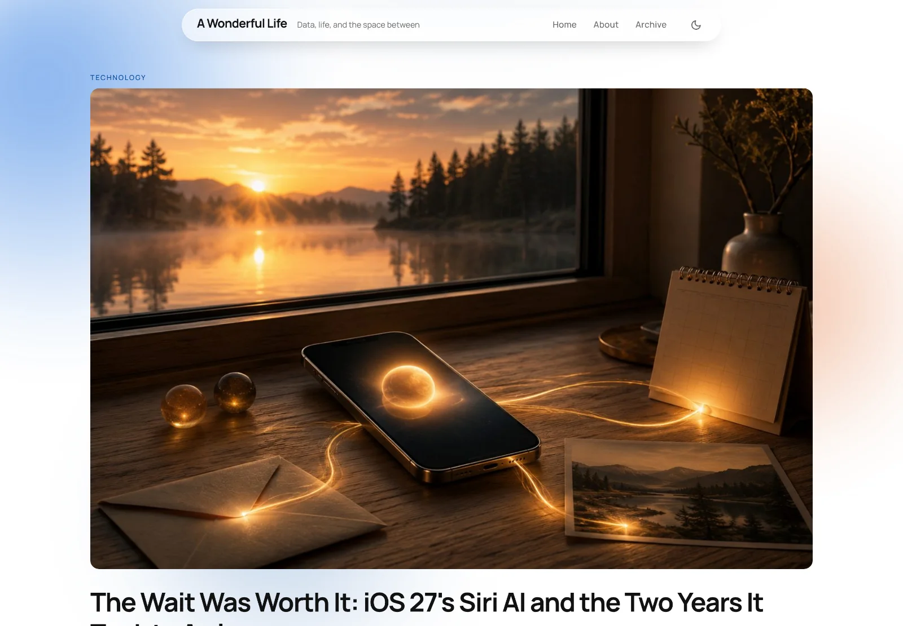
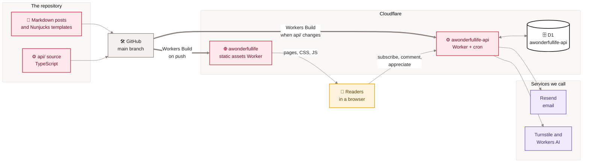
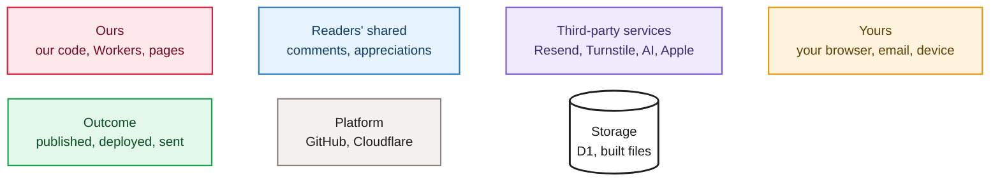

# A Wonderful Life wiki

<em>The live home page on 2026-11-09: the newest essay opens the page as the featured story, with the soft ambient backdrop behind it.</em>

Welcome. This wiki is the front door to everything about **A Wonderful Life** (awonderfullife.ca): what the site is for, how it is built and deployed, where every piece of data lives and how it moves, how the newsletter, comments and appreciations work, and how to change any of it safely. It is written for the owner, for future maintainers, and for anyone who wants to understand the project without reading the code first.

A Wonderful Life is the personal essay blog of Vijay Panangipally, tagline *Data, life, and the space between*. Eighteen essays across five categories are built by Eleventy from one Markdown file each and served as static files by a Cloudflare Worker. A second Worker at `api.awonderfullife.ca` owns everything that needs a server: newsletter sign-ups and sends, email-verified comments, and a zero-PII appreciate counter. The site also hosts the support and privacy pages for **Namaz**, the owner's iOS prayer-times app.

> [!NOTE]
> **At a glance**
> - Two Cloudflare Workers: `awonderfullife` serves the Eleventy build in `_site/`; `awonderfullife-api` runs the API, a 15-minute cron and one D1 database.
> - A post is one Markdown file; the home page, archive, categories, feed, sitemap, search index and SEO tags are all generated from it.
> - Every push to `main` deploys through Cloudflare Workers Builds (one build per Worker). There are no deploy workflows in GitHub; `wiki-sync.yml` only publishes this wiki.
> - Privacy first: no analytics scripts, no accounts for readers, comment emails never shown, appreciations keyed by a salted daily hash.

## Start here

| If you want to… | Read |
|---|---|
| **Understand what the blog is and why** | [About the blog](About-the-Blog) |
| **See every feature and where it lives** | [Features catalogue](Features-Catalogue) |
| **Get the big picture of the system** | [Site architecture](Site-Architecture) |
| **Understand how Markdown becomes a website** | [Build pipeline](Build-Pipeline) |
| **Publish a new essay** | [Adding a post](Adding-a-Post) |
| **Ship a change** | [Deployment and release](Deployment) |
| **See what shipped, and when** | [Release history](Release-History) |
| **Fix something in production** | [Runbooks](Runbooks) and [Monitoring and incidents](Monitoring-and-Incidents) |
| **Support the Namaz app** | [Namaz app support pages](Namaz-App-Support) |
| **Take over the project** | [Hand-offs](Hand-offs) |

## The map

*Read left to right: code and content live in the repository, GitHub hands each push to Cloudflare, one Worker serves pages and the other handles everything a reader sends back.*

### How to read the diagrams in this wiki

Every diagram uses the same colours, so you can tell at a glance whose thing each box is.

*Maple is this project's code; blue is what readers share publicly; violet is a third-party service the project relies on; amber is a reader's own browser, inbox or iPhone; green is an outcome; grey is a platform; white cylinders store data.*

## All pages

**Business and product**
- [About the blog](About-the-Blog): the product, the voice and the mission.
- [Features catalogue](Features-Catalogue): every reader-facing and owner-facing feature.
- [Readers and journeys](Readers-and-Journeys): who comes, and the paths they take.
- [The five categories](The-Five-Categories): the taxonomy and what belongs where.
- [Post catalogue](Post-Catalog): all eighteen essays, with dates and categories.
- [Content and editorial](Content-and-Editorial): the house style every essay follows.
- [Adding a post](Adding-a-Post): the one-file workflow, step by step.
- [Hero photography](Hero-Photography): how every post gets its cover image.
- [Namaz app support pages](Namaz-App-Support): the iOS app's support and privacy pages.
- [Decisions log](Decisions-Log): the big choices and why they were made.
- [Glossary](Glossary): the words this project uses.
- [Roadmap](Roadmap): what is planned and what was deliberately left.
- [The May 2026 redesign](The-May-2026-Redesign) and [The June 2026 redesign](The-June-2026-Redesign): how the look came to be.

**Architecture**
- [Site architecture](Site-Architecture): the two Workers and how they fit.
- [Technology stack](Technology-Stack): every tool and why.
- [Repository map](Repository-Map): every folder and what it holds.
- [Build pipeline](Build-Pipeline): Eleventy inputs to `_site/` to Worker assets.
- [Page lifecycle](Page-Lifecycle): what happens when someone opens a page.
- [Design system](Design-System): tokens, Liquid Glass, dark mode, components.
- [SEO and discoverability](SEO-and-Discoverability): canonicals, Open Graph, JSON-LD, feed, sitemap.

**Data**
- [Data sources and integrations](Data-Sources-and-Integrations): every outside service.
- [Data flow end to end](Data-Flow-End-to-End): each kind of data from origin to screen.
- [Data model](Data-Model): front matter, site data and the five D1 tables.
- [Data quality and processing](Data-Quality-and-Processing): validation, moderation, throttles, purges.
- [Newsletter pipeline](Newsletter-Pipeline): sign-up, compose, queue, send, unsubscribe.
- [Comments and reactions](Comments-and-Reactions): verified comments and the appreciate button.

**Operations**
- [GitHub Actions](GitHub-Actions): the one workflow, and why deploys are not here.
- [Cloudflare](Cloudflare): Workers, Builds, D1, cron, Access, Turnstile, AI, DNS.
- [Deployment and release](Deployment): how changes reach production, and versioning.
- [Release history](Release-History): every release, newest first.
- [Secrets and configuration](Secrets-and-Configuration): names only, where each lives.
- [Monitoring and incidents](Monitoring-and-Incidents): what to watch, and what went wrong before.
- [Runbooks](Runbooks): step-by-step fixes and routine tasks.
- [Hand-offs](Hand-offs): what a new owner needs, and the owner-only steps.

**Security and development**
- [Security and privacy](Security-and-Privacy): headers, Access, Turnstile, data kept and not kept.
- [API reference](API-Reference): every route on `api.awonderfullife.ca`.
- [Local development](Local-Development): run the site and the API on a laptop.
- [Testing and quality](Testing-and-Quality): the 61 API tests and how the site is checked.
- [Contributing and house style](Contributing-and-House-Style): rules for every change.
- [AI-assisted development](AI-Assisted-Development): the brainstorm, spec, plan, execute workflow.

**Not applicable here:** there is no internationalisation (the site is English only, written in Canadian English, `en-CA`), no user accounts for readers, and no mobile app inside this repository (Namaz lives elsewhere; this site only hosts its public pages).

Last checked: 2026-11-09

Sources in the repo

- `CLAUDE.md`, `README.md`, `CHANGELOG.md`, `ROADMAP.md`
- `wrangler.jsonc`, `api/wrangler.jsonc`, `eleventy.config.js`
- `src/`, `api/src/`, `assets/js/`

