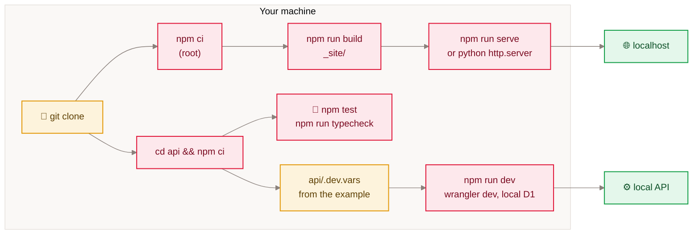

<sub>[Home](Home) › Security and development › Local development</sub>

# Local development

How to run the site and the API on your own machine. The site needs only Node; the API needs Node and Wrangler (installed as a dev dependency) and a `.dev.vars` file with local values. Neither needs access to production to build, test or preview.

> [!NOTE]
> **At a glance:**
> - Site: `npm ci`, `npm run build` (writes `_site/`), `npm run serve` (live reload).
> - API: `cd api && npm ci && npm test`; `npm run dev` for a local Worker with a local D1.
> - Copy `api/.dev.vars.example` to `api/.dev.vars` and fill in local values; it is gitignored.
> - Search only works after a full `npm run build`, because Pagefind indexes the built output.


*Read left to right: one clone, two independent setups: the site on top, the API below.*

## Prerequisites

- Node 18 or newer (`engines.node`), npm.
- For the API: nothing global; Wrangler comes from `api/node_modules`. `npx wrangler login` only if you will touch remote D1 or deploy.
- Python 3 is optional, for serving `_site/` with `python3 -m http.server`.

## The site

```bash
npm ci
npm run build                      # eleventy && pagefind --site _site
npm run serve                      # Eleventy dev server with live reload
# or, to serve exactly what will deploy:
cd _site && python3 -m http.server 8000
```

> [!TIP]
> `npm run serve` rebuilds on save but does not run Pagefind, so the archive search uses whatever index the last full build wrote. Run `npm run build` when you need search to reflect your change.

Clean URLs (`/posts/<slug>`) are a Cloudflare feature; a plain local server needs the `.html` form (`/posts/<slug>.html`). The comments, appreciate and newsletter widgets call the production API at `api.awonderfullife.ca`, and its CORS rules only allow the production origins, so they will not work from localhost.

## The API

```bash
cd api
npm ci
cp .dev.vars.example .dev.vars     # then edit the values
npm test                           # 61 tests in workerd
npm run typecheck
npm run dev                        # wrangler dev on a local port, local D1
```

For a local database with the real schema:

```bash
npx wrangler d1 migrations apply awonderfullife-api --local
```

`.dev.vars` keys: `ACCESS_TEAM_DOMAIN`, `ACCESS_AUD`, `TURNSTILE_SECRET`, `RESEND_API_KEY`, `NEWSLETTER_FROM`, `NEWSLETTER_REPLY_TO`, `REACTION_SALT` (and optionally `COMMENT_SECRET`). Any random string works for `REACTION_SALT` locally. Turnstile publishes test secrets that always pass or always fail, which are handy for local runs.

> [!WARNING]
> `npm run deploy`, `wrangler d1 ... --remote` and `npm run send` without `--dry-run` or `--test` all act on production. Locally, stick to `npm test`, `npm run dev` and `--local`.

## Previewing a newsletter issue

```bash
cd api
npm run send -- issues/<file>.md --dry-run --test <your address>
open issues/.preview.html
```

With both flags it works fully offline and sends nothing.

## Related pages
- [Testing and quality](Testing-and-Quality): what the tests check.
- [Build pipeline](Build-Pipeline): what `npm run build` does.
- [Secrets and configuration](Secrets-and-Configuration): the `.dev.vars` names.
- [Contributing and house style](Contributing-and-House-Style): before you open a pull request.

Last checked: 2026-11-09

<details><summary>Sources in the repo</summary>

- `package.json`, `api/package.json`, `api/.dev.vars.example`, `api/vitest.config.ts`
- `README.md` (Preview locally), `CLAUDE.md` (Working in `/api`), `api/issues/README.md`
</details>
