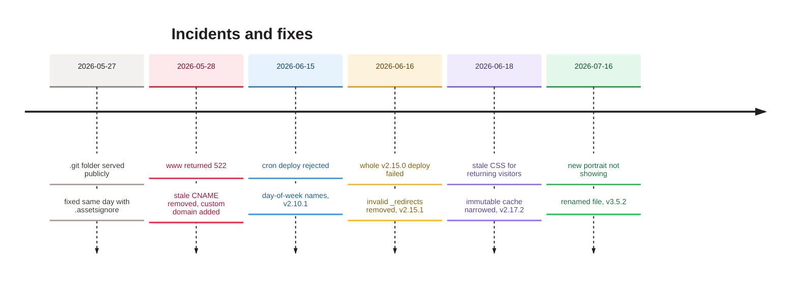

<sub>[Home](Home) › Operations › Monitoring and incidents</sub>

# Monitoring and incidents

What there is to watch, how to check that everything is healthy, and the incidents the project has had so far with what each one taught. Monitoring is deliberately light for a personal site: Cloudflare Workers observability on both Workers, a public `/health` route, the cron's one-line log on every tick, and zone analytics. There is no paging or external uptime service.

> [!NOTE]
> **At a glance:**
> - Health: `https://api.awonderfullife.ca/health` returns `{"status":"ok",...}`; the site home page returns 200.
> - Logs: Workers observability is on for both Workers (`observability.enabled: true`); the cron logs `[scheduled] ... send= moderation= reactions_purge=`.
> - Traffic: Cloudflare zone analytics, or `docs/superpowers/tools/cf-analytics.sh` for a report.
> - Six incidents so far, all fixed; none lost reader data.

## Health check in one minute

```bash
curl -sI https://awonderfullife.ca/ | head -1                     # HTTP/2 200
curl -sI https://www.awonderfullife.ca/about | grep -i location    # 301 to the apex
curl -s https://api.awonderfullife.ca/health                      # {"status":"ok",...}
curl -s "https://api.awonderfullife.ca/reactions?slug=built-with-ai-here-to-stay"   # {"count":N}
```

On 2026-11-09 all four answered as expected, and `/namaz/` and `/namaz/privacy/` returned 200.

## What to watch

| Signal | Where | Healthy looks like |
|---|---|---|
| **Site build** | Cloudflare dashboard, `awonderfullife`, Builds | green after each push |
| **API build** | dashboard, `awonderfullife-api`, Builds | green after pushes touching `api/` |
| **Cron** | dashboard, `awonderfullife-api`, Logs | a `[scheduled]` line every 15 minutes; `send={"status":"nothing_due"}` most of the time |
| **Issue sends** | `/admin/compose` queue list, or `npm run send -- --queue-list` | `sent` with `sent_count` near the list size |
| **Comments** | the comments on recent posts | no `unverified` backlog; tombstones rare |
| **Owner access** | `GET /admin/whoami` | your email and `db: ok` |
| **Traffic** | zone analytics, `cf-analytics.sh --days 30` | page views and uniques; requests include bots |
| **Email deliverability** | DMARC aggregate reports to the postmaster mailbox | passing SPF and DKIM |

## Incidents


*Read top to bottom in time: each incident has a fix release and a lasting rule.*

| Date | What happened | Impact | Fix | Lasting rule |
|---|---|---|---|---|
| **2026-05-27** | The first Workers deploy used the repo root as assets, so `.git/` and docs were downloadable | repository history exposed (the repo is public anyway; no secrets in it) | `.assetsignore` the same day; since v3.0.0 only `_site/` is served | serve only build output |
| **2026-05-28** | `www.awonderfullife.ca` returned 522 | `www` visitors saw an error | removed a stale CNAME, added `www` as a custom domain; later a 301 Redirect Rule (2026-06-20) | one canonical host |
| **2026-06-15** | v2.10.0 crons `0 23 * * 6` and `0 0 * * 0` rejected | scheduled send not deployed for minutes | `SAT`/`SUN` names (v2.10.1); later a `*/15` tick | Cloudflare's day-of-week is 1 to 7 |
| **2026-06-16** | an absolute URL in `_redirects` failed the whole v2.15.0 deploy (error 100324) | v2.15.0 not live until caught | file removed (v2.15.1) | host redirects belong in Redirect Rules |
| **2026-06-18** | CSS and JS were cached immutable for a year | returning visitors kept old styles | immutable only for images (v2.17.2) | unversioned files must revalidate |
| **2026-07-16** | the new portrait reused `vijay.jpg` under the immutable image cache | old portrait kept showing | renamed to `vijay-v2.jpg` (v3.5.2) | rename replaced images |

## Known risks to keep an eye on

- **Missing thumbnail:** `thumbs/the-wait-was-worth-it-ios-27-siri-ai.jpg` does not exist. Harmless while that post is featured; its home card will show a broken image once a newer post is published (see [Runbooks](Runbooks)).
- **Build command drift:** if the site's Workers Build command is cleared, a deploy would upload an empty or stale `_site/`.
- **Resend quota or key expiry:** sends would be marked `failed`; check the queue after each Saturday.
- **No tests on the site build:** a template error shows up as a failed Workers Build, after merge.

## Related pages
- [Runbooks](Runbooks): what to do when a check fails.
- [Cloudflare](Cloudflare): where logs and builds live.
- [Security and privacy](Security-and-Privacy): the `.git` exposure in context.
- [Release history](Release-History): the fix releases.
- [Testing and quality](Testing-and-Quality): what is tested before merge.

Last checked: 2026-11-09

<details><summary>Sources in the repo</summary>

- `wrangler.jsonc`, `api/wrangler.jsonc`, `api/src/index.ts` (`scheduled` log line), `_headers`
- `CHANGELOG.md` (2026-05-27, v1.0.0, v2.10.1, v2.15.1, v2.17.2, v3.5.2), `ROADMAP.md`
- `docs/superpowers/tools/cf-analytics.sh`
</details>
