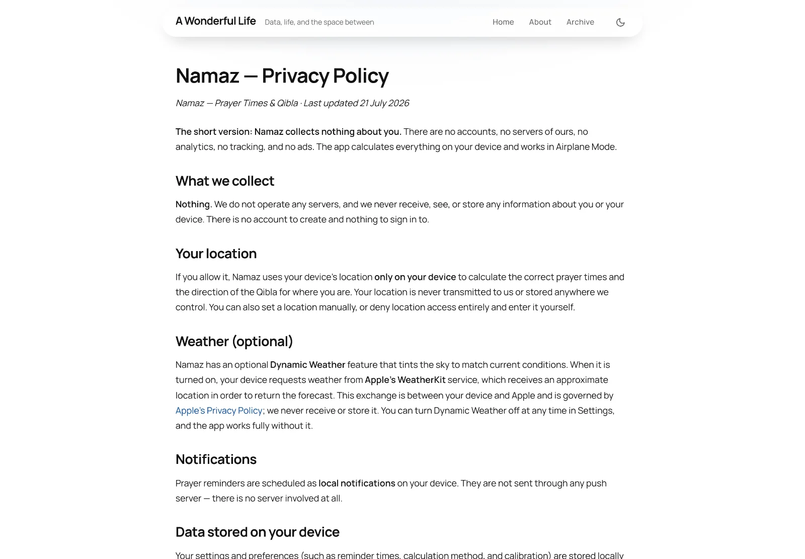
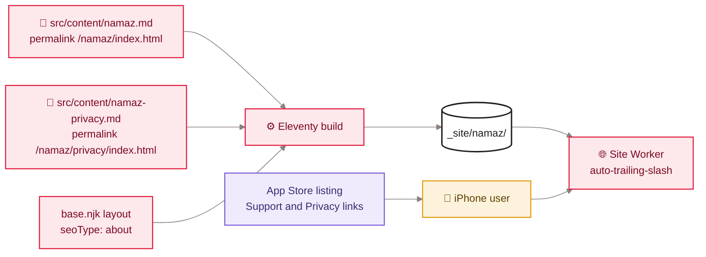

[Home](Home) › Business and product › Namaz app support pages

# Namaz app support pages

awonderfullife.ca hosts the two public web pages that Apple requires for the owner's iOS app **Namaz (Prayer Times & Qibla)**: a support page at `/namaz/` and a privacy policy at `/namaz/privacy/`. The app itself is not in this repository. These pages are ordinary Eleventy Markdown pages using the blog's base layout, added on 2026-07-21 as two direct commits to `main` (no pull request, no version tag yet).

> [!NOTE]
> **At a glance:**
> - `/namaz/` is the App Store **Support URL**; `/namaz/privacy/` is the **Privacy Policy URL** used in App Store Connect and TestFlight.
> - The policy says the app collects nothing: no accounts, no servers, no analytics, no ads; location stays on the device.
> - The only outside service the app can contact is Apple's WeatherKit, and only if the reader turns on Dynamic Weather.
> - Both pages are live and return 200; neither is in `sitemap.xml` yet.

<em>The privacy page in the blog's layout: the same header, typography and dark-mode support as every other page.</em>

## How the pages are built

*Read left to right: two Markdown files render through the shared layout into `_site/namaz/`; the App Store links bring users straight there.*

| Page | Source | Output | Public URL |
|---|---|---|---|
| **Support** | `src/content/namaz.md` | `_site/namaz/index.html` | `https://awonderfullife.ca/namaz/` |
| **Privacy policy** | `src/content/namaz-privacy.md` | `_site/namaz/privacy/index.html` | `https://awonderfullife.ca/namaz/privacy/` |

Both set `layout: base.njk`, `seoType: about` and `mainClass: "container"`. They do not set `newsletter`, so there is no sign-up card, and they are not posts, so there are no comments, appreciate button or search indexing. Requests to `/namaz` (no slash) get a 307 to `/namaz/` from the Worker's `html_handling: auto-trailing-slash`.

## What the pages say (summary)

**Support:** a short description (next prayer and countdown over a living sky, Qibla direction, gentle reminders), a contact email, a link to the privacy policy, and a note on accuracy: times are computed on the device, built with Dawoodi Bohra practice in mind with a one-time calibration to a community timetable, plus the common methods (MWL, ISNA, Umm al-Qura, Egyptian, Karachi, Tehran).

**Privacy policy (last updated 21 July 2026):**

| Topic | What the policy states |
|---|---|
| **Collection** | nothing; no servers, no account |
| **Location** | used only on the device for prayer times and Qibla; manual entry possible |
| **Weather** | optional Dynamic Weather asks Apple WeatherKit with an approximate location; governed by Apple's policy |
| **Notifications** | local notifications only; no push server |
| **On-device data** | settings stay on the device and go when the app is deleted |
| **Third parties** | no analytics, advertising or tracking SDKs |
| **Children** | safe for all ages, because nothing is collected |

## Things to know

> [!IMPORTANT]
> These URLs are registered with Apple. Do not move or rename `namaz.md` or `namaz-privacy.md`'s permalinks, or the App Store review and the listing links will break. If the app's data practices change, update the policy and its "Last updated" date in the same release as the app.

- **Social preview:** because both pages use `seoType: about`, their Open Graph image is the author portrait and their JSON-LD node is an `AboutPage` about the author. A dedicated `seoType` with an app icon would describe them better (see [Roadmap](Roadmap)).
- **Sitemap:** `src/content/sitemap.njk` lists home, about, archive, categories and posts only. Add the two Namaz URLs if you want search engines to find them directly.
- **House style:** both page titles and a few sentences use em dashes (for example between "Namaz" and "Privacy Policy" in the privacy page title). The site's editorial rules ban them in prose; a small copy edit would bring these pages in line.
- **Release record:** the two commits are not yet in `CHANGELOG.md` or tagged.

## Related pages
- [About the blog](About-the-Blog): the domain as a personal platform.
- [Build pipeline](Build-Pipeline): how a Markdown page becomes a URL.
- [SEO and discoverability](SEO-and-Discoverability): `seoType` and the sitemap.
- [Release history](Release-History): the 2026-07-21 entry.
- [Security and privacy](Security-and-Privacy): the site's own privacy posture.

Last checked: 2026-11-09

Sources in the repo

- `src/content/namaz.md`, `src/content/namaz-privacy.md`
- `src/_layouts/base.njk`, `src/_includes/head-seo.njk`, `eleventy/jsonld.mjs`, `src/content/sitemap.njk`
- `wrangler.jsonc` (`html_handling`)
- git: `a092c88`, `d005a0c` (2026-07-21)

