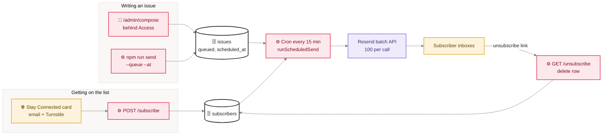
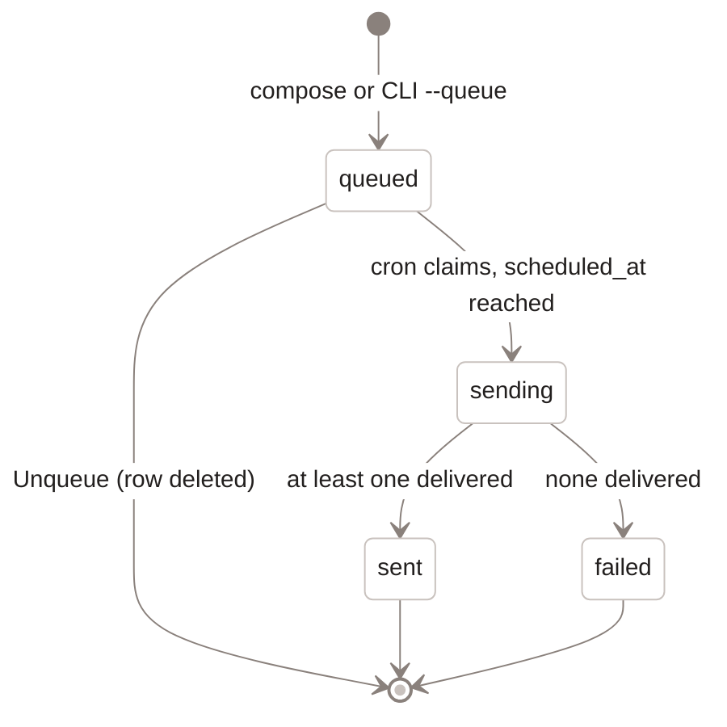

<sub>[Home](Home) › Data › Newsletter pipeline</sub>

# Newsletter pipeline

The newsletter is fully owned: the list lives in D1, issues are written in a compose page behind Cloudflare Access (or with a CLI), queued with their own send time, and sent by the API Worker's 15-minute cron through Resend. There is deliberately no "broadcast now" button in the web UI; an issue goes out only when its scheduled time arrives. This replaced Buttondown in v2.8.0 (2026-06-15).

> [!NOTE]
> **At a glance:**
> - Sign-up: single opt-in, Turnstile-gated, `POST /subscribe` from the card on home, About and every post.
> - Authoring: `https://api.awonderfullife.ca/admin/compose` (rich editor, preview, test to self, schedule) or `npm run send` in `api/`.
> - Default send time: the next Saturday at 7pm Eastern; any future Eastern time can be chosen.
> - Every email carries a personal unsubscribe link and `List-Unsubscribe` one-click headers.

## The whole pipeline


*Read left to right: readers join the list, the owner queues issues, the cron joins the two at each issue's time and hands them to Resend; unsubscribing deletes the row.*

## Issue lifecycle


*Read from the top: only a queued issue can be pulled back; once claimed, it ends as sent or failed.*

## The compose page

Served by the API Worker at `GET /admin/compose`, gated by Cloudflare Access at the edge and by an in-code check of the Access JWT. It offers:

- subject, preheader and a Toast UI rich editor that produces Markdown;
- **Preview**, rendered through the same template as the real email (`render.mjs`);
- **Send test to me**, which sends one copy to the signed-in address only;
- a schedule picker: next Saturday 7pm ET, or a custom Eastern date and time;
- a queue list of the latest 50 issues with status, time and an **Unqueue** button for queued ones;
- **Sign out** through `/cdn-cgi/access/logout`.

## The CLI

From `api/`, with `RESEND_API_KEY` exported locally for immediate sends:

```bash
npm run send -- issues/<file>.md --dry-run                  # render to issues/.preview.html, send nothing
npm run send -- issues/<file>.md --test <your address>      # one copy to you
npm run send -- issues/<file>.md --queue                    # next Saturday 7pm ET
npm run send -- issues/<file>.md --queue --at "2026-11-14 09:00"   # custom Eastern time
npm run send -- --queue-list                                # list issues
npm run send -- --unqueue <id>                              # pull one back
npm run send -- issues/<file>.md                            # immediate broadcast from the laptop
```

Issue files are Markdown with front matter `subject` and optional `preheader`. The CLI reads and writes D1 through `wrangler d1 execute --remote`.

> [!WARNING]
> The last command, with no flag, sends to every active subscriber at once from your laptop. Prefer `--queue` so the send goes through the scheduled path and can still be unqueued.

## Timing

The cron fires every 15 minutes (`*/15 * * * *`). `scheduled_at` is stored in UTC; `schedule.mjs` converts Eastern wall-clock times by measuring the offset at the target instant, so 7pm stays 7pm across daylight saving changes. Two issues left on the default both send that Saturday; give them different times to space them out. If nothing is due, nothing is sent.

> [!IMPORTANT]
> Cloudflare's cron day-of-week numbering is non-standard (1 is Sunday, 7 is Saturday). The current trigger avoids the field entirely, but if you add a day-specific cron, use `SAT` and `SUN` names. v2.10.1 fixed a deploy that failed on this.

## Sending details

| Setting | Value |
|---|---|
| **From** | `NEWSLETTER_FROM` var: the "A Wonderful Life" sender on the `send.` subdomain |
| **Reply-To** | `NEWSLETTER_REPLY_TO` var: the owner's iCloud inbox |
| **Headers** | `List-Unsubscribe: <unsub URL>`, `List-Unsubscribe-Post: List-Unsubscribe=One-Click` |
| **Template** | 600px table layout, masthead, body, footer with unsubscribe; plain-text part |
| **Batching** | 100 messages per Resend call |

## Related pages
- [API reference](API-Reference): `/subscribe`, `/unsubscribe`, `/admin/*`.
- [Data model](Data-Model): `subscribers` and `issues`.
- [Runbooks](Runbooks): queueing, unqueueing and checking a send.
- [Secrets and configuration](Secrets-and-Configuration): `RESEND_API_KEY` and the vars.
- [Security and privacy](Security-and-Privacy): Access and what is kept about subscribers.

Last checked: 2026-11-09

<details><summary>Sources in the repo</summary>

- `api/src/index.ts`, `api/src/admin.ts`, `api/src/scheduled.ts`, `api/src/render.mjs`, `api/src/schedule.mjs`
- `api/scripts/send-issue.mjs`, `api/issues/README.md`, `api/wrangler.jsonc`
- `src/_includes/newsletter.njk`, `src/_includes/newsletter-script.njk`
- `CHANGELOG.md` (v2.5.0 to v2.12.0)
</details>
