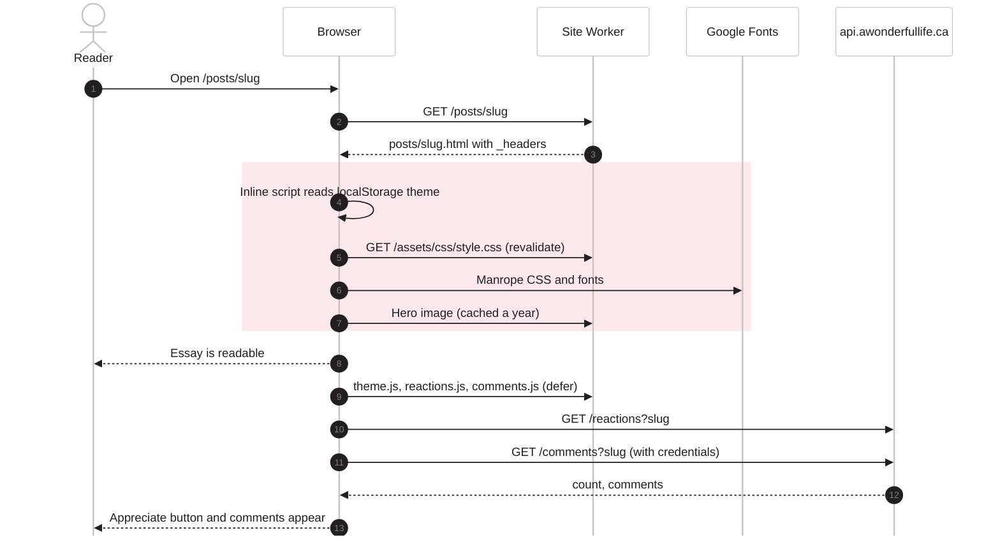

[Home](Home) › Architecture › Page lifecycle

# Page lifecycle

What happens, in order, when someone opens a post on awonderfullife.ca. The HTML comes from the static site Worker with no code running; the browser then applies the saved theme before painting, loads one stylesheet and the Manrope font, and finally three small scripts reach out to `api.awonderfullife.ca` for the appreciate count and the comments. If any of those later calls fail, the essay has already been read.

> [!NOTE]
> **At a glance:**
> - The essay is in the first HTML response; nothing after that is needed to read it.
> - The theme is applied by an inline script before the stylesheet, so there is no flash of the wrong theme.
> - CSS and JS revalidate on every load (`max-age=0, must-revalidate`); images are cached for a year.
> - API calls happen after the page is usable and fail silently.

*Read top to bottom: the highlighted phase is everything needed to show the essay; the API calls after it only add the count and comments.*

## Step by step

1. **Request.** `GET /posts/<slug>` reaches the site Worker. `html_handling: auto-trailing-slash` maps it to `posts/<slug>.html` in `_site/`. A request for `/posts/<slug>.html` gets a redirect to the clean URL; `www.awonderfullife.ca` gets a 301 to the apex from a dashboard Redirect Rule.
2. **Headers.** `_headers` adds `X-Content-Type-Options`, `Referrer-Policy`, `Strict-Transport-Security`, `X-Frame-Options`, `Permissions-Policy` to every response.
3. **Theme before paint.** The first script in `<head>` reads `localStorage.theme`; if it is `dark` or `light` it sets `data-theme` on `<html>`. Otherwise `prefers-color-scheme` decides through CSS.
4. **Styles and font.** `style.css` (revalidated each load, cheap 304s) and Manrope from Google Fonts.
5. **Content.** The post body, hero, author card, prev and next, and the "More reading" strip are all in the HTML already.
6. **Deferred scripts.** `theme.js` wires the toggle; `reactions.js` and `comments.js` (only on posts) mount into `<section class="reactions">` and `<section id="comments">`. Pages with the newsletter card also load the Turnstile script.
7. **API calls.** Reads are public and cached nowhere; `comments.js` sends credentials so a returning commenter's session cookie is included.

## Which pages load what

| Page | Newsletter + Turnstile | Comments | Appreciate | Search | Ambient |
|---|---|---|---|---|---|
| **Home** | ✅ | No | No | No | ✅ |
| **Post** | ✅ | ✅ | ✅ | No | No |
| **About** | ✅ | No | No | No | No |
| **Archive** | No | No | No | ✅ | No |
| **Category** | No | No | No | No | No |
| **Namaz pages** | No | No | No | No | No |

Driven by front matter flags `newsletter`, `hasComments`, `hasReactions`, `search` and `ambient` read in `base.njk`.

## When the API is down

| Feature | What the reader sees |
|---|---|
| **Appreciate** | the button renders with a count of 0 and never updates |
| **Comments** | "Comments are unavailable right now." in place of the list; the essay is unaffected |
| **Newsletter** | "Network error. Please try again." |

## Related pages
- [Build pipeline](Build-Pipeline): how the files in this sequence were made.
- [Security and privacy](Security-and-Privacy): the headers in step 2.
- [Design system](Design-System): the theme logic in step 3.
- [Comments and reactions](Comments-and-Reactions): steps 6 and 7 in depth.
- [API reference](API-Reference): the endpoints called.

Last checked: 2026-11-09

Sources in the repo

- `src/_layouts/base.njk`, `src/_layouts/post.njk`, `src/_includes/newsletter-script.njk`
- `assets/js/theme.js`, `assets/js/reactions.js`, `assets/js/comments.js`
- `_headers`, `wrangler.jsonc`, `ROADMAP.md` (www redirect)

