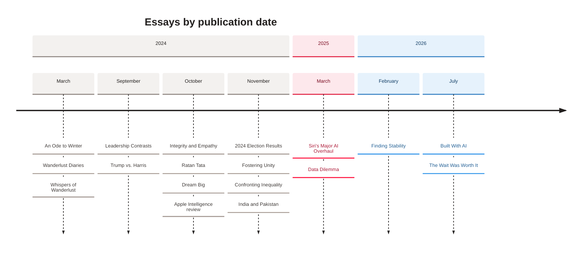

[Home](Home) › Business and product › Post catalogue

# Post catalogue

All eighteen essays on awonderfullife.ca, newest first, as their front matter stands on 2026-11-09. The slug is the file name in `src/content/posts/` and the public URL `/posts/<slug>`. Titles here are the current ones; most were retuned for search in v3.5.3 without changing the slug, so links and feed GUIDs never broke.

> [!NOTE]
> **At a glance:**
> - 18 posts, from 2024-03-14 to 2026-07-16; 13 in 2024, 2 in 2025, 3 in 2026.
> - 17 posts carry a frozen `guid` from the hand-built era; the newest post is the first without one.
> - 9 posts use a "hero-titled" cover whose image carries the title.
> - The newest post is always the featured opener on the home page.

*Read left to right through time: the 2024 election autumn was the busiest stretch; 2026 brought the technology trilogy to a close.*

## The posts

| Date | Category | Title | Slug | Cover |
|---|---|---|---|---|
| **2026-07-16** | Technology | The Wait Was Worth It: iOS 27's Siri AI and the Two Years It Took to Arrive | `the-wait-was-worth-it-ios-27-siri-ai` | textless |
| **2026-07-10** | Technology | Built With AI, Here to Stay: Why AI-Assisted Software Deserves a Fair Look | `built-with-ai-here-to-stay` | textless |
| **2026-02-18** | Reflection | Finding Stability in Unfinished Work: How I Learned to Endure Uncertainty | `finding-stability-in-unfinished-work-a-guide-to-endurance` | textless |
| **2025-03-04** | Society | Data Dilemma: Why Economic Data Feels So Far From Real Life | `data-dilemma-starving-for-truth-in-a-sea-of-misinformation` | textless |
| **2025-03-03** | Technology | Siri's Major AI Overhaul: The Apple Intelligence Features Coming to iOS 18.5 | `siris-major-ai-overhaul-features-of-ios-18-5-you-need-to-know` | titled |
| **2024-11-18** | Politics | Confronting Inequality: The Shared Failures of the U.S. and Canada | `the-united-states-and-canada-uneasy-neighbors-shared-failures` | textless |
| **2024-11-18** | Society | India and Pakistan: The 1947 Partition, and Twin Dreams Still Bound by Hope | `india-and-pakistan-twin-dreams-divided-bound-by-hope` | textless |
| **2024-11-07** | Politics | Fostering Unity in Canada: Pushing Back on Divisive Political Rhetoric | `fostering-unity-in-canada-combating-divisive-rhetoric` | textless |
| **2024-11-06** | Politics | 2024 U.S. Election Results: What the Vote Was Really Asking For | `2024-election-results-a-call-for-change` | titled |
| **2024-10-29** | Technology | How Apple's AI Enhances Everyday Life: An Apple Intelligence Review | `apple-intelligence-ai-for-us-everyday-users` | titled |
| **2024-10-09** | Society | Dream Big: Making Quality Education Accessible for Every Child | `dream-big-transforming-education-for-every-child` | titled |
| **2024-10-09** | Reflection | Ratan Tata: The Leadership Legacy of a Giant Who Wore His Greatness Lightly | `ratan-tata-the-giant-who-wore-his-greatness-lightly` | textless |
| **2024-10-09** | Reflection | How Integrity and Empathy Define Us: The Small Choices That Build Character | `how-integrity-and-empathy-define-us` | titled |
| **2024-09-11** | Politics | Trump vs. Harris: Policy, Strategy, and Leadership in the U.S. Presidential Debate | `trump-vs-harris-policy-strategy-and-leadership-in-u-s-presidential-debate` | textless |
| **2024-09-11** | Politics | Leadership Contrasts in the U.S. Election: A Canadian's View on the Global Stakes | `leadership-contrasts-in-u-s-election-a-canadians-view-on-global-impact` | titled |
| **2024-03-15** | Travel | Whispers of Wanderlust: An Electric-Car Road Trip Across Canada | `whispers-of-wanderlust-an-eco-friendly-journey-across-canada` | titled |
| **2024-03-14** | Travel | Wanderlust Diaries: Travel Stories From Beyond Borders | `wanderlust-diaries-journeys-beyond-borders` | titled |
| **2024-03-14** | Travel | An Ode to Winter: Finding Unexpected Beauty in a Toronto Winter | `an-ode-to-winter-discovering-unforeseen-charms-in-torontos-embrace` | titled |

"Titled" means `heroTitled: true`: the cover image carries the kicker, title and byline, and the HTML header is hidden visually but kept in the page for search engines and screen readers.

## How the order is decided

Posts sort by `date`, newest first. Same-day posts keep alphabetical order by slug, with one documented exception in `eleventy.config.js`: on 2024-11-18, "Confronting Inequality" comes before "India and Pakistan", matching the order the hand-built site used on six surfaces before the Eleventy move (`SAME_DAY_TIE_BREAK`).

> [!TIP]
> Front-matter dates parse as UTC midnight. Every date filter reads UTC getters for that reason, so a post dated `2026-07-16` never shows as July 15 in the byline.

## The technology trilogy

Three Technology essays form a deliberate arc: the October 2024 Apple Intelligence review, the March 2025 Siri preview, and the July 2026 iOS 27 essay that measures both against what finally shipped. The July 2026 post is also the first with inline figures inside the body, which added a small `.post-content img` style.

## Related pages
- [The five categories](The-Five-Categories): the taxonomy.
- [Adding a post](Adding-a-Post): how to add a row to this table.
- [Hero photography](Hero-Photography): the covers.
- [Release history](Release-History): when each post and title change shipped.

Last checked: 2026-11-09

Sources in the repo

- `src/content/posts/*.md` (front matter `title`, `date`, `category`, `guid`, `heroTitled`)
- `eleventy.config.js` (`posts` collection and `SAME_DAY_TIE_BREAK`)
- `CHANGELOG.md` (v3.5.3, v3.5.4)

