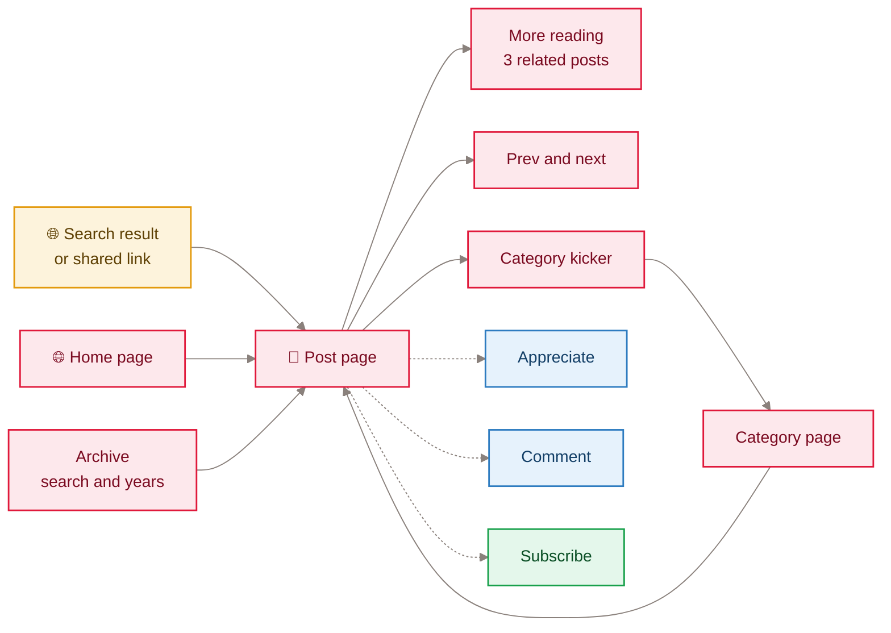
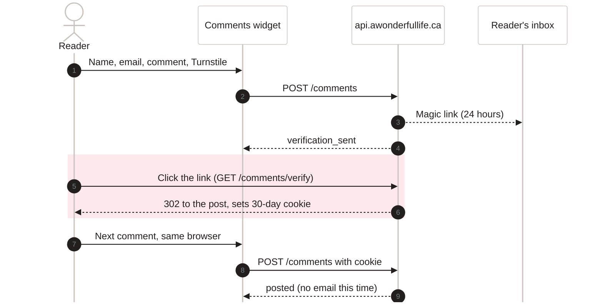
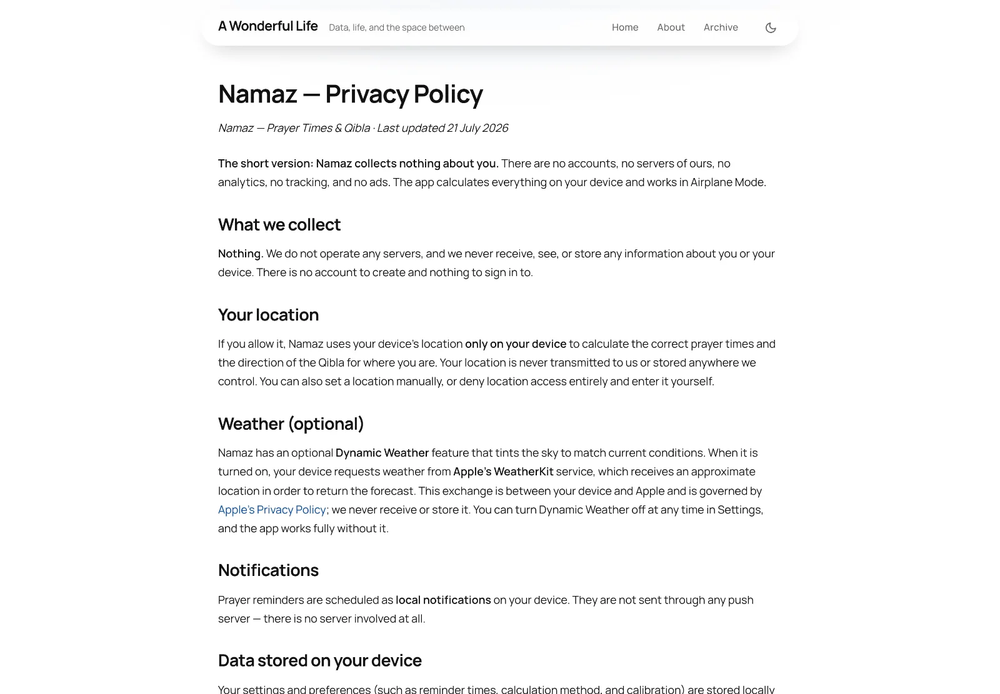
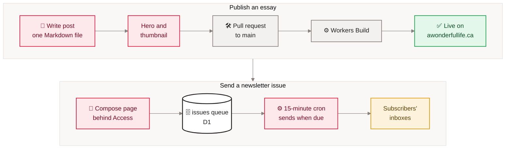

[Home](Home) › Business and product › Readers and journeys

# Readers and journeys

Who uses awonderfullife.ca, and the paths they take through it. There are no accounts and no analytics script, so this page describes the journeys the site is built for, using the routes and features in the code, not tracked behaviour.

> [!NOTE]
> **At a glance:**
> - Four kinds of visitor: a reader, a subscriber, a commenter, and a Namaz app user looking for help.
> - One owner journey: write a post, ship it, and send a newsletter issue.
> - No journey needs an account. The only identity a reader ever proves is an email address, and only to subscribe or to comment.
> - The site never blocks reading on the API: if the API is down, comments and appreciations quietly fail and every page still renders.

## Who comes

| Visitor | Arrives from | Wants | Touches the API? |
|---|---|---|---|
| **Reader** | search, a shared link, the RSS feed | to read an essay | only to show the appreciate count and comments |
| **Subscriber** | the "Stay Connected" card on home, About or a post | new essays by email | `POST /subscribe`, later `GET /unsubscribe` |
| **Commenter** | the comments section under a post | to respond | `POST /comments`, `GET /comments/verify` |
| **Namaz user** | the App Store's Support or Privacy link | help, or to check what the app collects | No |
| **Owner** | Cloudflare Access sign-in | to write and schedule an issue | `/admin/*` |

## A reader's journey

*Read left to right: most readers land on a post; from there the kicker, related posts, prev and next, and the archive keep them reading. Dotted lines are optional actions that call the API.*

## A commenter's journey

*Read top to bottom: the first comment needs one email click; the highlighted step sets a session so later comments publish at once.*

## A subscriber's journey

1. Fills in the email field on the "Stay Connected" card and completes Turnstile.
2. Sees "Thanks, you're on the list." (single opt-in; no confirmation email).
3. Receives each issue at its scheduled time, usually Saturday 7pm Eastern, from the newsletter sending address, with replies going to the owner's inbox.
4. Clicks **Unsubscribe** in any issue (or uses the mail client's one-click unsubscribe). The row is deleted, and a plain "You've been unsubscribed." page confirms it.

## A Namaz user's journey

<em>The Namaz privacy page as an App Store visitor sees it, in the blog's own layout.</em>

An iPhone user taps **App Support** or **Privacy Policy** on the App Store listing and lands on `/namaz/` or `/namaz/privacy/`. The pages use the blog's base layout, without the newsletter card, comments or appreciate button. See [Namaz app support pages](Namaz-App-Support).

## The owner's journey

*Read each row left to right: a post ships by merging; an issue ships by queuing it, and the cron sends it at its scheduled time.*

## Related pages
- [Features catalogue](Features-Catalogue): every feature named here.
- [Comments and reactions](Comments-and-Reactions): the commenter and appreciate flows in depth.
- [Newsletter pipeline](Newsletter-Pipeline): the subscriber and owner flows in depth.
- [Adding a post](Adding-a-Post): the owner's writing journey, step by step.
- [Namaz app support pages](Namaz-App-Support): the app user's pages.

Last checked: 2026-11-09

Sources in the repo

- `src/_layouts/post.njk`, `src/_includes/newsletter*.njk`
- `assets/js/comments.js`, `assets/js/reactions.js`
- `api/src/index.ts`, `api/src/comments.ts`, `api/src/scheduled.ts`
- `src/content/namaz.md`, `src/content/namaz-privacy.md`

