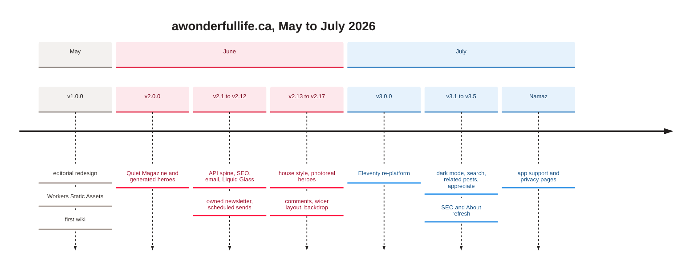
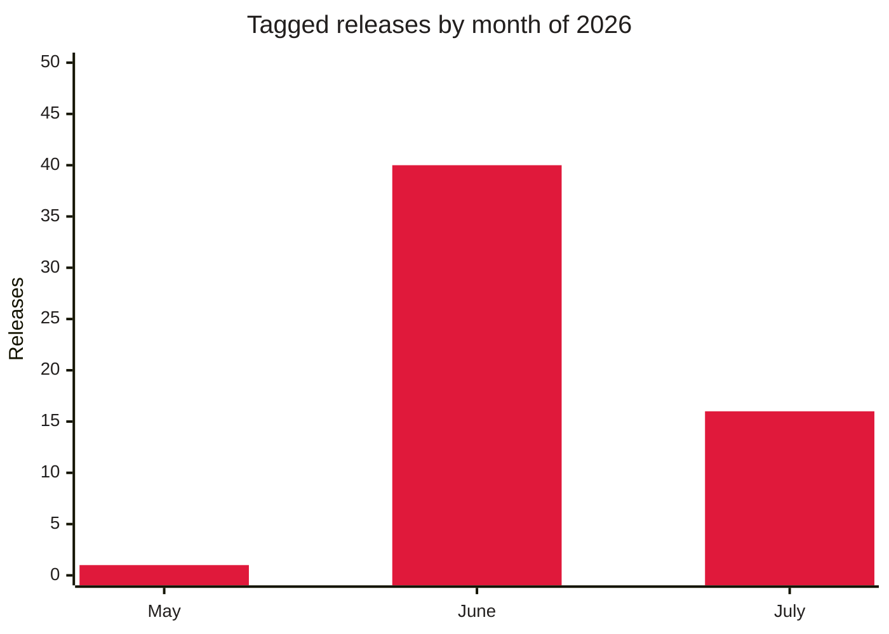

[Home](Home) › Operations › Release history

# Release history

Every release and merged change to awonderfullife.ca, newest first: the 57 tagged releases from `v1.0.0` (2026-05-28) to `v3.5.7` (2026-07-16), plus the untagged merges and direct commits around them, through the Namaz pages of 2026-07-21. Each row says what a reader would notice, what changed in the code, and how it reached production. Dates are UTC, from `CHANGELOG.md` where it gives them (which can be a day after the local commit date). Full prose notes for every tag are in `CHANGELOG.md`; the reasons behind the big turns are in the [Decisions log](Decisions-Log).

> [!NOTE]
> **At a glance:**
> - 70 rows: 57 tagged releases and 13 untagged changes, from the first commit (2026-05-25) to 2026-07-21.
> - Three majors: `v1.0.0` editorial launch, `v2.0.0` Quiet Magazine redesign, `v3.0.0` Eleventy re-platform.
> - The site has always deployed through its Workers Build on push to `main`; the API was deployed by hand until its own Workers Build arrived on 2026-06-20.
> - The last change, the Namaz pages, is live but has no CHANGELOG entry or tag yet.

**Jump to:** [July 2026](#july-2026) · [June 2026](#june-2026) · [May 2026](#may-2026) · [Sources and gaps](#sources-and-gaps)

## The journey so far

*Read top to bottom by month: June was the busiest month by far, when the site grew an API, a newsletter and comments.*

*Counts of semver tags: one in May, 40 in June, 16 in July. Nothing has been tagged since 2026-07-16.*

## How to read the tables

| Column | Meaning |
|---|---|
| **Version** | the semver tag on the merge commit, or **untagged** for a merge or commit without one |
| **Date (UTC)** | release time from `CHANGELOG.md`, else the merge commit |
| **PR** | the pull request(s); "direct to `main`" when there was none |
| **For readers** | what a visitor would notice; "None" for owner-only or internal changes |
| **Technical** | files, migrations, secrets and tests involved |
| **Deployed by** | see below |

- **Site build:** the site Worker's Cloudflare Workers Build on push to `main`, with the repo root as assets (before v3.0.0).
- **Site build (Eleventy):** the same, running `npm ci && npm run build` and uploading `_site/` (v3.0.0 onward).
- **API by hand (`npm run deploy`):** `wrangler deploy` from `api/` on the owner's machine (2026-06-13 to 2026-06-19).
- **API Workers Build:** the API Worker's own Workers Build on pushes touching `api/*` (2026-06-20 onward).
- D1 migrations and Wrangler secrets were always applied by hand.

## Releases

### July 2026

| Version | Date (UTC) | PR | For readers | Technical | Deployed by |
|---|---|---|---|---|---|
| **untagged** | 2026-07-21 | direct to `main` | New Namaz support page at `/namaz/` and privacy policy at `/namaz/privacy/` for the iOS app | `src/content/namaz.md`, `namaz-privacy.md` on `base.njk`; two direct commits `a092c88`, `d005a0c`; no CHANGELOG entry or tag yet | Site build (Eleventy) |
| **`v3.5.7`** | 2026-07-16 | [#68](https://github.com/vijaybpanangi/awonderfullife/pull/68) | Track Your App link on About uses its real wordmark, swapped for light and dark, and points to its About page | `assets/images/tya-light.png`, `tya-dark.png`, theme cascade in CSS | Site build (Eleventy) |
| **`v3.5.6`** | 2026-07-16 | [#67](https://github.com/vijaybpanangi/awonderfullife/pull/67) | About profile links spread evenly and centred | CSS `justify-content: space-evenly` | Site build (Eleventy) |
| **`v3.5.5`** | 2026-07-16 | [#66](https://github.com/vijaybpanangi/awonderfullife/pull/66) | About page rewritten in plain first person; profile links (LinkedIn, X, GitHub, Instagram, Track Your App) shown | `about.njk`, brand icons, dark-mode fills | Site build (Eleventy) |
| **`v3.5.4`** | 2026-07-16 | [#65](https://github.com/vijaybpanangi/awonderfullife/pull/65) | New post "The Wait Was Worth It" (iOS 27 Siri AI), first with inline figures | new Markdown post, three inline images, `.post-content img` style | Site build (Eleventy) |
| **`v3.5.3`** | 2026-07-16 | [#64](https://github.com/vijaybpanangi/awonderfullife/pull/64) | Every excerpt rewritten in first person; titles retuned for search | front matter `title`, `excerpt` on all 17 posts; slugs and GUIDs unchanged | Site build (Eleventy) |
| **`v3.5.2`** | 2026-07-16 | [#63](https://github.com/vijaybpanangi/awonderfullife/pull/63) | The new About portrait actually shows (was cached) | portrait renamed `vijay-v2.jpg`, four references updated; cache rule documented | Site build (Eleventy) |
| **`v3.5.1`** | 2026-07-16 | [#62](https://github.com/vijaybpanangi/awonderfullife/pull/62) | Better search snippets; new About portrait | first-person `description` on 17 posts; 800 x 800 portrait | Site build (Eleventy) |
| **`v3.5.0`** | 2026-07-16 | [#61](https://github.com/vijaybpanangi/awonderfullife/pull/61) | Richer search results and social cards | `sameAs`, `BreadcrumbList`, `og:image` alt and real dimensions (`imageDims`), Twitter attribution, `meta author`, optional `updated`; robots opened to all crawlers | Site build (Eleventy) |
| **`v3.4.0`** | 2026-07-11 | [#59](https://github.com/vijaybpanangi/awonderfullife/pull/59) | Appreciate button at the end of every post | `assets/js/reactions.js`, `hasReactions` in `post.njk`; uses the #54 API | Site build (Eleventy) |
| **`v3.3.0`** | 2026-07-11 | [#58](https://github.com/vijaybpanangi/awonderfullife/pull/58) | "More reading": three related posts under each post | `relatedPosts` filter, card macro reuse | Site build (Eleventy) |
| **`v3.2.0`** | 2026-07-11 | [#57](https://github.com/vijaybpanangi/awonderfullife/pull/57) | Instant search on the archive | Pagefind 1.5.2 in `npm run build`, `data-pagefind-body` on posts | Site build (Eleventy) |
| **`v3.1.0`** | 2026-07-11 | [#56](https://github.com/vijaybpanangi/awonderfullife/pull/56) | Dark mode, automatic or by toggle, no flash | about 20 colours moved to tokens, dark token block, pre-paint script, `theme.js` | Site build (Eleventy) |
| **`v3.0.0`** | 2026-07-11 | [#53](https://github.com/vijaybpanangi/awonderfullife/pull/53) [#55](https://github.com/vijaybpanangi/awonderfullife/pull/55) | No visible change: same pages and URLs | Eleventy re-platform: Markdown posts, generated pages, feed, sitemap, SEO; parity gate 27 of 27; `assets.directory` moved to `./_site`; `.assetsignore` and `seo-inject.py` retired; five latent bugs fixed | Site build (Eleventy) (build command set in the dashboard before merge) |
| **untagged** | 2026-07-11 | [#54](https://github.com/vijaybpanangi/awonderfullife/pull/54) | None yet (endpoints dormant until v3.4.0) | `GET/POST /reactions`, migration `0005`, `REACTION_SALT`, daily purge in the cron; 16 tests | API Workers Build; migration and secret by hand |
| **untagged** | 2026-07-11 | [#60](https://github.com/vijaybpanangi/awonderfullife/pull/60) | None | CHANGELOG and README rows for v3.1.0 to v3.4.0 | nothing to deploy (docs or tooling) |
| **`v2.17.5`** | 2026-07-10 | [#52](https://github.com/vijaybpanangi/awonderfullife/pull/52) | "Built With AI, Here to Stay" rewritten from the owner's draft, with a dek | post body, new `.post-dek` style, 9 min read | Site build |
| **`v2.17.4`** | 2026-07-10 | [#51](https://github.com/vijaybpanangi/awonderfullife/pull/51) | Same post gets a photoreal hero | hero replaced, 3:2 crop, alt rewritten | Site build |
| **untagged** | 2026-07-10 | [#50](https://github.com/vijaybpanangi/awonderfullife/pull/50) | None | timestamp fix and CLAUDE.md "Latest" marker | nothing to deploy (docs or tooling) |
| **`v2.17.3`** | 2026-07-10 | [#49](https://github.com/vijaybpanangi/awonderfullife/pull/49) | New post "Built With AI, Here to Stay" (Technology) | hand-built in four places; `seo-inject.py` canonical `.html` fix | Site build |

### June 2026

| Version | Date (UTC) | PR | For readers | Technical | Deployed by |
|---|---|---|---|---|---|
| **untagged** | 2026-06-20 | [#48](https://github.com/vijaybpanangi/awonderfullife/pull/48) | None | `cf-analytics.sh` gains trackyourapp.ca and trackurapp.ca | nothing to deploy (docs or tooling) |
| **untagged** | 2026-06-20 | [#47](https://github.com/vijaybpanangi/awonderfullife/pull/47) | None | new `docs/superpowers/tools/cf-analytics.sh` traffic report | nothing to deploy (docs or tooling) |
| **untagged** | 2026-06-20 | [#46](https://github.com/vijaybpanangi/awonderfullife/pull/46) | None | docs: API auto-deploy and the www to apex Redirect Rule recorded as done | nothing to deploy (docs or tooling) |
| **untagged** | 2026-06-20 | [#45](https://github.com/vijaybpanangi/awonderfullife/pull/45) | None | `npm audit fix` in `api/` (0 vulnerabilities); test guarding offline moderation | API Workers Build (first builds after it was connected that day) |
| **`v2.17.2`** | 2026-06-18 | [#44](https://github.com/vijaybpanangi/awonderfullife/pull/44) | Style updates appear on a normal refresh | `_headers`: immutable only for `/assets/images/*`; CSS and JS revalidate | Site build |
| **`v2.17.1`** | 2026-06-18 | [#43](https://github.com/vijaybpanangi/awonderfullife/pull/43) | Brighter backdrop with three comets | CSS timings and opacity | Site build |
| **`v2.17.0`** | 2026-06-18 | [#42](https://github.com/vijaybpanangi/awonderfullife/pull/42) | Gentle drifting backdrop on the home page | `.ambient` layer, reduced-motion freeze | Site build |
| **`v2.16.7`** | 2026-06-18 | [#41](https://github.com/vijaybpanangi/awonderfullife/pull/41) | Rounder About portrait | border radius 4px to 14px | Site build |
| **`v2.16.6`** | 2026-06-18 | [#40](https://github.com/vijaybpanangi/awonderfullife/pull/40) | Wider, roomier layout | grids 1200px, post shell 1200px, base 860px, reading column 44rem | Site build |
| **`v2.16.5`** | 2026-06-18 | [#39](https://github.com/vijaybpanangi/awonderfullife/pull/39) | Home page cards three across | `card-grid--3` modifier, responsive steps | Site build |
| **untagged** | 2026-06-17 | [#38](https://github.com/vijaybpanangi/awonderfullife/pull/38) | None | newsletter issue drafts versioned in `api/issues/` | nothing to deploy (docs or tooling) |
| **`v2.16.4`** | 2026-06-16 | [#37](https://github.com/vijaybpanangi/awonderfullife/pull/37) | Softer grey favicon | favicon set regenerated | Site build |
| **`v2.16.3`** | 2026-06-16 | [#36](https://github.com/vijaybpanangi/awonderfullife/pull/36) | A real favicon instead of an old WordPress one | `favicon.svg`, `.ico`, `apple-touch-icon.png`, head links | Site build |
| **`v2.16.2`** | 2026-06-16 | [#35](https://github.com/vijaybpanangi/awonderfullife/pull/35) | Comments shown as one glass pane with cards | CSS and widget markup | Site build |
| **`v2.16.1`** | 2026-06-16 | [#34](https://github.com/vijaybpanangi/awonderfullife/pull/34) | Comments restyled to match the site | frosted pane, recessed inputs, avatars | Site build |
| **`v2.16.0`** | 2026-06-16 | [#33](https://github.com/vijaybpanangi/awonderfullife/pull/33) | Comments on every post, published after one email confirmation | `comments.ts`, migration `0004`, `AI` binding, `COMMENT_SECRET`, moderation in the cron, `comments.js`; 7 tests | Site build and API by hand (`npm run deploy`) |
| **`v2.15.1`** | 2026-06-16 | [#32](https://github.com/vijaybpanangi/awonderfullife/pull/32) | v2.15.0 finally live | removed an invalid host-based `_redirects` that failed the whole deploy | Site build |
| **`v2.15.0`** | 2026-06-16 | [#31](https://github.com/vijaybpanangi/awonderfullife/pull/31) | Rounded 3:2 images, author sidebar, RSS, clean URLs, faster cards | `_headers` cache and five security headers, 640px thumbs with `srcset`, `feed.xml`, `.html` dropped from links | Site build (failed until v2.15.1) |
| **`v2.14.0`** | 2026-06-16 | [#30](https://github.com/vijaybpanangi/awonderfullife/pull/30) | Every post has a photoreal cover | 16 heroes, 9 composed, alt texts rewritten | Site build |
| **`v2.13.0`** | 2026-06-16 | [#29](https://github.com/vijaybpanangi/awonderfullife/pull/29) | Cleaner, calmer reading on every post | 17px left-aligned body, emphasis and em dashes removed, Canadian spelling, references lists | Site build |
| **`v2.12.2`** | 2026-06-16 | [#28](https://github.com/vijaybpanangi/awonderfullife/pull/28) | Working reference links; a fixed heading | two posts cleaned of WordPress artifacts | Site build |
| **`v2.12.1`** | 2026-06-16 | [#27](https://github.com/vijaybpanangi/awonderfullife/pull/27) | Photoreal covers on five posts | `.is-hero-titled` treatment introduced | Site build |
| **`v2.12.0`** | 2026-06-15 | [#26](https://github.com/vijaybpanangi/awonderfullife/pull/26) | Owner: rich editor, sign out, custom send times | Toast UI, migration `0003` `scheduled_at`, cron to `*/15`; 37 tests | API by hand (`npm run deploy`); migration by hand |
| **`v2.11.0`** | 2026-06-15 | [#25](https://github.com/vijaybpanangi/awonderfullife/pull/25) | Owner: in-browser newsletter compose page | `/admin/compose`, `/admin/issues*`, shared `render.mjs`; 9 tests | API by hand (`npm run deploy`) |
| **`v2.10.1`** | 2026-06-15 | [#24](https://github.com/vijaybpanangi/awonderfullife/pull/24) | None (fix) | cron day-of-week names `SAT`/`SUN`; deploy had been rejected | API by hand (`npm run deploy`) |
| **`v2.10.0`** | 2026-06-15 | [#23](https://github.com/vijaybpanangi/awonderfullife/pull/23) | Newsletter sends itself on Saturdays at 7pm ET | migration `0002` `issues`, `scheduled` handler, Resend batch, `RESEND_API_KEY` secret | API by hand (`npm run deploy`); migration and secret by hand |
| **`v2.9.2`** | 2026-06-15 | [#22](https://github.com/vijaybpanangi/awonderfullife/pull/22) | None | CLI rejects placeholder key and address with a clear message | CLI only, nothing to deploy (docs or tooling) |
| **`v2.9.1`** | 2026-06-15 | [#21](https://github.com/vijaybpanangi/awonderfullife/pull/21) | Replies to issues reach the owner | CLI sets `reply_to`; Resend sending domain verified | nothing to deploy (docs or tooling) |
| **`v2.9.0`** | 2026-06-15 | [#20](https://github.com/vijaybpanangi/awonderfullife/pull/20) | None yet | `api/scripts/send-issue.mjs`: Markdown to Resend, `--test`, `--dry-run` | nothing to deploy (docs or tooling) |
| **`v2.8.0`** | 2026-06-15 | [#19](https://github.com/vijaybpanangi/awonderfullife/pull/19) | Owned newsletter sign-up with Turnstile; Buttondown retired | form rewired to `POST /subscribe` on 18 pages; `TURNSTILE_SECRET`; migration `0001` applied | Site build and API by hand (`npm run deploy`) |
| **`v2.7.0`** | 2026-06-15 | [#18](https://github.com/vijaybpanangi/awonderfullife/pull/18) | Glass that bends what is behind it (Chromium) | inline `#edge-lensing` SVG filter on 24 pages, `.lensing` | Site build |
| **`v2.6.2`** | 2026-06-15 | [#17](https://github.com/vijaybpanangi/awonderfullife/pull/17) | Justified post text (later reverted in v2.13.0) | `text-align: justify`, `hyphens: auto` | Site build |
| **`v2.6.1`** | 2026-06-15 | [#14](https://github.com/vijaybpanangi/awonderfullife/pull/14) | None | README release table, CHANGELOG entries for v2.5.0 and v2.6.0 | nothing to deploy (docs or tooling) |
| **`v2.6.0`** | 2026-06-15 | [#12](https://github.com/vijaybpanangi/awonderfullife/pull/12) | Floating glass capsule header | CSS only, scoped to `header:not(.post-header)` | Site build |
| **`v2.5.0`** | 2026-06-15 | [#11](https://github.com/vijaybpanangi/awonderfullife/pull/11) | None yet (backend only) | `POST /subscribe`, `GET /unsubscribe`, `verifyTurnstile`, migration `0001`; 15 tests | merged; deployed by hand with v2.8.0 |
| **`v2.4.2`** | 2026-06-15 | [#13](https://github.com/vijaybpanangi/awonderfullife/pull/13) | Post titles no longer get a stray glass panel | CSS selector fix | Site build |
| **`v2.4.1`** | 2026-06-15 | [#10](https://github.com/vijaybpanangi/awonderfullife/pull/10) | None | semver tags back-filled to v1.0.0; versioned CHANGELOG | nothing to deploy (docs or tooling) |
| **`v2.4.0`** | 2026-06-15 | [#9](https://github.com/vijaybpanangi/awonderfullife/pull/9) | Frosted sticky header, newsletter card and chips | glass tokens, `@supports` fallback | Site build |
| **untagged** | 2026-06-15 | [#15](https://github.com/vijaybpanangi/awonderfullife/pull/15) | None | Liquid Glass design spec | nothing to deploy (docs or tooling) |
| **`v2.3.1`** | 2026-06-15 | [#8](https://github.com/vijaybpanangi/awonderfullife/pull/8) | Contact address on About | About line and `Person` JSON-LD | Site build |
| **`v2.3.0`** | 2026-06-15 | [#7](https://github.com/vijaybpanangi/awonderfullife/pull/7) | None (owner email works) | iCloud+ mail: MX, SPF, DKIM, DMARC set in Cloudflare DNS | nothing to deploy (docs or tooling); DNS by hand |
| **`v2.2.1`** | 2026-06-15 | [#6](https://github.com/vijaybpanangi/awonderfullife/pull/6) | None | `check-email-dns.sh`, email plan in ROADMAP | nothing to deploy (docs or tooling) |
| **`v2.2.0`** | 2026-06-15 | [#5](https://github.com/vijaybpanangi/awonderfullife/pull/5) | Better search and social previews | canonicals, Open Graph, Twitter, JSON-LD, `sitemap.xml`, `robots.txt` via `seo-inject.py` | Site build |
| **`v2.1.1`** | 2026-06-15 | [#4](https://github.com/vijaybpanangi/awonderfullife/pull/4) | Regenerated India and Pakistan hero | one image, seed 77 | Site build |
| **`v2.1.0`** | 2026-06-14 | [#3](https://github.com/vijaybpanangi/awonderfullife/pull/3) | None (owner-only API) | new Worker at `api.awonderfullife.ca`: `/health`, Access-gated `/admin/whoami`, D1; 9 tests | API by hand (`npm run deploy`) |
| **`v2.0.0`** | 2026-06-11 | [#2](https://github.com/vijaybpanangi/awonderfullife/pull/2) | Quiet Magazine redesign: featured opener, card grids, breakout heroes, prev/next | 16 generated illustrations via `gen-hero.sh`, stylesheet to about 480 lines | Site build |

### May 2026

| Version | Date (UTC) | PR | For readers | Technical | Deployed by |
|---|---|---|---|---|---|
| **`v1.0.0`** | 2026-05-28 | direct to `main` | Editorial site live on apex and `www` | tag on `e5349e7`; `www` custom domain; `README.md`, `CLAUDE.md`, `CHANGELOG.md`, `ROADMAP.md`; first 12-page wiki | Site build |
| **untagged** | 2026-05-27 | [#1](https://github.com/vijaybpanangi/awonderfullife/pull/1) | Site served by Cloudflare Workers | `wrangler.jsonc` added (Cloudflare auto-config); `.assetsignore` the same day after `.git/` was found public | Site build |
| **untagged** | 2026-05-27 | direct to `main` | Editorial redesign: Manrope, hero images, faceted archive, five categories | 17 commits straight to `main`; WordPress artifacts cleaned from all 16 posts | first served when #1 connected Workers |
| **untagged** | 2026-05-25 | direct to `main` | Original WordPress-export site | `7b3eab3` "Initial Load" | · (before Cloudflare Workers) |

## Sources and gaps

- **Sources:** `git log` and `git tag` (57 tags), `CHANGELOG.md`, and the README release table. They agree on every tag and PR number.
- **Dates:** v3.0.0 to v3.4.0 are tagged on commits dated 2026-07-10 local time; the CHANGELOG gives 2026-07-11 UTC, used here.
- **PR #16** (the edge-lensing prototype) is mentioned in the v2.7.0 notes but was not merged; v2.7.0 (#18) shipped the feature.
- **Not recorded:** the 2026-07-21 Namaz commits have no CHANGELOG entry, README row or tag. If they become `v3.5.8` (a patch, content), add all three.
- **Deploy evidence:** Workers Builds logs live in the Cloudflare dashboard, not in the repository; "Deployed by" reflects the documented deploy model at each date.

## Related pages
- [Deployment and release](Deployment): how each of these was shipped.
- [Decisions log](Decisions-Log): why the big ones happened.
- [Monitoring and incidents](Monitoring-and-Incidents): the fixes that followed incidents.
- [The May 2026 redesign](The-May-2026-Redesign) and [The June 2026 redesign](The-June-2026-Redesign): the two big design releases.
- [Roadmap](Roadmap): what comes next.

Last checked: 2026-11-09

Sources in the repo

- `CHANGELOG.md`, `README.md` (Release history)
- `git log --merges`, `git tag --sort=-creatordate`

