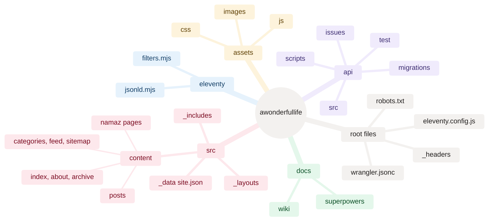

[Home](Home) › Architecture › Repository map

# Repository map

Every folder and important file in `vijaybpanangi/awonderfullife`, what it holds, and whether it reaches the public site. The repository is public, and only Eleventy's output folder `_site/` (which is gitignored) is ever served, so nothing outside the inputs listed below can leak onto the web.

> [!NOTE]
> **At a glance:**
> - `src/` is Eleventy's input; `_site/` is its output and the site Worker's asset folder.
> - `assets/`, the favicons, `robots.txt` and `_headers` are copied into `_site/` as they are.
> - `api/` is a separate Worker with its own `package.json`, `wrangler.jsonc`, migrations and tests.
> - `docs/` holds specs, plans, tools and this wiki; none of it is deployed.

*Read outward from the centre: six top-level areas; the leaves are the folders and files described in the tables below.*

## Top level

| Path | What it is | Deployed? |
|---|---|---|
| **`src/`** | Eleventy input: content, layouts, includes, data | rendered into `_site/` |
| **`eleventy/`** | `filters.mjs` (dates, URLs, reading time, related posts, image sizes) and `jsonld.mjs` (structured data) | No (build code) |
| **`eleventy.config.js`** | Eleventy config: markdown-it, passthrough copies, filters, the `posts` collection | No |
| **`assets/`** | `css/style.css`, `js/*.js`, `images/` (portrait, OG default, Track Your App wordmarks, post heroes and thumbs) | copied as is, except `staging-images/` |
| **`_headers`** | cache and security headers for the site Worker | copied into `_site/` |
| **`robots.txt`** | allow all, sitemap line | copied |
| **`favicon.ico`, `favicon.svg`, `apple-touch-icon.png`** | the "A" monogram | copied |
| **`wrangler.jsonc`** | site Worker config: `assets.directory: ./_site` | No |
| **`package.json`** | `build` = `eleventy && pagefind --site _site`; `serve` | No |
| **`api/`** | the API Worker | its own deploy |
| **`docs/`** | specs, plans, tools, conversation log, this wiki | No |
| **`.github/workflows/wiki-sync.yml`** | publishes `docs/wiki/` to the GitHub Wiki | No |
| **`CLAUDE.md`, `README.md`, `CHANGELOG.md`, `ROADMAP.md`** | project docs | No |
| **`_site/`** | build output (gitignored) | ✅ this is the site |

## `src/`

| Path | Becomes |
|---|---|
| **`content/posts/<slug>.md`** | `_site/posts/<slug>.html`, served at `/posts/<slug>` |
| **`content/posts/posts.11tydata.js`** | defaults for every post: `layout: post.njk`, permalink, `tags: ["posts"]` |
| **`content/index.njk`** | `_site/index.html` (featured opener, card grid, ambient backdrop) |
| **`content/about.njk`** | `_site/about.html` |
| **`content/archive.njk`** | `_site/archive.html` (search, facets, years) |
| **`content/categories.njk`** | `_site/categories/<slug>.html` (one per category) |
| **`content/feed.njk`** | `_site/feed.xml` |
| **`content/sitemap.njk`** | `_site/sitemap.xml` |
| **`content/namaz.md`, `namaz-privacy.md`** | `_site/namaz/index.html`, `_site/namaz/privacy/index.html` |
| **`_layouts/base.njk`** | the page shell: head, theme pre-paint, SEO, header, footer, optional scripts |
| **`_layouts/post.njk`** | post body, author card, reactions, related posts, comments |
| **`_includes/`** | `header`, `footer`, `card-grid`, `facets`, `post-nav`, `head-seo`, `jsonld`, `newsletter`, `newsletter-script`, `author-card` |
| **`_data/site.json`** | site name, tagline, URL, author, Turnstile site key, `sameAs`, categories |

## `api/`

| Path | What it is |
|---|---|
| **`src/index.ts`** | router, `/health`, `/admin/whoami`, `/subscribe`, `/unsubscribe`, CORS, the `scheduled` handler |
| **`src/admin.ts`** | compose page HTML and `/admin/issues*` JSON endpoints |
| **`src/access.ts`** | Cloudflare Access JWT verification with `jose` |
| **`src/turnstile.ts`** | Turnstile siteverify, fail closed |
| **`src/comments.ts`** | comment routes, magic links, session cookie, moderation sweep |
| **`src/reactions.ts`** | appreciate counter with salted daily throttle |
| **`src/scheduled.ts`** | due-issue sender (Resend batch) and reaction-event purge |
| **`src/render.mjs`, `schedule.mjs`** | shared email template and Eastern-time scheduling (with `.d.mts` types) |
| **`migrations/0001` to `0005`** | D1 schema: subscribers, issues, schedule column, comments, reactions |
| **`test/*.test.ts`** | 9 test files, 61 tests |
| **`scripts/send-issue.mjs`** | the newsletter CLI |
| **`issues/`** | issue Markdown files and the issue README |
| **`.dev.vars.example`** | names of local secrets (placeholders only) |

## `docs/`

| Path | What it is |
|---|---|
| **`superpowers/specs/`** | design specs, `YYYY-MM-DD-<topic>-design.md`, plus the image manifest |
| **`superpowers/plans/`** | implementation plans, `YYYY-MM-DD-<topic>.md` |
| **`superpowers/tools/`** | `gen-hero.sh`, `cf-analytics.sh`, `check-email-dns.sh` |
| **`superpowers/README.md`** | the brainstorm, spec, plan, execute convention |
| **`conversation-log.md`** | a journal of build sessions: the how and why behind notable changes |
| **`wiki/`** | this wiki's source pages and images |

## Related pages
- [Build pipeline](Build-Pipeline): how `src/` and `assets/` become `_site/`.
- [Technology stack](Technology-Stack): the tools behind these files.
- [Data model](Data-Model): what `site.json`, front matter and migrations define.
- [Contributing and house style](Contributing-and-House-Style): where new files should go.

Last checked: 2026-11-09

Sources in the repo

- the repository tree on branch `main` (commit `d005a0c`)
- `eleventy.config.js`, `package.json`, `.gitignore`, `wrangler.jsonc`

