[Home](Home) › Business and product › Roadmap

# Roadmap

What is planned, what was deliberately left, and what has already shipped from earlier plans. The source of truth is `ROADMAP.md` in the repository (future work) together with `CHANGELOG.md` (past work); this page summarises both as of 2026-11-09 and adds the gaps found while writing this wiki.

> [!NOTE]
> **At a glance:**
> - Open from `ROADMAP.md`: DMARC tightening, Search Console and Bing verification, newsletter polish, client-side lifestyle tools.
> - Found in this review: Namaz release record and sitemap entries, a missing thumbnail, em dashes on the Namaz pages, optional CI.
> - Shipped from earlier roadmaps: `www` redirect, email, owned newsletter, Eleventy, dark mode, search, related posts, `sameAs` and breadcrumbs.

```mermaid
%%{init: {"theme":"base","themeVariables":{"fontFamily":"Nunito, Segoe UI, Helvetica, Arial, sans-serif","fontSize":"15px","primaryColor":"#FFFFFF","primaryTextColor":"#221F1E","primaryBorderColor":"#C9C2BE","lineColor":"#8A817C","clusterBkg":"#FAF8F6","clusterBorder":"#E4DEDA","edgeLabelBackground":"#FFFFFF","tertiaryColor":"#FAF8F6"},"flowchart":{"curve":"basis","nodeSpacing":40,"rankSpacing":55}}}%%
flowchart LR
  subgraph Now["Next (small)"]
    direction TB
    N1["Namaz CHANGELOG,<br/>tag, sitemap"]:::ours
    N2["Thumbnail for<br/>newest post"]:::ours
    N3["Namaz copy:<br/>remove em dashes"]:::ours
  end
  subgraph Soon["Soon (owner)"]
    direction TB
    S1["DMARC to<br/>quarantine, reject"]:::infra
    S2["Search Console<br/>and Bing"]:::official
  end
  subgraph Later["Later (features)"]
    direction TB
    L1["Newsletter polish<br/>rate limit, import"]:::ours
    L2["Client-side tools<br/>store nothing"]:::ours
    L3["CI for tests<br/>and build"]:::infra
  end
  Now --> Soon --> Later
classDef ours fill:#FDE8EC,stroke:#E0193B,stroke-width:1.5px,color:#7A0A20
classDef community fill:#E6F2FC,stroke:#2E7CC0,stroke-width:1.5px,color:#123E66
classDef official fill:#F0EBFC,stroke:#7A5BD6,stroke-width:1.5px,color:#3B2B70
classDef user fill:#FDF3DC,stroke:#E39A0D,stroke-width:1.5px,color:#5E4004
classDef good fill:#E4F7EB,stroke:#18A04B,stroke-width:1.5px,color:#0A4F25
classDef infra fill:#F3F1EF,stroke:#8A817C,stroke-width:1.5px,color:#221F1E
classDef store fill:#FFFFFF,stroke:#221F1E,stroke-width:2px,color:#221F1E
```

*Read left to right: quick fixes first, then owner-only account tasks, then new features.*

## Open items

| Item | Source | Notes |
|---|---|---|
| **Tighten DMARC** | ROADMAP (email) | after clean aggregate reports, `p=none` to `quarantine` to `reject`; keep SPF `~all` |
| **Search Console and Bing** | ROADMAP (SEO) | owner verifies the domain and submits `/sitemap.xml` |
| **Cloudflare managed robots** | ROADMAP (SEO) | if enabled, it prepends a block; turn it off to serve the repo file exactly |
| **Newsletter polish** | ROADMAP (API) | import any old Buttondown subscribers; rate-limit `/subscribe`; Cloudflare Queues if the list reaches thousands |
| **Client-side lifestyle tools** | ROADMAP (API) | tip calculator, bill splitter and similar, storing and posting nothing |
| **BreadcrumbList on category pages** | ROADMAP (SEO) | posts already have one |
| **Namaz release record** | this review | CHANGELOG entry, README row, tag for the 2026-07-21 pages |
| **Namaz in the sitemap, own social image** | this review | add URLs to `sitemap.njk`; a dedicated `seoType` |
| **Namaz copy** | this review | remove em dashes per house style |
| **Thumbnail for the newest post** | this review | `thumbs/the-wait-was-worth-it-ios-27-siri-ai.jpg`, before the next post |
| **CI on pull requests** | this review | API tests and the site build |

## Accepted deviations (not planned)

From the June redesign spec, consciously not done: Manrope 800 (700 looks the same), a warm off-white background (pure white preferred), and a 68-character measure at the time (the column is about 73 characters today).

## Shipped from earlier roadmaps

| Item | Shipped |
|---|---|
| **India and Pakistan hero regeneration** | v2.1.1 |
| **Email on the domain** | v2.3.0 |
| **Owned newsletter, scheduled sends** | v2.8.0 to v2.12.0 |
| **API Workers Build** | 2026-06-20 |
| **`www` to apex redirect** | 2026-06-20 |
| **Eleventy re-platform, one-file posts, clean URLs everywhere** | v3.0.0 |
| **Dark mode, search, related posts** | v3.1.0, v3.2.0, v3.3.0 |
| **`sameAs`, post `BreadcrumbList`** | v3.5.0 |

## Related pages
- [Hand-offs](Hand-offs): open threads with owners.
- [Decisions log](Decisions-Log): why things were done, or not.
- [Release history](Release-History): what shipped and when.
- [Namaz app support pages](Namaz-App-Support): the Namaz items in detail.

Last checked: 2026-11-09

Sources in the repo

- `ROADMAP.md`, `CHANGELOG.md`
- `src/content/sitemap.njk`, `src/content/namaz*.md`, `assets/images/posts/thumbs/`

