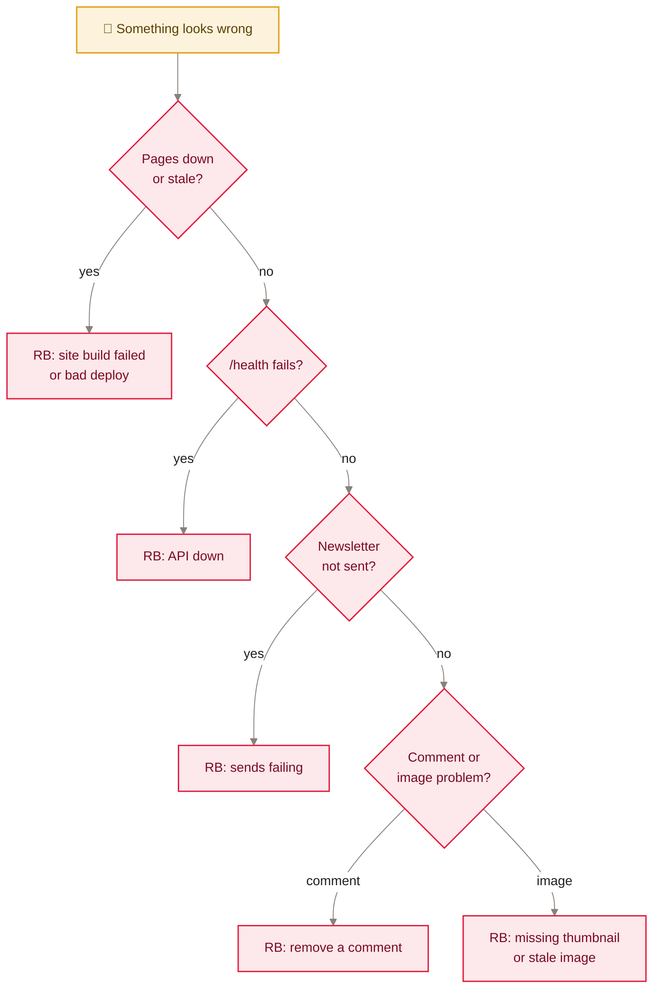

<sub>[Home](Home) › Operations › Runbooks</sub>

# Runbooks

Step-by-step procedures for the routine tasks and the likely failures. Each runbook says when to use it, the steps, and how to know it worked. Commands assume a clone of the repository; API commands run from `api/` with Wrangler logged in to the owner's Cloudflare account.

> [!NOTE]
> **At a glance:**
> - Routine: publish a post, queue a newsletter issue, apply a D1 migration, rotate a secret, run a traffic report.
> - Fixes: site build failed, a bad deploy, API down, sends failing, a comment that should not be there, missing thumbnail.
> - Anything that writes to production D1 or sends email is marked with a warning.
> - When in doubt, check [Monitoring and incidents](Monitoring-and-Incidents) first.


*Read top to bottom: answer each question to find the runbook below.*

## Publish a new post

1. Follow [Adding a post](Adding-a-Post): Markdown file, hero, 640px thumbnail, manifest row.
2. `npm ci && npm run build`, check locally.
3. Pull request with the CHANGELOG entry and README row; merge.
4. Tag the merge commit and push the tag.
5. **Worked if:** the home page shows the post as featured, `/feed.xml` lists it first, archive search finds it.

## Queue a newsletter issue

1. Sign in at `https://api.awonderfullife.ca/admin/compose`.
2. Write subject, preheader and body; **Preview**; **Send test to me** and check your inbox.
3. Choose next Saturday 7pm ET or a custom time; **Queue**.
4. **Worked if:** the queue list shows the issue as `queued` with the right time; after that time, `sent` with a count.

To pull it back before it sends: **Unqueue** in the list, or `npm run send -- --unqueue <id>`.

## Sends failing

1. Check the queue: `npm run send -- --queue-list` (or the compose page). `failed` with `sent_count 0` means every Resend call failed.
2. Check the cron log in the dashboard for `send={"status":"skipped_no_key"}` (key missing) or errors.
3. Check the Resend dashboard: API key valid, `send.awonderfullife.ca` still verified, quota.
4. Fix the key if needed: `npx wrangler secret put RESEND_API_KEY`.
5. A `failed` issue is not retried. Queue it again (compose page or `--queue`) with a new time.

> [!WARNING]
> Re-queuing a partly sent issue (some `sent_count`, some `failed_count`) sends it again to everyone, including people who already received it.

## Apply a D1 migration

1. Review the new file in `api/migrations/` and merge the code that needs it.
2. From `api/`: `npx wrangler d1 migrations apply awonderfullife-api --remote` (or `npx wrangler d1 execute awonderfullife-api --remote --file migrations/<file>.sql` for a single file, as the issue README does).
3. **Worked if:** `npx wrangler d1 execute awonderfullife-api --remote --command "SELECT name FROM sqlite_master WHERE type='table'"` lists the new table.

> [!WARNING]
> This changes the production database. Take note of the time first: D1 Time Travel can restore the database to a point before it if something goes wrong.

## Rotate a secret

1. Create the new value at the provider (Resend, Turnstile, Access) or generate one (`COMMENT_SECRET`, `REACTION_SALT`).
2. `cd api && npx wrangler secret put <NAME>` and paste it.
3. Revoke the old value at the provider.
4. Notes: rotating `COMMENT_SECRET` signs everyone out of comment sessions; rotating `REACTION_SALT` only resets today's throttle.

## Site build failed or bad deploy

1. Open the Cloudflare dashboard, `awonderfullife`, Builds; read the log.
2. Reproduce locally: `npm ci && npm run build`. Template errors name the file and line.
3. If production is broken now: **Deployments**, pick the last good version, **Rollback**. Then fix forward or `git revert` the merge.
4. Check the build settings are still `npm ci && npm run build` with assets `./_site`.

## API down

1. `curl -s https://api.awonderfullife.ca/health`. If it fails, check the `awonderfullife-api` Builds and Logs.
2. Roll back from **Deployments** if a recent deploy caused it, or redeploy by hand: `cd api && npm ci && npm run deploy`.
3. Readers can still read everything; only sign-ups, comments and appreciations wait.

## Remove a comment by hand

```sql
-- from api/: npx wrangler d1 execute awonderfullife-api --remote --command "<SQL>"
SELECT id, slug, name, status, created_at FROM comments WHERE slug = '<slug>' ORDER BY id DESC LIMIT 20;
UPDATE comments SET status = 'removed', mod_reason = 'removed by owner', moderated_at = datetime('now') WHERE id = <id>;
```

Setting `removed` keeps the tombstone, matching the automatic sweep. Use `DELETE` only to erase a comment completely (for example on the author's request).

## Missing thumbnail or stale image

- **Missing thumbnail:** create a 640px-wide copy of `assets/images/posts/<slug>.jpg` at `assets/images/posts/thumbs/<slug>.jpg`. On 2026-11-09 this is needed for `the-wait-was-worth-it-ios-27-siri-ai`.
- **Image changed but old one shows:** images are cached immutable for a year. Save the new image under a new name, update every reference, deploy.

## Traffic report

```bash
docs/superpowers/tools/cf-analytics.sh --days 30
```

Needs a read-only analytics token in `CLOUDFLARE_ANALYTICS_TOKEN` or `~/.cloudflare_analytics_token`.

## Push a release tag the workflow cannot create

GitHub refuses the Actions token a tag on a commit whose workflow files differ from today's, and `release-tag` then warns ("was refused") and moves on. Create that tag once from your own git login:

```bash
git fetch origin --tags
git tag -a vX.Y.Z -m "vX.Y.Z: title from CHANGELOG.md" <commit from docs/release-tags.tsv>
git push origin vX.Y.Z
```
*Expected:* `* [new tag]` for that tag only. Tags never change the live site.

## Related pages
- [Monitoring and incidents](Monitoring-and-Incidents): signs that a runbook is needed.
- [Deployment and release](Deployment): the normal release path.
- [Newsletter pipeline](Newsletter-Pipeline): the send path in depth.
- [Secrets and configuration](Secrets-and-Configuration): every secret named here.
- [Data model](Data-Model): the tables touched by the SQL above.

Last checked: 2026-11-09

<details><summary>Sources in the repo</summary>

- `api/issues/README.md`, `api/scripts/send-issue.mjs`, `api/src/scheduled.ts`, `api/src/admin.ts`
- `api/migrations/`, `api/wrangler.jsonc`, `wrangler.jsonc`, `_headers`
- `CLAUDE.md`, `docs/superpowers/tools/cf-analytics.sh`
</details>
