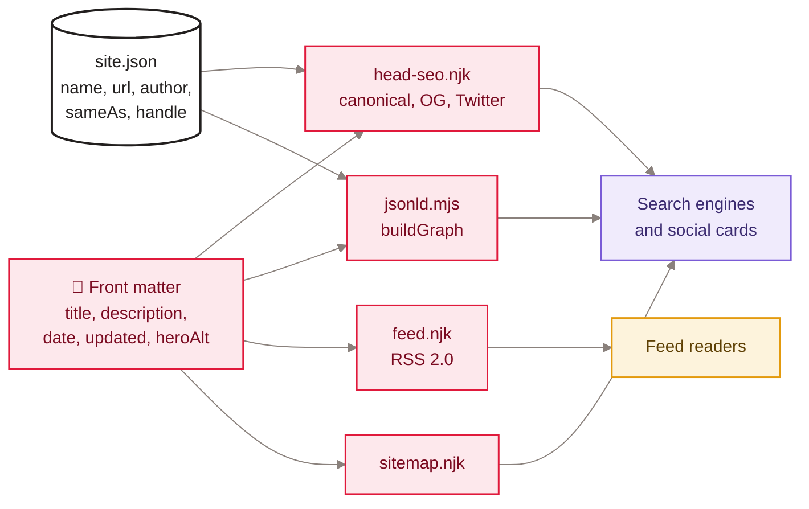
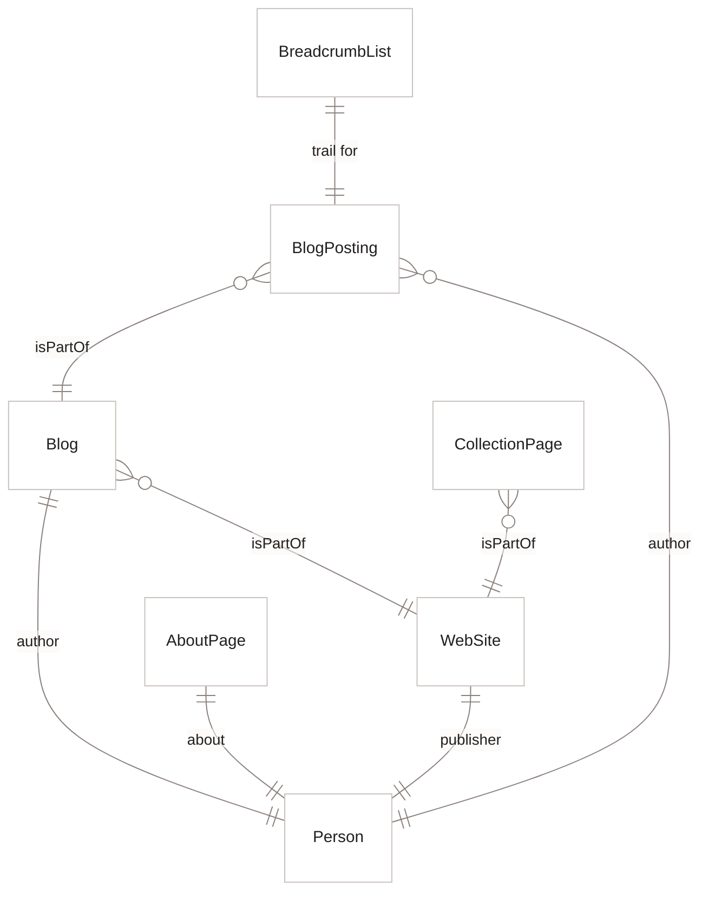

[Home](Home) › Architecture › SEO and discoverability

# SEO and discoverability

How search engines, social networks, feed readers and AI answer engines find and describe the site. Every page's `<head>` is generated at build time by `src/_includes/head-seo.njk` and `src/_includes/jsonld.njk` (backed by `eleventy/jsonld.mjs`), and the build also writes `feed.xml` and `sitemap.xml`. Nothing needs re-running after a new post: the old Python injector `seo-inject.py` was retired in v3.0.0.

> [!NOTE]
> **At a glance:**
> - Every page: absolute self-canonical, `meta author`, Open Graph, Twitter `summary_large_image`, JSON-LD `@graph`.
> - Posts add `article:*` tags, a `BlogPosting` node and a `BreadcrumbList` (Home › Category › Post).
> - `og:image` width and height are measured from the real JPEG at build time.
> - `robots.txt` allows every crawler, including AI crawlers (decision of 2026-07-16).

*Read left to right: two data sources feed four generators, whose output is read by search engines, social networks and feed readers.*

## The head block

| Tag | Value |
|---|---|
| **`<title>`** | home: `A Wonderful Life - Data, life, and the space between`; others: `<title> - A Wonderful Life` |
| **`link rel=canonical`** | absolute, extension-less (`cleanUrl` then `absoluteUrl`) |
| **`og:type`** | `article` on posts, `website` elsewhere |
| **`og:locale`** | `en_CA` |
| **`og:image`** | post hero; author portrait for `seoType: about` (About and both Namaz pages); `og-default.jpg` for the rest |
| **`og:image:width/height`** | from the `imageDims` filter, which reads the JPEG header |
| **`article:published_time`, `modified_time`** | `date`, and `updated` or `date` |
| **`twitter:site`, `twitter:creator`** | `site.twitterHandle` |

## The JSON-LD graph

*Read each line as a relationship: every page shares `WebSite`, `Person` and `Blog`; posts add `BlogPosting` and `BreadcrumbList`; other pages add a `CollectionPage` or `AboutPage`.*

- **`Person`** carries name, URL, portrait, a contact address from `site.json`, job title "Writer" and `sameAs` (LinkedIn, X, GitHub, Track Your App, Instagram).
- **`BlogPosting`** carries headline, description, image, `datePublished`, `dateModified`, `articleSection`, `inLanguage: en-CA`.
- **Page kinds** come from each template's `seoType`: `home`, `about`, `archive`, `category`, `post`.

## Feed and sitemap

| File | Contents |
|---|---|
| **`/feed.xml`** | RSS 2.0, `language en-ca`, every post newest first, `listTitle` or `title`, description, `pubDate`; GUID is the frozen `guid` if present, else `https://awonderfullife.ca/posts/<slug>` |
| **`/sitemap.xml`** | home, about, archive, 5 categories, 18 posts with `lastmod` (newest post date, category's newest post, or the post's date; About is fixed at `2026-06-15`) |
| **`/robots.txt`** | `User-agent: *`, `Allow: /`, sitemap line |

> [!IMPORTANT]
> Legacy posts' `guid` values end in `.html` on purpose. Changing them makes feed readers show every old post as new. Leave `guid` alone, and omit it on new posts.

## Known gaps

- The Namaz pages are not in `sitemap.xml`, and they reuse the About page's social image and `AboutPage` node.
- Category pages have no `BreadcrumbList`.
- Search Console and Bing Webmaster verification are owner tasks still listed in the [Roadmap](Roadmap).
- If Cloudflare's managed `robots.txt` is ever enabled, it prepends its own block to the committed file.

## Related pages
- [Content and editorial](Content-and-Editorial): writing titles and descriptions.
- [Build pipeline](Build-Pipeline): when these files are generated.
- [Data model](Data-Model): the fields they read.
- [Namaz app support pages](Namaz-App-Support): the two pages outside the sitemap.
- [Decisions log](Decisions-Log): opening `robots.txt` to AI crawlers.

Last checked: 2026-11-09

Sources in the repo

- `src/_includes/head-seo.njk`, `src/_includes/jsonld.njk`, `eleventy/jsonld.mjs`, `eleventy/filters.mjs`
- `src/content/feed.njk`, `src/content/sitemap.njk`, `robots.txt`, `src/_data/site.json`
- `docs/superpowers/specs/2026-06-15-blog-seo-foundation-design.md`, `CHANGELOG.md` (v2.2.0, v3.5.0)

