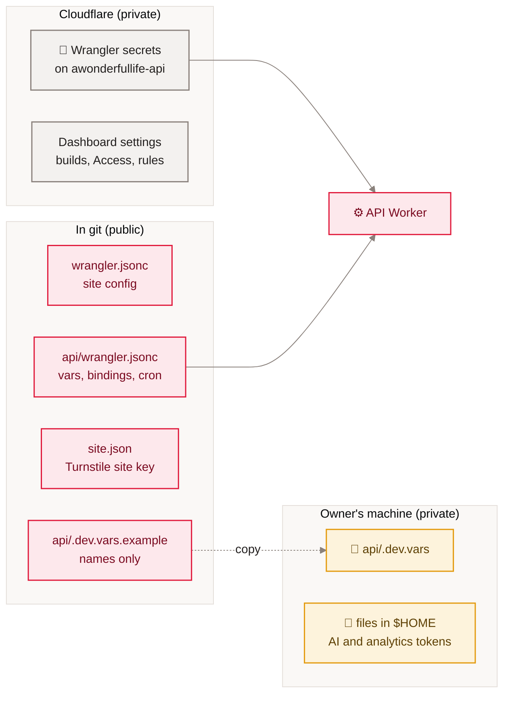

[Home](Home) › Operations › Secrets and configuration

# Secrets and configuration

Every setting the project depends on, by name only, with where it lives and what breaks without it. The rule is simple because the repository is public: anything secret is a Wrangler secret on the API Worker (or a file in the owner's home folder for laptop tools), and everything in git is safe to read. The static site needs no secrets at all.

> [!NOTE]
> **At a glance:**
> - API Worker secrets: `ACCESS_TEAM_DOMAIN`, `ACCESS_AUD`, `TURNSTILE_SECRET`, `RESEND_API_KEY`, `COMMENT_SECRET` (optional), `REACTION_SALT`.
> - API Worker vars (in `api/wrangler.jsonc`): `NEWSLETTER_FROM`, `NEWSLETTER_REPLY_TO`.
> - Bindings: `DB` (D1 `awonderfullife-api`) and `AI` (Workers AI).
> - Local development reads `api/.dev.vars` (gitignored), copied from `api/.dev.vars.example`.

*Read left to right: git holds names and non-secret values; Cloudflare and the owner's machine hold the secrets.*

## API Worker secrets

| Name | Used by | If missing |
|---|---|---|
| **`ACCESS_TEAM_DOMAIN`** | `access.ts`: JWKS URL and issuer | every `/admin` route returns 403 |
| **`ACCESS_AUD`** | `access.ts`: JWT audience | every `/admin` route returns 403 |
| **`TURNSTILE_SECRET`** | `turnstile.ts` siteverify | sign-ups and comments fail with 403 `turnstile_failed` |
| **`RESEND_API_KEY`** | scheduled sends, test sends, comment magic links | cron logs `skipped_no_key`; first-time comments return 503; test send returns 503 |
| **`COMMENT_SECRET`** | signs and verifies the `awl_c` comment session | comments still work, one email per comment |
| **`REACTION_SALT`** | salts the appreciate throttle hash | `POST /reactions` returns 503; reads work |

Set or rotate with `cd api && npx wrangler secret put <NAME>`. List names with `npx wrangler secret list`.

## API Worker vars and bindings

| Name | Kind | Value or target |
|---|---|---|
| **`NEWSLETTER_FROM`** | var | the "A Wonderful Life" sender on the `send.` subdomain |
| **`NEWSLETTER_REPLY_TO`** | var | the owner's inbox |
| **`DB`** | D1 binding | database `awonderfullife-api` |
| **`AI`** | Workers AI binding | used by the moderation sweep |
| **cron** | trigger | `*/15 * * * *` |
| **route** | custom domain | `api.awonderfullife.ca`; `workers_dev: false` |

## Site configuration (not secret)

| Where | Holds |
|---|---|
| **`wrangler.jsonc`** | Worker name, `compatibility_date`, `nodejs_compat`, `assets.directory ./_site`, `html_handling`, observability |
| **`_headers`** | cache and security headers |
| **`src/_data/site.json`** | name, tagline, URL, author, public contact, Turnstile **site** key (public by design), `sameAs`, X handle, categories |
| **`assets/js/comments.js`** | API base URL and the same public Turnstile site key |

## Laptop-only credentials

| Tool | Reads | Never commit |
|---|---|---|
| **`gen-hero.sh`** | `$HOME/.cloudflare_ai_token`, `$HOME/.cloudflare_ai_account` | ✅ |
| **`cf-analytics.sh`** | `CLOUDFLARE_ANALYTICS_TOKEN` or `$HOME/.cloudflare_analytics_token` (read-only analytics scope) | ✅ |
| **`send-issue.mjs`** | `RESEND_API_KEY`, `NEWSLETTER_FROM`, `NEWSLETTER_REPLY_TO` from the shell; Wrangler login for D1 | ✅ |

## Dashboard-only settings

Not in git, so write them down when they change: both Workers Build configurations, the `www` Redirect Rule, the Access application and policy, the Turnstile widget and its allowed hostnames, DNS records (iCloud mail, Resend on `send.`), and the Resend account and domain.

> [!CAUTION]
> Never paste a secret value into an issue, a pull request, a commit, `CLAUDE.md` or this wiki. If one leaks, rotate it at the provider first, then `wrangler secret put` the new value.

## Related pages
- [Security and privacy](Security-and-Privacy): why these are secrets.
- [Cloudflare](Cloudflare): where the dashboard settings live.
- [Runbooks](Runbooks): rotating a secret.
- [Local development](Local-Development): setting up `.dev.vars`.
- [Hand-offs](Hand-offs): which accounts a new owner needs.

Last checked: 2026-11-09

Sources in the repo

- `api/src/index.ts` (`Env`), `api/wrangler.jsonc`, `api/.dev.vars.example`, `wrangler.jsonc`
- `src/_data/site.json`, `assets/js/comments.js`, `.gitignore`
- `docs/superpowers/tools/gen-hero.sh`, `cf-analytics.sh`, `api/scripts/send-issue.mjs`

