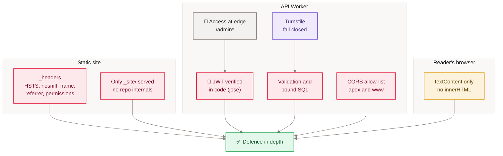

[Home](Home) › Security and development › Security and privacy

# Security and privacy

How the site protects readers, the owner and itself. The static site has almost no attack surface: it is files with strict headers, built from a public repository that contains no secrets. The API Worker is where the care goes: Cloudflare Access plus an in-code JWT check for the owner, Turnstile and validation for readers, parameterised SQL, text-only rendering of reader content, and a data model that stores as little personal data as each feature needs.

> [!NOTE]
> **At a glance:**
> - The repository is public: every secret is a Wrangler secret or a file under the owner's home folder, never in git.
> - `_headers` sets five security headers on every page; images are immutable, CSS and JS revalidate.
> - `/admin*` is gated twice: Cloudflare Access at the edge, `jose` JWT verification in the Worker.
> - Personal data kept: subscriber emails, commenter names and emails. Not kept: IP addresses, analytics, accounts.

## Defences at a glance

*Read top to bottom: each layer stands on its own, so one missing layer does not open the whole system.*

## Headers on every page

| Header | Value |
|---|---|
| **`Strict-Transport-Security`** | `max-age=31536000; includeSubDomains` |
| **`X-Content-Type-Options`** | `nosniff` |
| **`X-Frame-Options`** | `SAMEORIGIN` |
| **`Referrer-Policy`** | `strict-origin-when-cross-origin` |
| **`Permissions-Policy`** | `geolocation=(), microphone=(), camera=()` |
| **Cache, `/assets/images/*`** | `public, max-age=31536000, immutable` |
| **Cache, `/assets/css/*`, `/assets/js/*`** | `public, max-age=0, must-revalidate` |

There is no Content-Security-Policy header today; the pages use inline scripts (theme pre-paint, newsletter, Pagefind init), so adding one would need hashes or nonces.

## Owner access

- Cloudflare Access protects `api.awonderfullife.ca/admin*` with a policy for the owner's identity.
- The Worker still verifies `Cf-Access-Jwt-Assertion` itself (`api/src/access.ts`): issuer `https://<ACCESS_TEAM_DOMAIN>`, audience `ACCESS_AUD`, keys from the team JWKS, and a non-empty `email` claim. A request that bypassed Access would still get 403.
- `workers_dev` is off, so there is no second hostname to bypass Access through.
- "Send test to me" can only send to the signed-in address; there is no broadcast-now endpoint.

## Reader input

| Threat | Defence |
|---|---|
| **Bots and spam sign-ups** | Turnstile on `/subscribe` and `POST /comments`, verified server-side, fail closed |
| **Stored XSS in comments** | comments rendered with `textContent`; magic-link email escapes the name |
| **SQL injection** | every query is `prepare(...).bind(...)` |
| **Cross-site calls** | CORS allows only the two site origins; cookies are `Secure; HttpOnly` |
| **Comment abuse** | heuristic and AI moderation sweep, tombstones |
| **Appreciation stuffing** | 10 per post per salted IP hash per day |
| **Token guessing** | random UUID unsubscribe and verification tokens; unsubscribe never reveals whether a token existed |

## Personal data

| Data | Where | Why | Shown publicly? |
|---|---|---|---|
| **Subscriber email, consent time, source** | D1 `subscribers` | to send the newsletter | No |
| **Commenter name** | D1 `comments` | shown with the comment | ✅ |
| **Commenter email** | D1 `comments`, `comment_verifications`, the `awl_c` cookie | to verify the author once | No |
| **IP address** | never stored; used transiently for Turnstile and hashed for the throttle | abuse prevention | No |
| **Theme and appreciated flags** | reader's `localStorage` | convenience | No |

The site loads Manrope from Google Fonts and the Turnstile script from Cloudflare, so those providers see the reader's IP when fetching them. There are no analytics or ad scripts.

> [!CAUTION]
> The repository is public. Never commit `.dev.vars`, `.env` files, API tokens, the Access audience or team domain, or the files under `$HOME` that `gen-hero.sh` and `cf-analytics.sh` read. `.gitignore` already excludes `.dev.vars*` and `.env*`.

## History that shaped this

- **2026-05-27:** the first Workers deploy served the whole repository, including `.git/`. `.assetsignore` closed it the same day; since v3.0.0 only `_site/` is served, so the class of bug is gone.
- **v2.15.0:** the five security headers were added.
- **v2.17.2:** immutable caching was narrowed to images, after CSS and JS pinned stale styles for returning visitors.

## Related pages
- [Secrets and configuration](Secrets-and-Configuration): every secret by name.
- [API reference](API-Reference): which routes need what.
- [Comments and reactions](Comments-and-Reactions): the privacy design of both features.
- [Cloudflare](Cloudflare): Access, Turnstile and the Workers settings.
- [Monitoring and incidents](Monitoring-and-Incidents): the `.git` exposure and other incidents.

Last checked: 2026-11-09

Sources in the repo

- `_headers`, `.gitignore`, `wrangler.jsonc`, `api/wrangler.jsonc`
- `api/src/access.ts`, `api/src/turnstile.ts`, `api/src/index.ts`, `api/src/comments.ts`, `api/src/reactions.ts`
- `assets/js/comments.js`, `src/_layouts/base.njk`
- `CHANGELOG.md` (2026-05-27, v2.15.0, v2.17.2)

