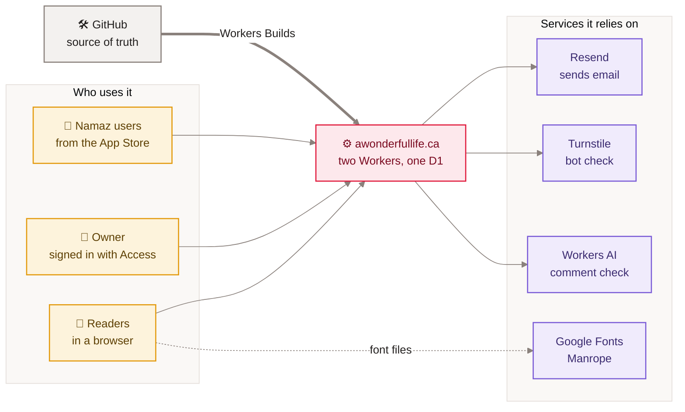
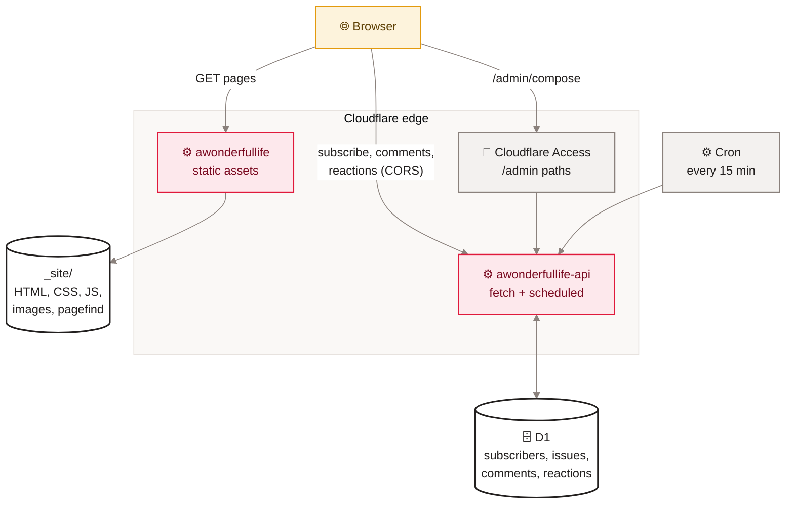
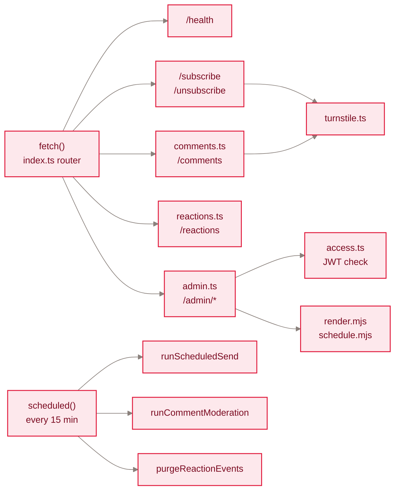

[Home](Home) › Architecture › Site architecture

# Site architecture

awonderfullife.ca is two independent Cloudflare Workers built from one repository. The **site Worker** (`awonderfullife`, repo root) has no code of its own: it serves the static files Eleventy writes to `_site/`, with headers from `_headers`. The **API Worker** (`awonderfullife-api`, folder `api/`) is TypeScript on the Workers runtime: it answers the browser features that need a server, runs a cron every 15 minutes, and owns the only database, a D1 SQLite database. Each Worker has its own Cloudflare Workers Build, so a push to `main` rebuilds whichever side changed. The split keeps reading fast and unbreakable: if the API is down, every page still loads.

> [!NOTE]
> **At a glance:**
> - Site Worker: static assets only, `assets.directory: ./_site`, clean URLs via `html_handling: auto-trailing-slash`.
> - API Worker: custom domain `api.awonderfullife.ca`, `workers_dev` off, D1 binding `DB`, Workers AI binding `AI`, cron `*/15 * * * *`.
> - Browsers talk to the API cross-origin (CORS allows only the apex and `www` origins).
> - Owner routes under `/admin` are gated by Cloudflare Access at the edge and re-verified in code.
> - No server-side rendering: pages are built once at deploy time.

## Context

*Read left to right: three kinds of visitor reach one system on Cloudflare, which leans on four outside services; GitHub feeds every deploy.*

## Containers

*Read top to bottom: pages come from the static Worker; anything a reader sends goes to the API Worker; the owner's pages pass through Access first; the cron wakes the API Worker on its own.*

## The two Workers side by side

| | Site Worker | API Worker |
|---|---|---|
| **Name** | `awonderfullife` | `awonderfullife-api` |
| **Config** | `wrangler.jsonc` | `api/wrangler.jsonc` |
| **Code** | none (assets only) | `api/src/index.ts` and modules |
| **Domain** | `awonderfullife.ca`, `www` (301 to apex by a Redirect Rule) | `api.awonderfullife.ca` (custom domain) |
| **Bindings** | none | `DB` (D1), `AI` (Workers AI) |
| **Triggers** | HTTP | HTTP and cron `*/15 * * * *` |
| **Build** | `npm ci && npm run build` | `npm ci`, then `npx wrangler deploy` (root `api`) |
| **Deploys when** | any push to `main` | a push to `main` touching `api/*` |
| **Tests** | none (visual check) | 61 Vitest tests in workerd |
| **compatibility_date** | `2026-05-27` (`nodejs_compat`) | `2026-06-13` |

## Inside the API Worker

*Read left to right: one router fans out to five route groups; the scheduled handler runs three jobs on every tick.*

Design choices that matter:

- **Dependency injection for tests.** `createWorker(overrides)` takes stand-ins for `getAccessEmail`, `verifyTurnstile` and `sendBatch`, so tests never call Cloudflare Access, Turnstile or Resend.
- **One email template.** `src/render.mjs` is plain JavaScript so both the Worker and the Node CLI (`scripts/send-issue.mjs`) render issues identically.
- **Graceful degradation.** No `RESEND_API_KEY`: scheduled sends skip. No `COMMENT_SECRET`: comments still work, one email per comment. No `AI`: moderation uses heuristics only. No `REACTION_SALT`: `POST /reactions` returns 503, reads still work.

## Why this shape

The blog started as a static site on Cloudflare Workers Static Assets (May 2026). When the owner wanted an owned newsletter, adding a second Worker on a subdomain kept the static site untouched and cacheable, and let the API grow (newsletter, comments, reactions) without ever putting a server in the path of a page view. See the [Decisions log](Decisions-Log).

## Related pages
- [Technology stack](Technology-Stack): each tool in these diagrams.
- [Build pipeline](Build-Pipeline): how `_site/` is made.
- [Page lifecycle](Page-Lifecycle): one request, step by step.
- [Cloudflare](Cloudflare): every Cloudflare product in use.
- [API reference](API-Reference): every route.
- [Data flow end to end](Data-Flow-End-to-End): the data that crosses these boxes.

Last checked: 2026-11-09

Sources in the repo

- `wrangler.jsonc`, `api/wrangler.jsonc`, `_headers`
- `api/src/index.ts`, `api/src/scheduled.ts`, `api/src/comments.ts`, `api/src/reactions.ts`, `api/src/admin.ts`
- `CLAUDE.md` (The API worker), `docs/superpowers/specs/2026-06-13-api-spine-foundation-design.md`

