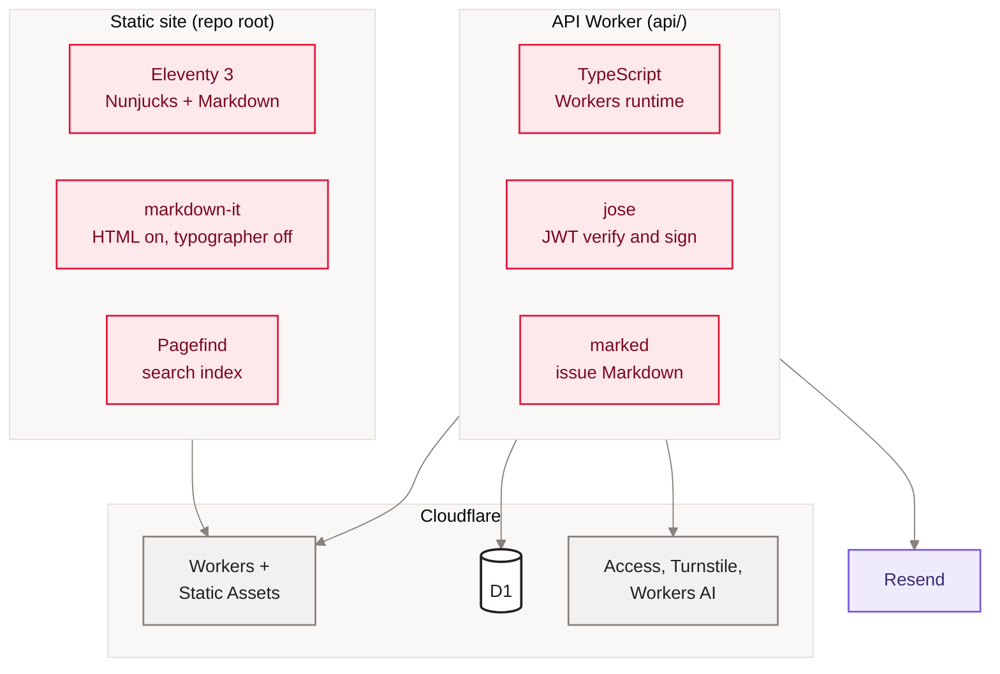

[Home](Home) › Architecture › Technology stack

# Technology stack

Every tool the project uses, what it does here, and why it was chosen. The stack is deliberately small: a static site generator with three dev dependencies, and an API Worker with two runtime dependencies. There is no front-end framework, no CSS framework and no bundler for the site; the browser gets one stylesheet and three tiny scripts.

> [!NOTE]
> **At a glance:**
> - Site: Eleventy 3 (Nunjucks and Markdown), markdown-it, Pagefind; Node 18 or newer.
> - API: TypeScript on Cloudflare Workers, `jose` for JWTs, `marked` for email Markdown.
> - Tests: Vitest 4 with `@cloudflare/vitest-pool-workers`, running in workerd against a local D1.
> - Hosting, data and security: Cloudflare Workers, Workers Builds, D1, Access, Turnstile, Workers AI; email by Resend.

*Read top to bottom: two small toolchains, both deployed to Cloudflare; only the API side touches data and outside services.*

## Site

| Tool | Version | Role | Why |
|---|---|---|---|
| **Eleventy** | `@11ty/eleventy` ^3.0.0 (3.1.6 installed) | builds every page from `src/` into `_site/` | turned a hand-edited HTML site into one file per post (v3.0.0) |
| **Nunjucks** | bundled with Eleventy | layouts, includes, macros | familiar templating, data cascade, pagination |
| **markdown-it** | ^14.2.0 | renders post bodies | HTML passthrough for legacy posts; typographer off so text stays as written |
| **Pagefind** | 1.5.2 (pinned) | static search index over `_site/` | no server, no third-party search, zero cost (v3.2.0) |
| **Manrope** | Google Fonts, weights 400 to 700 | the only typeface | closest free match to the owner's reference font |
| **Plain CSS** | `assets/css/style.css`, about 1,100 lines | tokens, components, dark mode, Liquid Glass | one cacheable file, no build step |
| **Vanilla JS** | `theme.js`, `comments.js`, `reactions.js` | dark toggle, comments widget, appreciate | tiny, dependency-free, `textContent` only |
| **Node** | `engines.node >=18` | build runtime | pinned floor for a deterministic Workers Build |

## API Worker

| Tool | Version | Role |
|---|---|---|
| **TypeScript** | ^6.0.3 | the Worker source, `tsc --noEmit` typecheck |
| **jose** | ^6.2.3 | verifies Cloudflare Access JWTs against the team JWKS; signs and verifies the HS256 comment session |
| **marked** | ^18.0.5 | renders newsletter Markdown in `render.mjs` |
| **Wrangler** | ^4.100.0 (4.103.0 installed) | dev server, deploy, D1 migrations and queries, secrets |
| **@cloudflare/workers-types** | ^4.20260613.1 | runtime types |
| **Vitest** | 4.1.8 | test runner |
| **@cloudflare/vitest-pool-workers** | ^0.16.15 | runs tests inside workerd with a local D1 (v4 plugin API `cloudflareTest`) |
| **Toast UI Editor** | 3.2.2 from its CDN | the rich editor on `/admin/compose` (owner only) |

## Platforms and services

| Service | Used for | Page |
|---|---|---|
| **Cloudflare Workers** | both Workers, static assets, custom domains | [Cloudflare](Cloudflare) |
| **Cloudflare Workers Builds** | build and deploy on push to `main` | [Deployment and release](Deployment) |
| **Cloudflare D1** | the API's database `awonderfullife-api` | [Data model](Data-Model) |
| **Cloudflare Access** | sign-in for `/admin*` | [Security and privacy](Security-and-Privacy) |
| **Cloudflare Turnstile** | bot check on subscribe and comments | [Data quality and processing](Data-Quality-and-Processing) |
| **Cloudflare Workers AI** | comment moderation; hero generation script | [Comments and reactions](Comments-and-Reactions) |
| **Resend** | newsletter sends and comment magic links | [Newsletter pipeline](Newsletter-Pipeline) |
| **iCloud+ Custom Email Domain** | the owner's inbox on the domain | [Data sources and integrations](Data-Sources-and-Integrations) |
| **GitHub** | source, pull requests, tags, this wiki | [GitHub Actions](GitHub-Actions) |

## Not used, on purpose

- **No front-end framework or bundler.** The site is static HTML, so nothing needs hydrating.
- **No CMS.** Posts are Markdown in git; the history is the audit trail.
- **No analytics script.** Traffic comes from Cloudflare zone analytics only.
- **No third-party comments or newsletter service.** Both were brought in house (see [Decisions log](Decisions-Log)).

## Related pages
- [Site architecture](Site-Architecture): how the pieces fit.
- [Repository map](Repository-Map): where each tool's files live.
- [Local development](Local-Development): installing and running them.
- [Testing and quality](Testing-and-Quality): the Vitest setup.

Last checked: 2026-11-09

Sources in the repo

- `package.json`, `package-lock.json`, `api/package.json`, `api/package-lock.json`
- `api/vitest.config.ts`, `api/tsconfig.json`, `api/src/admin.ts`
- `src/_layouts/base.njk`, `assets/css/style.css`, `assets/js/`

