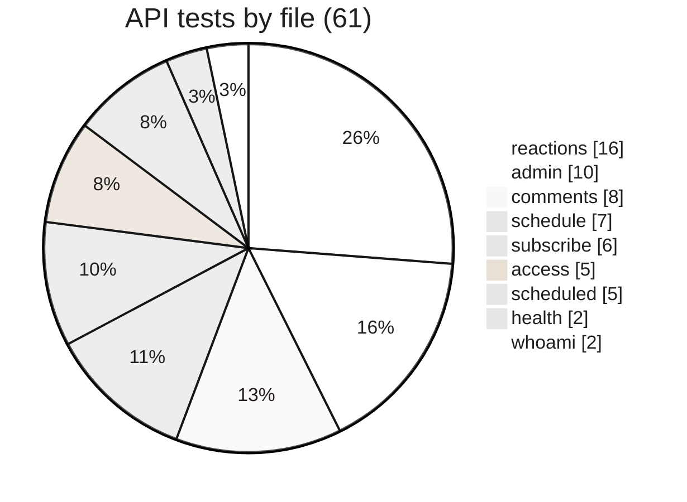

<sub>[Home](Home) › Security and development › Testing and quality</sub>

# Testing and quality

How changes are checked before and after they ship. The API Worker has a real test suite: 61 Vitest tests in 9 files, running inside workerd (the Workers runtime) against a local D1, with every outside service replaced by an injected stand-in. The static site has no automated tests; it is checked by building it, looking at it, and by the build itself failing on template errors. On 2026-11-09 all 61 tests and the TypeScript check pass, and the site builds cleanly.

> [!NOTE]
> **At a glance:**
> - `cd api && npm test`: 61 tests, 9 files, about 9 seconds; `npm run typecheck`: clean.
> - Tests never call Access, Turnstile, Resend or Workers AI; they inject fakes.
> - Site: `npm run build` must succeed (Eleventy writes 30 files, Pagefind indexes 18 pages); then a visual check.
> - No CI runs these automatically; run them before you open a pull request.


*Real counts of `it(...)` blocks in `api/test/`: the newest and most privacy-sensitive feature, reactions, has the most.*

## What the API tests cover

| File | Tests | Covers |
|---|---|---|
| **`reactions.test.ts`** | 16 | counts, invalid slugs, 400s, 503 without salt, the 10-per-day cap per slug and per IP, missing IP bucket, CORS preflight, purge of old days, and that no raw IP is stored anywhere |
| **`admin.test.ts`** | 10 | 403 without Access, compose page, queue with default and custom time, past-time rejection, list, preview, test send, 503 without key, unqueue |
| **`comments.test.ts`** | 8 | unverified store and magic link, Turnstile failure, verify and cookie, invalid token, session post, list with tombstones, clean pass, offline heuristics without AI |
| **`schedule.test.ts`** | 7 | Eastern to UTC in summer and winter, next Saturday 7pm, rollover after 7pm, `datetime-local` parsing, formatting |
| **`subscribe.test.ts`** | 6 | valid sign-up, invalid email, Turnstile failure, idempotent re-subscribe, CORS preflight, unsubscribe deletes the row |
| **`access.test.ts`** | 5 | valid token, wrong audience, expired, forged signature, missing email claim |
| **`scheduled.test.ts`** | 5 | skip without key, nothing due, sends only the due issue with per-recipient unsubscribe links, no double send on a second tick, zero subscribers |
| **`health.test.ts`** | 2 | `/health` shape, 404 for unknown routes |
| **`whoami.test.ts`** | 2 | 403 without identity, email and `db: ok` with one |

The Vitest config uses the v4 plugin API: `cloudflareTest({ wrangler: { configPath: './wrangler.jsonc' } })` composed with `defineConfig` from `vitest/config`. Types for `cloudflare:test` come from the package's `./types` entry, referenced in `api/test/env.d.ts`. Miniflare prints a warning that AI bindings access remote resources; it is harmless, because the tests build their own env without `AI`.

## Running the checks

```bash
# API
cd api
npm ci
npm test            # vitest run
npm run typecheck   # tsc --noEmit

# Site
cd ..
npm ci
npm run build       # eleventy && pagefind --site _site
npm run serve       # look at it
```

## Checking the site by eye

Before merging a site change, look at: the home page (featured post, 3-up grid), one post (hero, byline, author card, More reading, comments and appreciate load), a category page, the archive (search returns results), About, and `/namaz/`. Do it in light and dark mode and at a phone width. For SEO changes, view source and check the canonical, `og:image` dimensions and the JSON-LD.

## Quality history

- **Parity gate (v3.0.0):** before the Eleventy cut-over, a one-time script compared 27 generated pages with the hand-built ones, down to attribute order, and passed 27 of 27, after fixing five real bugs it found. The script was deleted once its job was done.
- **Editorial audits (v2.13.0, v2.14.0):** every post re-checked for artifacts, emphasis and em dashes.
- **Dependency audit (#45):** `npm audit fix` in `api/` brought the dev toolchain to zero advisories.

## Related pages
- [Local development](Local-Development): getting set up to run these.
- [GitHub Actions](GitHub-Actions): adding them to CI.
- [API reference](API-Reference): the behaviour under test.
- [Data quality and processing](Data-Quality-and-Processing): the rules these tests pin.

Last checked: 2026-11-09

<details><summary>Sources in the repo</summary>

- `api/test/*.test.ts`, `api/test/env.d.ts`, `api/vitest.config.ts`, `api/package.json`
- `package.json`, `CHANGELOG.md` (v3.0.0)
- local run on 2026-11-09: 9 files, 61 tests passed; `tsc --noEmit` clean; Eleventy wrote 30 files
</details>
