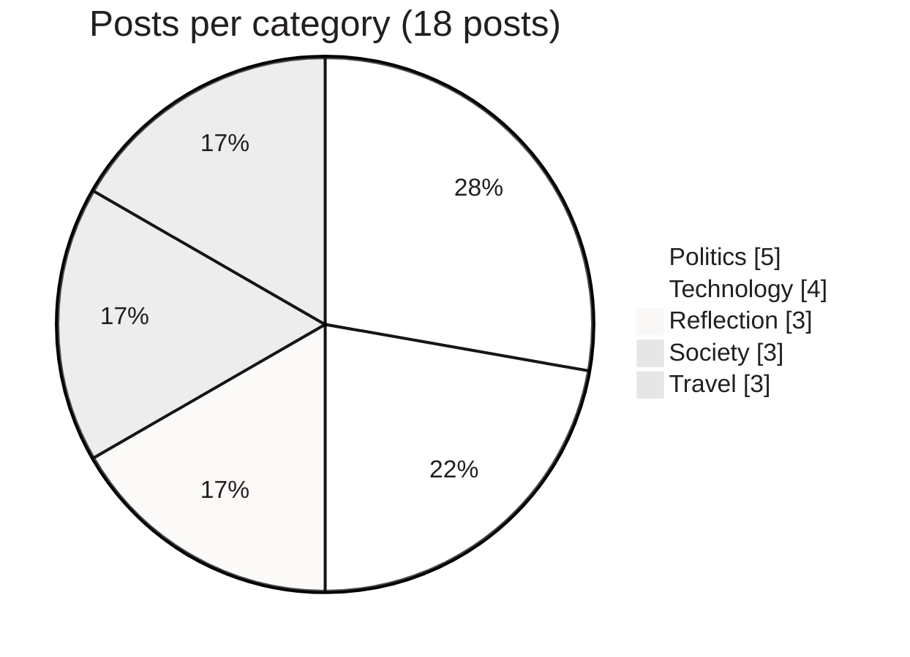
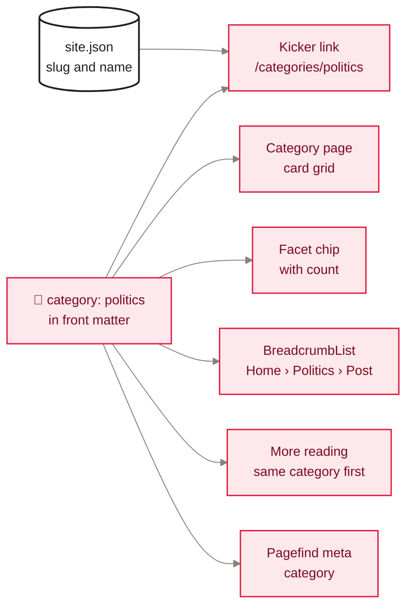

[Home](Home) › Business and product › The five categories

# The five categories

Every essay belongs to exactly one of five categories: Reflection, Society, Politics, Technology and Travel. The taxonomy was chosen in the May 2026 redesign from a survey of the sixteen posts that existed then, and it has not changed since. Categories drive the kicker above every title, the category pages, the facet chips, the breadcrumb in structured data and the related-posts strip.

> [!NOTE]
> **At a glance:**
> - Five categories, defined once in `src/_data/site.json` (`slug` and display `name`).
> - A post sets `category:` to one slug; everything else is generated.
> - Counts on 2026-11-09: Reflection 3, Society 3, Politics 5, Technology 4, Travel 3 (18 in all).
> - Adding a category is a deliberate decision, not a casual edit: see below.

*Real counts from the `category:` front matter of every file in `src/content/posts/`.*

## The categories

| Category | Slug | Posts | What belongs here |
|---|---|---|---|
| **Reflection** | `reflection` | 3 | Personal essays on character, endurance and lives well lived: integrity and empathy, Ratan Tata, unfinished work |
| **Society** | `society` | 3 | How we live together: economic data versus real life, education for every child, the 1947 partition |
| **Politics** | `politics` | 5 | Elections and leadership in the United States and Canada, seen from north of the border |
| **Technology** | `technology` | 4 | Apple Intelligence and Siri across three essays, and building software with AI |
| **Travel** | `travel` | 3 | Winter in Toronto, an electric road trip across Canada, stories from beyond borders |

## Where a category shows up

*Read left to right: one front-matter value plus the shared list in `site.json` feeds six places on the site.*

- **Kicker:** `<a class="kicker" href="/categories/<slug>">` above every title, on home, category pages and posts. Always absolute and extension-less.
- **Category page:** `src/content/categories.njk` paginates over `site.categories`, writing `categories/<slug>.html` with a 2-up card grid.
- **Facets:** `src/_includes/facets.njk` renders a chip per category with its live count, plus period chips for the years that category has posts in.
- **Structured data:** posts carry `articleSection` and a `BreadcrumbList` (see [SEO and discoverability](SEO-and-Discoverability)).
- **Related posts:** the `relatedPosts` filter prefers the same category.
- **Search:** posts carry `data-pagefind-meta="category:..."`.

## Adding or renaming a category

> [!IMPORTANT]
> Renaming a slug changes public URLs (`/categories/<slug>`) and every post that uses it. Add a new slug rather than renaming an existing one, unless you also add a redirect.

1. Add `{ "slug": "...", "name": "..." }` to `categories` in `src/_data/site.json`.
2. Set `category:` on the posts that belong there.
3. `npm run build`. The category page, chips, counts and sitemap entry appear automatically.

## Related pages
- [Post catalogue](Post-Catalog): every post with its category.
- [Content and editorial](Content-and-Editorial): writing rules for every category.
- [Data model](Data-Model): `site.json` and front matter fields.
- [Decisions log](Decisions-Log): why five, and why these.

Last checked: 2026-11-09

Sources in the repo

- `src/_data/site.json`, `src/content/categories.njk`, `src/_includes/facets.njk`
- `src/_layouts/post.njk`, `eleventy/filters.mjs` (`byCategory`, `categoryName`, `relatedPosts`)
- `docs/superpowers/specs/2026-05-27-website-redesign-design.md`

