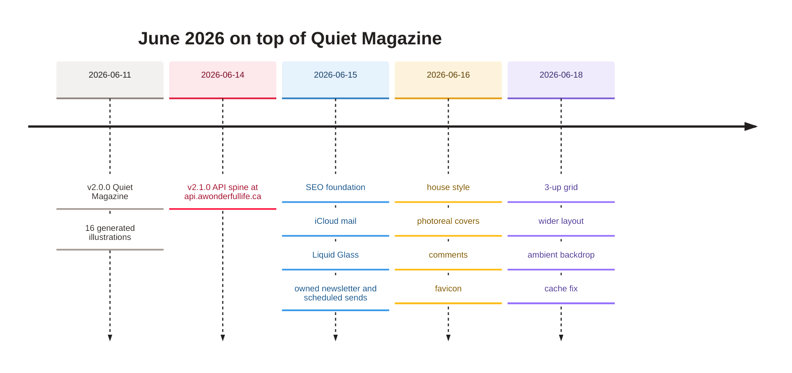

[Home](Home) › Business and product › The June 2026 redesign

# The June 2026 redesign

The "Quiet Magazine" redesign, released as `v2.0.0` on 2026-06-11 (PR #2), gave the blog the page structure it still has: a featured opener and illustrated card grid on the home page, card grids on category pages, display-scale titles, breakout heroes, reading times and prev/next links on posts. It also replaced the sixteen stand-in images with a single generated illustration series. The rest of June then layered on glass, comments, an owned newsletter and, at the end, photoreal covers.

> [!NOTE]
> **At a glance:**
> - Home: featured opener plus card grid (2-up then; 3-up since v2.16.5).
> - Posts: display title, breakout hero, `N MIN READ`, prev and next.
> - Images: 16 flat editorial illustrations (terracotta, slate blue, cream) from Cloudflare Workers AI, 1.5 MB in all.
> - The illustrations were themselves replaced by photoreal covers within a week (v2.12.1, v2.14.0).

*Read top to bottom: the redesign on the 11th, then a week of features that turned the blog into a small platform.*

## What changed

| Area | Before (May) | After (June 11) |
|---|---|---|
| **Home** | thumbnail list of every post | featured opener (newest post) and a 2-column illustrated card grid |
| **Category pages** | compact lists | illustrated card grids, facets kept |
| **Post title** | fixed `2.25rem` | `clamp(2.2rem, 5vw, 3.2rem)` |
| **Hero** | inside the text column | breakout beyond the column with a `--breakout` clamp |
| **Byline** | date only | `· N MIN READ` (words divided by 200) |
| **Navigation** | none | prev and next at the foot of each post |
| **About photo** | round | square editorial frame |
| **Stylesheet** | about 421 lines | about 480 lines (today about 1,100) |

## The illustration series

The images were produced with `docs/superpowers/tools/gen-hero.sh`, which calls a Cloudflare Workers AI image model with a fixed style prompt: flat editorial illustration, paper-grain texture, terracotta, slate blue and cream, no text. Every image was viewed and several were regenerated for style or cohesion; posts about real people used symbolic scenes rather than likenesses. Seeds, prompts and alt texts were recorded in `docs/superpowers/specs/2026-06-11-image-manifest.md`. The India and Pakistan image, rated weakest for cohesion, was regenerated in v2.1.1.

Within days the owner preferred photoreal covers: five in v2.12.1, the rest in v2.14.0, nine of them "composed" with the title in the image. The manifest was rewritten for the new series. See [Hero photography](Hero-Photography).

## How it was built

The work followed the project's brainstorm, spec, plan, execute method: a spec (`docs/superpowers/specs/2026-06-11-quiet-magazine-redesign-design.md`), a 13-task plan (`docs/superpowers/plans/2026-06-11-quiet-magazine-redesign.md`), and task-by-task execution with review between tasks. Three spec items were consciously dropped and recorded in the ROADMAP: Manrope 800 was never loaded, the background stayed pure white, and the 68-character measure was not adopted at the time (the column was narrowed later, in v2.15.0).

## Related pages
- [The May 2026 redesign](The-May-2026-Redesign): the foundation this built on.
- [Design system](Design-System): the design today.
- [Hero photography](Hero-Photography): the image series since.
- [Release history](Release-History): every June release.
- [Decisions log](Decisions-Log): why illustration, then photography.

Last checked: 2026-11-09

Sources in the repo

- `docs/superpowers/specs/2026-06-11-quiet-magazine-redesign-design.md`, `docs/superpowers/plans/2026-06-11-quiet-magazine-redesign.md`
- `docs/superpowers/specs/2026-06-11-image-manifest.md`, `docs/superpowers/tools/gen-hero.sh`
- `CHANGELOG.md` (v2.0.0 to v2.17.2), `ROADMAP.md` (Accepted deviations)

