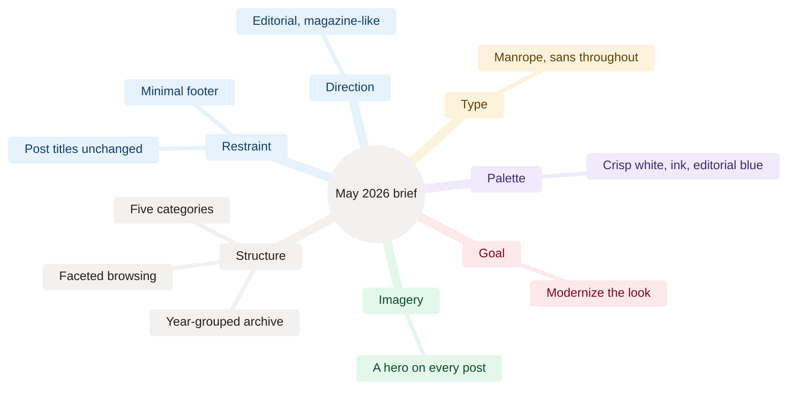

[Home](Home) › Business and product › The May 2026 redesign

# The May 2026 redesign

How the blog got its editorial identity. On 2026-05-27 and 2026-05-28 a generic, WordPress-exported blog was redesigned into a typography-led editorial site: Manrope throughout, white and ink with an editorial blue, a hero image on every post, five categories with faceted browsing, and a year-grouped archive. It was also the day the site moved onto Cloudflare Workers. This page is the history; the current design is in [Design system](Design-System).

> [!NOTE]
> **At a glance:**
> - Started from `7b3eab3` "Initial Load" (2026-05-25): five posts on the home page, no categories, WordPress artifacts in every post body.
> - Decided in a structured brainstorm, written up as a spec, built from a 12-task plan: 17 commits to `main` on 2026-05-27.
> - Released as `v1.0.0` on 2026-05-28 with a documentation set (README, CLAUDE.md, CHANGELOG, ROADMAP) and the first 12-page wiki.
> - Much of the page structure was later superseded by June's Quiet Magazine redesign; the identity stayed.

## The decisions

*Read outward: each branch is one question from the brainstorm and the answer that was locked into the spec.*

The owner named a reference typeface; Manrope was chosen as its closest free match. Twelve questions were answered one at a time and frozen in `docs/superpowers/specs/2026-05-27-website-redesign-design.md` before any code was written; the build followed `docs/superpowers/plans/2026-05-27-website-redesign.md`.

## What was built

| Area | Change |
|---|---|
| **Stylesheet** | rewritten around tokens on `:root`; Manrope; 800px container (from 680px) |
| **Home** | every post as a thumbnail row (was five posts) |
| **Archive** | year-grouped compact list with a facet strip (category pills, period chips) |
| **Categories** | five new pages: Reflection, Society, Politics, Technology, Travel |
| **Posts** | kicker, uppercase byline and a hero slot on all 16 posts; kickers link to categories |
| **Images** | 16 deterministic stand-in images seeded by slug (placeholders) |
| **Bodies** | WordPress artifacts removed: stray closing heading tags at every paragraph, raw Markdown emphasis; a scorecard rebuilt as a real table; a couplet made a blockquote |

## Infrastructure on the same days

- **Cloudflare Workers.** PR #1 (2026-05-27) added `wrangler.jsonc` and served the repository root as static assets.
- **The `.git` exposure.** That first deploy also served `.git/` and the docs. `.assetsignore` closed it the same day. (Since v3.0.0 only `_site/` is served.)
- **`www`.** It returned 522 because of a stale CNAME; the record was removed and `www` added as a second custom domain (2026-05-28). A 301 to the apex followed on 2026-06-20.

## What it left for later, and what happened

| Deferred item | Outcome |
|---|---|
| **Curated hero images** | generated illustrations in v2.0.0, photoreal covers in v2.14.0 |
| **Alt text that restates titles** | rewritten in v2.0.0 and again in v2.14.0 |
| **`www` to apex redirect** | Redirect Rule, 2026-06-20 |
| **Email on the domain** | iCloud+ in v2.3.0 |
| **`.html` in internal links** | clean URLs in v2.15.0, generated everywhere since v3.0.0 |

## Related pages
- [The June 2026 redesign](The-June-2026-Redesign): the next step.
- [Design system](Design-System): the design as it is today.
- [Decisions log](Decisions-Log): the reasoning in brief.
- [AI-assisted development](AI-Assisted-Development): the brainstorm, spec, plan, execute method used here.
- [Release history](Release-History): `v1.0.0` and what came before.

Last checked: 2026-11-09

Sources in the repo

- `docs/superpowers/specs/2026-05-27-website-redesign-design.md`, `docs/superpowers/plans/2026-05-27-website-redesign.md`
- `CHANGELOG.md` (2026-05-27, v1.0.0, Earlier)
- git: `7b3eab3` to `e5349e7`

